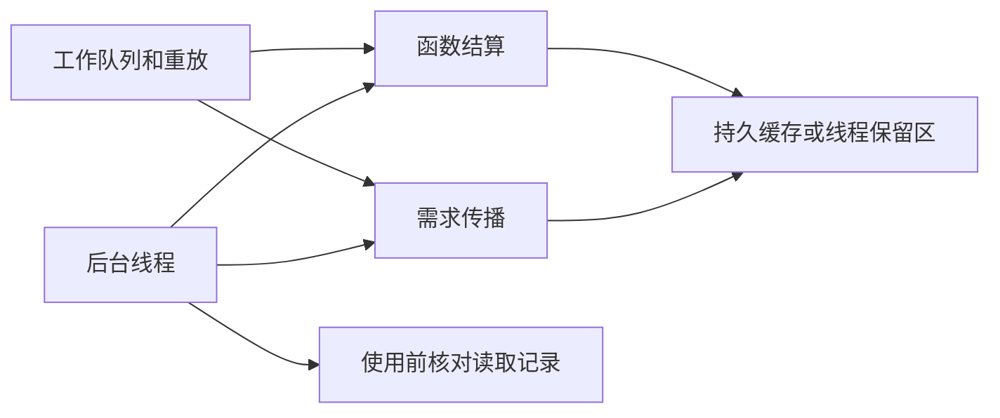
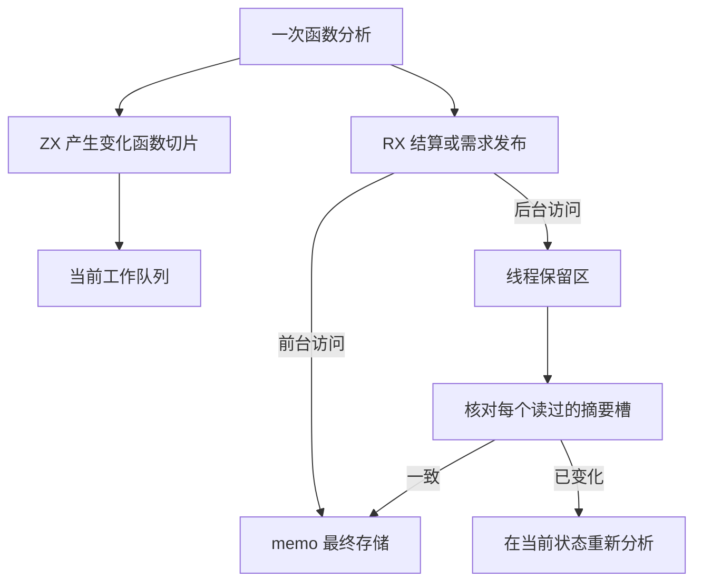

# 唯一性函数分析结果发布自举

## Intent · 目标

把函数所有权分析的结果直接写到消费方指定的内存。正常分析、后台预计算和增量重放使用同一份结果，避免每次访问函数都重建临时列表。

## Data · 现有实现

入口是 genz 的唯一性工作队列。函数结算得到传入各被调用函数的保证、返回保证和变化通知，需求传播得到标记与变化通知。两条路径都可能记录后台线程读过的摘要，在真正使用结果前重新核对。宿主逐行转换这些列表，随后工作线程或缓存再次复制。

## Edges · 边界

保留函数和槽的宽度、记录顺序、摘要写入时机及只读共享。每个阶段有独立的临时内存，后台结果跨越临时内存重置时必须独立保存。种子引导器继续使用原有结果语义。

## Answer · 验收

用同一工具链和源码清单比对生成结果、缓存载荷及编辑后恢复。运行现有函数分析、缓存和所有权回归，测量固定清单生成的时间和峰值。

### 正式路径

- 从 `function_analysis` 追到函数结算、需求传播、工作线程取用结果和增量重放，共核查 15 个原始 Zig 文件、2,994 行。直接分析在 memo 的 arena 中发布结果，预计算在线程的保留区中发布。只有预计算结果被采纳时，才将其中需要跨线程保留区存活的记录复制给 memo。
- 变化的函数编号由 ZX 直接产生工作队列所需的 `u64[]`。前台直接消费分析临时区的切片，后台只保留核验和重放需要的数据。函数输入保证、返回保证、需求标记和读取日志由 RX 编排发布到最终存储。两阶段的后台需求检查保留先后两组读取，包括同一槽位的重复观测。
- 传入保证的逻辑值和后台已保留的记录使用同一个 ZX 行写入函数。生成器为工作中的对象列表产生指针数组，已保留的 Zig 记录则连续存放。实测将二者改成同一个会逃逸的输入类型后，生成的入口要求每项为指针，无法直接借用连续存储。因此保留两种输入视图，两个入口都无需逐行装箱。读取日志的核验改用连续记录视图，移除了字节偏移、步幅和端序参数。
- 本批仍保留 Zig 中的工作队列主循环、线程调度、哈希表插入和原生描述符绑定。种子路径保留其原有的遍历，正式 Source 路径执行本批发布规则。

### 行为验收

两版 Source 引导器对相同的 771 个入口和 5,532 个模块冷生成。除环境输入戳外，13,111 个文件逐字节相同，14,277,509 字节的 v18 唯一性缓存载荷也相同，SHA-256 为 `9f03d9b99a4869bd92ae89bbb353350be98b973f64fb5db117796b94e0381fab`。缓存比较使用两份空缓存，以消除不同加载历史对哈希表遍历顺序的影响。

379 模块常驻工程首次生成、修改 ZX 函数正文、修改 RX 和恢复原源码后，分别与同一输入的 709 个冷生成 Zig 文件逐字节相同。修改 ZX 正文复用 376 个模块，只重写一个函数文件。无效依赖正常报告失败，修复后恢复了初始输出，无改动请求直接返回。

函数分析、模块生成、缓存所有权和字段事实的现有回归共通过 249 项。本批改动的 19 个 RX/ZX 文件全部通过格式和 lint 检查。上一批 Source 引导器 `c3fba4e78` 生成本批 ReleaseSmall 引导器，执行时均使用 Source 分析和生成实现。单独从初始种子构建解析器的 29 项步骤也全部通过。

### 性能与源码规模

固定 735 个入口和 16 个分区，两版交错各跑三轮，取中位数。两版冷生成的 11,758 个文件逐字节一致。热缓存重建输出也与各自冷生成一致。两版 14,098,494 字节的 v18 缓存载荷逐字节相同，SHA-256 为 `76562648064cc2080c35869617027c250fbb139033441baa15a9f10bf6a3ef94`。

| 源码生成场景         | 上一版同机实测 |     本版 | 本版相对固定基线 |
| -------------------- | -------------: | -------: | ---------------: |
| 冷生成墙钟           |         2.59 s |   2.57 s |          −0.28 s |
| 冷生成 CPU           |        12.22 s |  12.19 s |          −0.39 s |
| 冷生成进程树采样峰值 |       719.2 MB | 717.0 MB |        −176.0 MB |
| 冷生成单进程系统峰值 |       775.0 MB | 766.9 MB |        −172.8 MB |
| 热生成墙钟           |         1.98 s |   2.00 s |          −0.25 s |
| 热生成 CPU           |         8.18 s |   8.32 s |          −0.29 s |
| 无改动墙钟           |         0.03 s |   0.03 s |                — |

本次计时覆盖受改动影响的分析与 Zig 源码生成。热生成比同机上一版多用 0.02 秒墙钟和 0.14 秒 CPU，两项仍低于固定基线。本次未计时包含 LLVM 和链接的完整冷构建。

本批 RX 新增 63 行，ZX 新增 293 行、删除 66 行，合计净增 290 行。手写 Zig 含构建登记新增 223 行、删除 185 行，净增 38 行，主要用于保留种子路径、对接结果切片和描述目标内存。按生产目录 `packages/*/src` 统计，RX 有 732 个文件、24,401 行，ZX 有 5,100 个文件、262,183 行。排除根目录 `docs/` 后，全仓 RX 有 937 个文件、26,687 行，ZX 有 6,526 个文件、286,453 行。均按物理行数计算，含注释、空行和末尾没有换行符的行。
