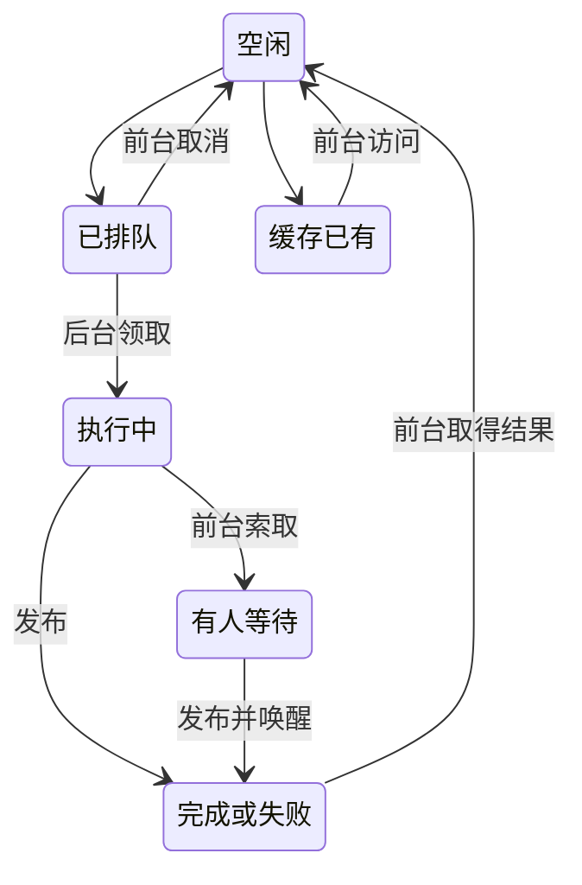

# 唯一性后台任务调度自举

## Intent · 目标

让函数结算、需求传播和计划发布共用 ZX 实现的预计算状态机。主线程仍按原来的顺序访问函数，只有通过读取记录核对的后台结果才能进入正式分析。

## Data · 调用关系

上一批已把队列填充、失效通知和增量重放迁入 Source。剩余三个阶段都经过 `ahead.zig`。其中后台任务的选择、领取、取消、等待和完成均由 Zig 决定。计划发布还维护了另一份函数遍历顺序，与队列重复。

## Edges · 并发生命周期

复用队列和递归标记的底层存储。结果先写入相应线程保留区，再以 release 发布；读者通过 acquire 取得结果。只有主线程改变失效标记。阶段结束先排空线程池，再重用结果区和状态表。缓存查询、线程创建、操作系统等待和分配仍有原生边界。

## Answer · 验收

用上阶段 Source 引导器生成本批工具，核对既有所有权回归、正式清单生成结果和冷暖缓存。在固定源码清单上配对测量墙钟、CPU 和峰值内存，单列仍由 Zig 执行的工作。

### 正式入口与迁移范围

从函数所有权分析入口沿结算、需求、计划、队列、缓存及线程池核查了上一提交的 11 个 Zig 文件，共 3,395 行。本批迁出了后台任务的选择和同步。队列的预读范围在 ZX 中按每个后台线程 16 个函数计算。调度器直接借用调用图中的递归标记，准备函数时不用把标记逐项抄进分析单元。最终计划按同一工作队列给出的函数编号发布，外部函数的计划保持为空。

状态字和结果各有独立存储。后台先领取排队任务，写好结果再发布；前台在同一状态字上取消尚未领取的任务，或等后台发布后取得结果。队列已满时，旧的环形队列记录仍可能领走刚登记的同一个函数。旧实现此时无条件写回空闲，新实现用比较交换撤回自己的排队状态。这一修正来自对并发交错的检查。

ZX 通过内部 memory 的 32 位原子读写、比较交换、交换、等待和唤醒访问已有状态表。四个正式入口传递的是借用切片和标量，调用处提供容量为零的分配器。单线程分析直接在前台执行。线程创建、环形队列、缓存散列表、具体函数分析的宿主调用及整轮队列驱动仍有手写 Zig；种子保留独立调度实现。

### 正确性证据

用上一批已验收的 Source 工具（源码提交 `812b6a4b4`）生成本批 ReleaseSmall 工具。初始种子生成解析器通过 29 步，Source 构建工具和解析器通过 38 步。两个 Source 工具在空缓存下处理同一份 777 个入口、5,547 个模块的正式清单，排除环境输入戳后，13,168 个文件逐字节一致。双方 v18 所有权缓存载荷都是 14,282,682 字节，SHA-256 为 `a82e1203621255fd4274ad909b75e426a89e57865cd65a3a484eabb02e2803d2`。

在现有 379 模块工程上，常驻生成器经过 ZX 正文修改、增删被调函数、RX 修改、无效依赖及恢复。每个成功状态的 709 个文件都与对应的冷生成一致。在保持模块依赖和函数数目不变的调用关系编辑中，每次只重析 3 个模块，复用其余 376 个。

现有函数分析、模块生成、缓存所有权和字段事实四组合计通过 249 项回归。6 个新增 ZX 文件和改动的内部声明通过 lint。正式清单覆盖并发生成与结果消费，满环撤回的罕见时序没有单独复现。

### 性能与规模

两版均使用 Source 分析和生成，固定 735 个入口、16 个分区，交错各跑三轮，取中位数。热生成保留编译缓存并重新写出，冷生成使用空缓存。两版的 11,758 个生成文件逐字节一致，14,098,494 字节的 v18 缓存载荷也一致。本次测量覆盖分析及 Zig 源码生成，不含后续 LLVM 编译和链接。

| 指标                 |   上一版 |     本批 | 本批相对固定基线 |
| -------------------- | -------: | -------: | ---------------: |
| 冷生成墙钟           |   2.58 s |   2.59 s |          −0.26 s |
| 冷生成 CPU           |  12.28 s |  12.24 s |          −0.34 s |
| 冷生成进程树采样峰值 | 710.0 MB | 710.4 MB |        −182.6 MB |
| 冷生成单进程系统峰值 | 796.3 MB | 769.7 MB |        −170.0 MB |
| 热生成墙钟           |   2.01 s |   1.98 s |          −0.27 s |
| 热生成 CPU           |   8.27 s |   8.26 s |          −0.35 s |
| 无修改墙钟           |   0.03 s |   0.04 s |                — |

冷生成系统峰值的三次取值，上一版为 749.9～833.2 MB，本批为 728.9～822.7 MB。进程树采样峰值中位数增加 0.4 MB。常驻请求同样交错各跑三轮，只改正文、增加调用边、恢复调用边的墙钟中位数分别从 88.50、147.04、109.47 毫秒变为 87.84、147.30、110.65 毫秒。

生产 ZX 新增 204 行，内部 memory 声明另增 40 行。手写 Zig 含种子、通用原子访问、宿主适配及构建登记，新增 219 行、删除 96 行，净增 123 行。正式预计算的选择、领取、等待、撤回与发布现由 ZX 执行。通用内存原语只有边界检查、原子访问和系统调用，未增加新的专用运行库。
