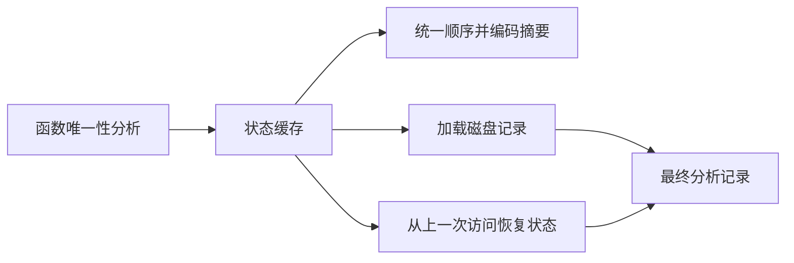
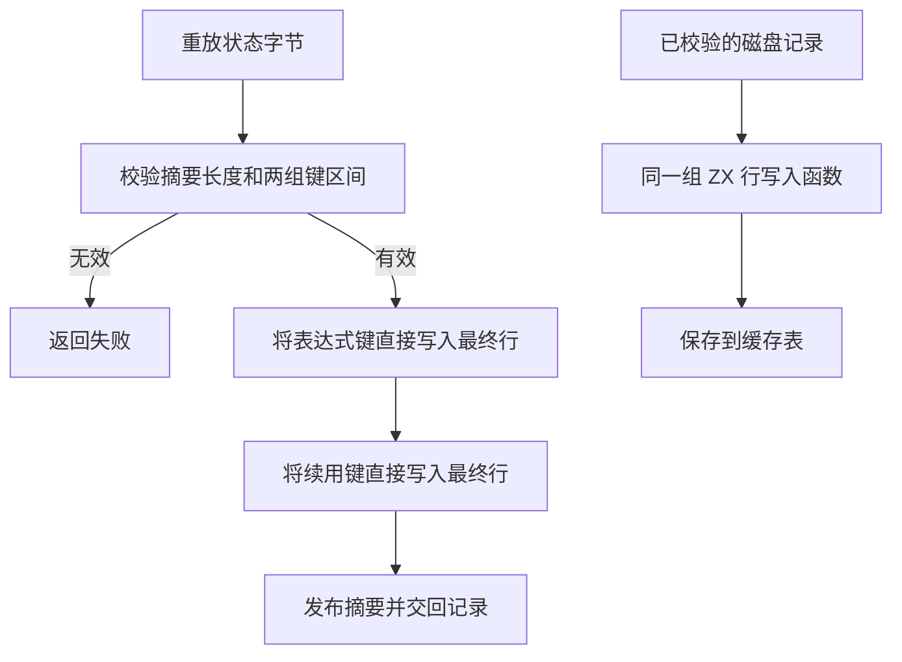

# 唯一性缓存键与恢复自举

## Intent · 目标

将唯一性分析在缓存键、磁盘加载和增量重放之间转换记录的逻辑迁入 RX/ZX。相同函数和分析状态继续得到相同的摘要与执行计划。

## Data · 现有实现

genz 的函数分析从唯一性工作队列访问 memo。每次查询，宿主先将不同宽度的键逐项转换为临时行，编码器再对行排序。恢复时 ZX 构造两组键数组、两组级别数组，Zig 再逐项写入最终行。磁盘加载另外使用一套已有的 ZX 行解码规则。

## Edges · 边界

保留原始记录的顺序、32 位表达式键和 64 位续用键。写出 v18 文件、重放键和旧版本读取互相兼容。磁盘输入先完成全部校验，失败不得写入摘要。恢复状态的两个结果数组成功分配后才发布。记录磁盘 I/O、哈希表与原生行布局剩余的职责。

## Answer · 验收

两代引导器对同一批入口比对全部产物。用现有函数分析、增量生成、缓存和所有权用例检查正式入口，比较固定 735 入口的冷、热生成、峰值内存和完整缓存文件。单独核对常驻编译器在正文编辑后与冷构建一致。

### 已迁移的职责

- 函数需求分析、磁盘加载和增量重放共用一份增长记录的输出类型。ZX 根据实际记录数分配最终行，直接写入键和唯一性级别。恢复路径删除了四个临时数组、两次 Zig 逐行转换以及单独的临时 arena。
- 恢复入口先校验函数、调用方摘要、键宽、级别及结尾。成功后写两组增长记录，最后发布摘要。磁盘加载的入口则复用文件整体校验结果，将记录解码到属于缓存的内存。输入缓冲区可在加载结束后释放。
- 键编码读取原有 32 位和 64 位记录，并与重放比较共用两种按键排序的实现。空数组和单元素数组直接借用，多元素在可复用的工作区中排序，避免改动分析保存的顺序。Zig 中将所有键转换为 64 位临时记录的两个循环退出正式路径。
- 校验区间只需要起点、数量和末尾偏移。最初将两个区间对象嵌进返回值时，生成的 Zig 要在堆上构造区间。改为在恢复结果里直接记录标量后，小清单中两个区间计算函数的三个对象分配位置均已消失。

正式调用链及相邻读写、重放与快照的 14 个原始 Zig 文件合计 2,253 行。仍由 Zig 持有四张摘要哈希表、工作队列、磁盘记录枚举、摘要散列工作区和实际行布局。这 2,253 行只用于划定核查范围。

### 正确性与兼容性

上一批 Source 引导器为 `d8e387a80`，由它生成本批 ReleaseSmall 引导器，编译和运行均启用正式 Source 分析及生成路径。上一版和本版分别用全新的函数缓存生成当前 769 个入口、5,521 个模块，排除环境输入戳后 13,089 个文件逐字节一致。两版生成的完整 v18 唯一性缓存载荷均为 14,273,920 字节，SHA-256 为 `ce6ccea41130722724936f0b994b282a13d6c915b00c0a1b3b81c77476201918`。

函数分析、模块生成、缓存所有权和字段事实四组回归合计通过 249 项。区间返回改为标量之后，复验了其中直接受影响的模块生成和缓存所有权两组，173 项全部通过。379 模块的常驻编译器在首次生成、修改 ZX 正文、修改 RX 和恢复源码四个状态下，各有 709 个 Zig 文件与相同输入的冷生成一致。缺失依赖按预期失败，恢复后无改动请求无需生成。生成产物对照和常驻编辑均使用最终引导器。

### 性能与源码规模

使用固定 735 入口、16 个分区，上一版与本版交错运行三轮，取中位数。冷生成使用空的生成目录与函数缓存，热生成保留函数缓存并重建输出。两版生成的 11,758 个文件以及整个 v18 缓存载荷逐字节一致。以下为分析和 Zig 源码生成，本批未重测含 LLVM 的完整冷构建。

| 场景                 |   上一版 |     本版 | 相对固定基线 |
| -------------------- | -------: | -------: | -----------: |
| 冷生成墙钟           |   2.58 s |   2.52 s |      −0.33 s |
| 冷生成 CPU           |  12.23 s |  12.17 s |      −0.41 s |
| 冷生成进程树采样峰值 | 717.9 MB | 718.9 MB |    −174.1 MB |
| 冷生成单进程系统峰值 | 749.1 MB | 749.3 MB |    −190.4 MB |
| 热生成墙钟           |   1.98 s |   1.98 s |      −0.27 s |
| 热生成 CPU           |   8.22 s |   8.23 s |      −0.38 s |
| 无改动墙钟           |   0.04 s |   0.04 s |            — |

本批生产 RX/ZX 新增 427 行、移除 321 行，净增 106 行。手写 Zig 含构建登记新增 117 行、移除 148 行，净减 31 行。当前生产 RX 有 730 个文件、24,338 行，ZX 有 5,091 个文件、261,956 行，合计 286,294 行。排除根目录 `docs/` 后，全仓 RX 有 935 个文件、26,624 行，ZX 有 6,517 个文件、286,226 行。统计按换行符划分，包含空行、注释及无换行符的末行。源码行数不能直接换算成自举完成率。
