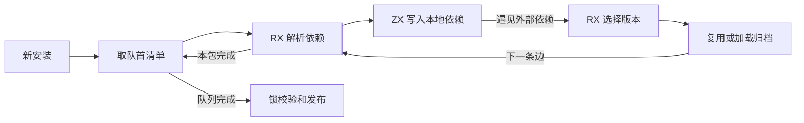
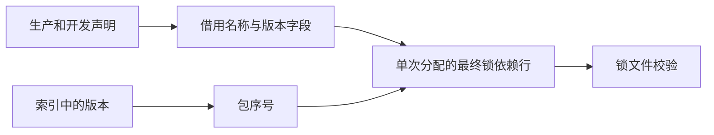

# 安装器依赖解析自举

## Intent · 目标

从 `zxc pkg install` 新建锁文件的路径迁出生产与开发依赖遍历、工作区目标选择、归档版本选择、边数限制及锁依赖行的构造。保留原有的广度优先包顺序和首个错误。

## Data · 依据

起点为 `ae86958dd`。`install/resolve.zig` 原来逐包建立临时边列表，逐条调用工作区选择或索引选择，并在遇到新归档时同步读取其清单。同一文件还持有磁盘路径、已加载归档和等待展开的包。

## Edges · 边界

归档的下载、收据校验、文件读取和真实路径仍走现有平台入口。需先完成前一个归档的读取，再检查同一清单中后面的依赖。归档的开发依赖不写入锁文件。超过全局边数上限时保留之前各条依赖的错误优先级。

## Answer · 调用和数据流

### 正式入口的变化

- RX 的 `install/advance` 先执行清单扫描，遇到外部依赖时调用已有注册表版本选择流程。ZX 把本地选择结果写入最终的锁依赖行。遇到第一个外部依赖便停下来，加载完成后由调用方写入目标序号，随后从下一条边继续。加载失败时游标仍指向当前依赖。
- 图显示和安装共用名称、别名、版本范围的解析。图显示沿用主机路径，安装保留锁文件要求的相对路径校验，两者均借用原声明字符串。
- `install/archive/plan` 依据已登记包的摘要查找归档，检查命中项的名字与版本，在新包分支检查数量上限并选择本地路径或远程 URL。首次登记前仍读取清单，名字和版本通过后再检查是否带有工作区声明。下载入口与解析入口使用同一传输方式判定。
- 索引只收录已经写进包队列的记录，增长时对已登记摘要重建表。临时查找使用栈上的小写摘要，命中时复用已有锁包；新包的摘要已是小写时直接借用注册表字符串。省去了先前每次命中都复制摘要的开销。
- 工作区清单直接从发现结果借用，额外发现的归档只保留其依赖声明切片。每个包的锁依赖行一次分配，名称和要求字符串都指向清单原文。
- Zig 仍负责外层包队列、归档下载与磁盘准备、真实路径、锁文件序列化和发布。对原生列和切片的借用通过生成 ABI 接入。

### 定向验证

Source 自编译引导器与上一引导阶段均生成 150 个可对照文件，内容逐字节一致。初始 Zig seed 和 Source 分别编译执行同一组状态与所有权检查。

- 混合本地、外部依赖只提供恰好容纳两个锁依赖行的缓冲区即可完成。名称和版本要求的指针与原声明一致，重取未确认的归档请求不会再次分配或跳过该行。
- 校验边数上限处的错误优先级、归档引用本地包的错误，以及归档开发依赖的排除。
- 连续登记 240 个归档，验证 720 次已有包查询，覆盖扩容、碰撞、非零工作区偏移、同摘要异名、未登记归档重试与目标行一致性。32 位 Windows 目标通过编译检查，运行验证使用 macOS arm64。
- 新旧 CLI 的 10 组失败用例逐字节对照退出状态和错误消息，均未发布锁文件。包含摘要大小写不同但指向同一归档、版本范围错误早于缺包、文件不存在与后续声明错误的先后，以及身份不符与归档工作区校验的先后。

### 归档索引的性能修正

在相同的 ReleaseSmall 可执行文件中，对原 Zig 哈希表和新的 Source 路径交替运行十轮，每个进程对 300 个包做 48,000 次请求。旧模式包含原来的小写摘要分配和命中身份检查，新模式包含栈上摘要规范化、索引和身份检查。两种模式都核对目标序号之和。

第一版 Source 使用字符串相等比较。48,000 次请求消耗 13.50 ms CPU，旧模式为 8.67 ms。macOS 采样在探测函数中的 `std.mem.eql` 观察到约 1,000 次栈顶命中。摘要改用标准库已有的 `bytes.equals` 比较借来的字节视图，消除了 ReleaseSmall 下逐字节比较长摘要的开销。

| 摘要分布                 |  墙钟，旧 → 新 |   CPU，旧 → 新 |       峰值 RSS，旧 → 新 |
| ------------------------ | -------------: | -------------: | ----------------------: |
| 有共同前缀的十六进制编码 | 9.56 → 3.31 ms | 8.90 → 2.67 ms | 5,046,272 → 1,916,928 B |
| 对各包名计算真实 SHA-256 | 9.30 → 3.11 ms | 8.74 → 2.57 ms | 5,029,888 → 1,916,928 B |

### 正式回归

清单、锁目标和安装联合回归通过 76/76 步、36/36 项 Zig 测试和 2,035/2,035 项 Node 测试。收紧游标确认、工作区清单借用和共用下载方式判定后，安装与 HTTP 下载回归通过 69/69 步、31/31 项 Node 测试。归档比较函数修正后，正式安装回归通过 63/63 步、14/14 项 Node 测试；上述 10 组失败场景也使用最终 CLI 再作对照。15 个修改的 RX/ZX 文件通过最终 CLI 的 lint 和格式核对。

### 新建锁文件的公开命令

每轮先移除测试工作区的锁文件，保留已准备的归档缓存，从 CLI 重新解析、验证并发布。三份 ReleaseSmall CLI 按轮次轮换执行顺序，各测 12 轮，比较标准输出、锁文件及磁盘安装映射的完整字节。CLI 由 Zig 构建，候选包解析和生成使用已经自编译的 Source 引导器。环境为 macOS arm64、Zig 0.17.0。

| 场景                | 指标              | 固定对照 `6e0cf529f` | 上阶段 `ae86958dd` |    本阶段 |
| ------------------- | ----------------- | -------------------: | -----------------: | --------: |
| 97 个工作区包       | 墙钟（ms）        |                7.916 |              7.993 |     7.728 |
| 97 个工作区包       | CPU（ms）         |                7.155 |              7.145 |     6.958 |
| 97 个工作区包       | 进程峰值 RSS（B） |            5,111,808 |          5,062,656 | 4,980,736 |
| 44 个包，含共享归档 | 墙钟（ms）        |                5.720 |              5.614 |     5.652 |
| 44 个包，含共享归档 | CPU（ms）         |                4.867 |              4.804 |     4.796 |
| 44 个包，含共享归档 | 进程峰值 RSS（B） |            5,128,192 |          5,070,848 | 5,144,576 |

44 包场景的峰值 RSS 较上阶段多 73,728 B。继续用相同两份 CLI 交错测量八轮，3 包时多 81,920 B，258 包时少 163,840 B，观测到的差额没有随包数递增。可执行文件的机器指令段增加 3,184 B；仅凭进程峰值无法精确拆出代码页和堆的各自占比。

本阶段 RX 增加 119 行，ZX 新增 480 行、移除 10 行；Zig 新增 217 行、移除 58 行，净增 159 行。新增 Zig 的主要用途是连接原生清单、注册表及最终锁行的借用视图，归档仍由宿主执行 I/O。包队列的外层推进和磁盘发布继续记作待迁移职责。
