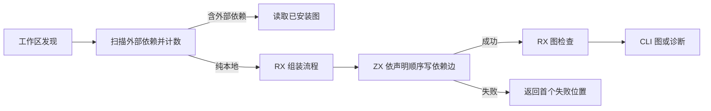

# 工作区依赖边组装自举

## Intent · 目标

让本地工作区的依赖组装及环检查从正式的 `zxc pkg graph` 进入 RX。迁出 Zig 中逐包逐边的遍历、重复名判断、路径和版本目标分派，保持包顺序、依赖顺序和首个诊断。

## Data · 依据

起点为 `301768932`。此前 `cli/src/package/graph.zig` 的 `resolve` 以两层列表遍历组装依赖，另在 `dependency` 中解析并选择目标。工作区发现、版本匹配、成员查询和图遍历已有各自的正式入口。

## Edges · 边界

磁盘发现、已安装依赖读取、宿主路径语义和 CLI 文本诊断保留原契约。工作区存在外部依赖时仍先走安装结果。纯本地路径使用宿主系统的路径解析，再按项目的斜杠表示比较。成员名借自原始清单，目标写入最终依赖数组。

## Answer · 结构与验收

### 调用链与成本

- `workspace/manifest/external.zx` 在原有外部依赖扫描中累计边数，按最大包度数预留哈希桶。外部依赖依然优先触发安装路径，即使前面的包另有本地声明错误。
- `workspace/edges/assemble.rx` 先组装边，再调用已有图检查。ZX 逐包按生产、开发的顺序检查名称和目标。此前的 Zig 三层遍历、逐边动态扩容和单独的 `dependency` 分派已退出正式路径。
- 依赖边一次分配，名称直接借自清单。哈希桶保存最终数组的行号，行号小于当前包起点时代表上个包留下的空位。各包共享一张表，无需逐包清空或复制名称。度数为零或一的包跳过去重索引。
- 宿主仍负责分配最终数组、把切片挂到包上、借出字段视图、文件系统与 CLI 诊断。平台路径操作保留 Zig 的标准路径解析；三个输入路径段直接传入，消除了早期候选为路径段数组分配的临时切片。临时解析结果在本次图组装结束后释放。安装器扩展归档队列和已安装图的物化仍在 Zig。
- 失败时保留已经完成的包，将当前及后续包的依赖恢复为空。访问当前边前先排除包级的环和深度错误。

### 定向验证

- 初始 seed 与 Source 引导器分别编译并运行相同的 390 组布局，覆盖同名依赖跨包复用、包内重复、生产与开发分界、写入顺序及名称指针身份。两个相邻 Source 引导器各生成 130 个对照文件，逐字节一致。另做了 32 位 Windows 目标的编译检查，执行用例运行在 macOS arm64。
- 13 组公开 CLI 对照检查了退出码、标准输出及错误输出，包含路径离开再进入工作区、别名、非法范围、版本不匹配、外部依赖与本地错误的先后、重复名和环。

### 宽依赖表

在同一 ReleaseSmall 程序中交替启动两个模式各五轮。旧模式复现 `301768932` 的逐名扫描、选择及图检查，沿用候选的成员选择入口；新模式调用正式组装入口。每行包含固定次数的完整组装，均为进程级中位数，包含启动和构造输入。每条边使用不同别名，指向同一个目标包，因而主要比较包内重复名检查。

| 每包依赖数 | 每轮次数 |    墙钟，旧 → 新 |     CPU，旧 → 新 |       峰值 RSS，旧 → 新 |
| ---------: | -------: | ---------------: | ---------------: | ----------------------: |
|        256 |       30 |  30.79 → 2.05 ms |  30.19 → 1.50 ms | 1,949,696 → 1,949,696 B |
|      1,024 |        3 |  45.10 → 1.75 ms |  44.44 → 1.12 ms | 2,048,000 → 2,031,616 B |
|      4,096 |        1 | 228.29 → 2.05 ms | 227.68 → 1.32 ms | 2,342,912 → 2,342,912 B |

### 正式命令与回归

macOS arm64、Zig 0.17.0、ReleaseSmall。CLI 由 Zig 从仓库正式入口构建，链接的包规则由已验收的 Source 自编译引导器生成；执行时使用生成的工作区组装、选择和 DFS。三份 CLI 在同一个 97 包、191 条边的工作区交错运行 12 轮，每次新开进程，对照公开输出并取中位数。

| 命令与指标           | 固定对照 `6e0cf529f` | 上阶段 `301768932` |      本阶段 |
| -------------------- | -------------------: | -----------------: | ----------: |
| `pkg graph` 墙钟     |             7.569 ms |           4.389 ms |    4.387 ms |
| `pkg graph` CPU      |             6.880 ms |           3.740 ms |    3.730 ms |
| `pkg graph` 峰值 RSS |          5,947,392 B |        4,374,528 B | 4,374,528 B |
| 离线冻结安装墙钟     |             7.969 ms |           7.374 ms |    7.244 ms |
| 离线冻结安装 CPU     |             7.194 ms |           6.598 ms |    6.514 ms |
| 离线冻结安装峰值 RSS |          5,201,920 B |        5,226,496 B | 5,160,960 B |

单独对共享哈希索引原有的无分组读取做了对照。装入 1,024 个键，每轮做 1,228,800 次成功查找。十轮中位墙钟 14.725 → 14.747 ms、CPU 14.066 → 14.082 ms，RSS 均为 1,916,928 B。旧版与新版使用同一 Source 引导器生成。

清单、锁图、安装与库 Store 初始化器四个正式回归目标合计 83/83 步、62/62 项 Zig 测试、2,035/2,035 项 Node 测试通过。10 个修改的 RX/ZX 文件均通过候选 `zxc lint`，格式与候选 `zxc fmt` 一致。

本批 RX 增加 40 行；ZX 新增 331 行、删除 2 行；Zig 新增 131 行、删除 79 行，净增 52 行。CLI 的旧遍历和选择已迁出，净增的 Zig 主要用于最终边数组的借用、可写字段视图和平台路径操作。
