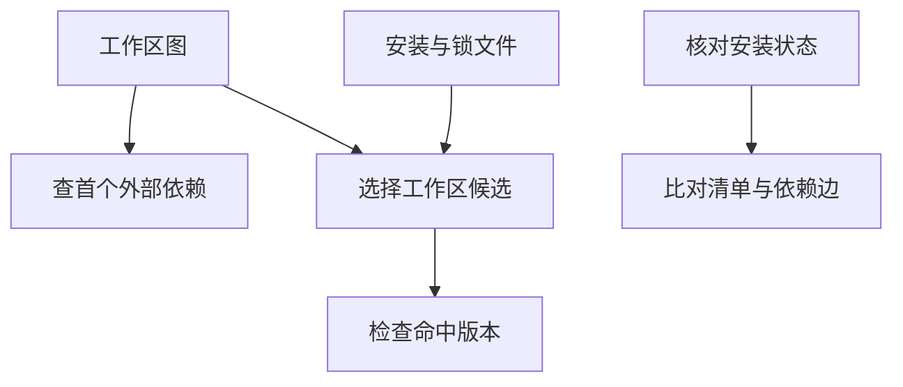
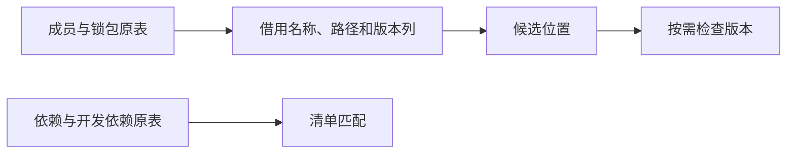

# 工作区候选与已安装清单匹配自举

## Intent · 目标

将工作区候选选择、依赖范围判断、外部包发现及安装清单比对迁入正式 Source 路径。避免给原本只读的查询增加包表复制或堆分配。

## Data · 证据

起点 `6e0cf529f`。安装器知道工作区成员排在归档之前，仍逐个检查锁包类型。`pkg graph` 对同一条相对路径重复为候选成员分配绝对路径。安装清单匹配还在 Zig 中按名称查找每条边。

## Edges · 边界

锁文件路径限制、图命令的平台路径语义、同名候选顺序和版本错误分别保留。扫描任意锁包表时须先判定活动分支，才能读取工作区路径。

## Answer · 验收

从工作区图、锁文件目标查找及安装入口对照行为和诊断，测量实际候选查找与清单匹配的成本，报告保留在宿主的职责。

### 正式路径

- 安装器直接借用已有的工作区成员表选择目标，命中后才验证目标版本。公开锁文件查询保留任意顺序的包表：按名称查询时只检查同名行的来源；按相对路径查询时以栈上有限大小的窗口借用来源标志，只有工作区变体可读路径。查询不需要堆分配。
- 图命令通过 Source 找到第一个外部依赖，保持先扫描生产依赖、再扫描开发依赖的诊断顺序。本地路径目标由平台解析一次，Source 对原成员路径逐段比较，去掉原来每个候选都分配一次绝对路径的开销。
- 安装、冻结安装和加载已安装包共用清单匹配。锁文件校验已保证依赖名唯一，因此同一位置命中就可直接比较要求与开发标志，位置不同时继续按名称查找。整个工作区同序时按位置比较，成员调换顺序时复用已有的二分路径查找；未命中再逐项查找，仍支持其他排列。
- 宿主保留操作系统路径解析、磁盘访问、安装器的外部归档获取、依赖数组的写入，以及将 Zig 联合类型按活动分支借给 Source。安装器主循环和工作区发现仍有 Zig 实现。

### 正确性

锁文件依赖图、工作区清单和安装三组正式回归通过，76/76 个构建步骤、36/36 项 Zig 测试、2,035 项 Node 测试，11 个 RX/ZX 文件通过 lint。

初始 Zig seed 直接生成的包规则与 Source 自编译引导器生成的包规则，都与前一提交比对了 6,480 个候选查询、768 个清单与外部依赖定位结果、1,536 个工作区比对结果；672 个主机路径选择与 `std.fs.path.resolve` 逐候选对照一致。路径对照运行在 macOS，包括离开工作区再进入、根目录、点目录及异常成员拼写。工具本体分别由 seed 和上一阶段 Source 生成时，以 Source 分析和生成同一清单：排除输入路径记录后，118 个输出文件逐字节一致。

### 性能

固定对照为 `6e0cf529f`。候选与对照均为 arm64 Zig small，同一 Source 自编译工具生成包规则。端到端使用 1 个根包与 96 个工作区成员，包含相对路径依赖链，每个命令新开进程，交替运行 11 轮取中位数。两套 CLI 的图输出、冻结安装输出分别逐字节一致。

| 公开命令                                  |           墙钟 |            CPU |                峰值 RSS |
| ----------------------------------------- | -------------: | -------------: | ----------------------: |
| `pkg graph`                               | 8.40 → 4.99 ms | 7.36 → 4.07 ms | 5,996,544 → 4,390,912 B |
| `pkg install --offline --frozen-lockfile` | 8.38 → 7.47 ms | 7.75 → 6.83 ms | 5,210,112 → 5,242,880 B |

独立函数测量在同一进程中重复调用，旧版使用前一提交中的查找和匹配逻辑；与新版交替运行 7 轮。下表为各轮的重复调用总耗时中位数。

| 场景                             | 重复次数 |           旧 → 新 |
| -------------------------------- | -------: | ----------------: |
| 1,024 个同序工作区包的整表比对   |       48 | 1251.05 → 0.36 ms |
| 1,024 个倒序工作区包的整表比对   |       16 | 424.86 → 13.74 ms |
| 安装器按名称查找最后一个成员     |    1,400 |    1.59 → 1.60 ms |
| 公开锁包表按名称查找最后一个成员 |    1,400 |    1.59 → 1.60 ms |
| 按主机路径查找最后一个成员       |      160 |   10.12 → 2.14 ms |

冻结安装的峰值 RSS 增加 32 KiB；同一场景下 CPU 与墙钟均下降。此批测量限于工作区及安装路径，未测整仓冷构建，也未在 Windows 上运行路径对照。

本批 Git 差异中，Zig 新增 348 行、删除 109 行，净增 239 行。新增部分主要是向 Source 借出 Zig 嵌套字段、处理联合类型活动分支，以及把结果接回安装器的代码。包候选和清单比对已经走正式 Source 路径，剩余 Zig 按实际职责继续计入自举清单。
