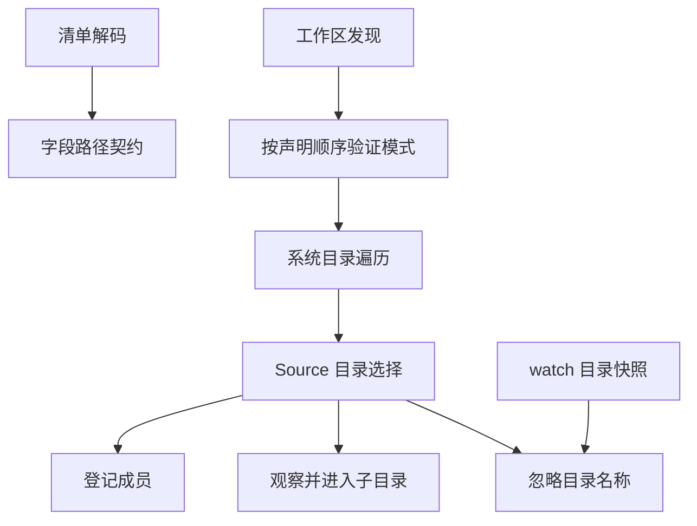
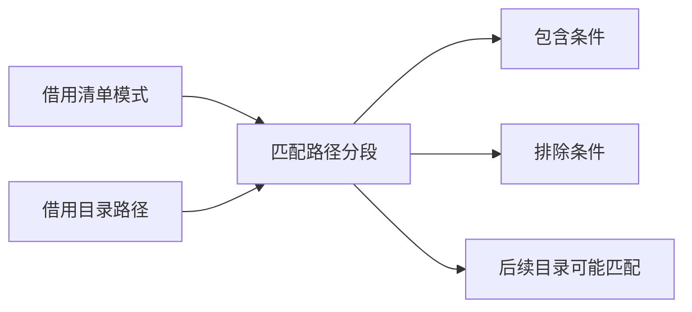

# 工作区目录选择与包路径校验自举

## Intent · 目标

把工作区模式校验、目录选择、下钻决定和清单路径规则迁入 Source。保持清单错误顺序、包含与排除的优先级，以及 watch 对目录变化的观察范围。

## Data · 证据

起点为 `d3419856a`。工作区、依赖图、安装和 watch 都经过 `workspace.zig`。原匹配器为每个目录和模式分配两行布尔状态，每处理一个分段清零、扫描并复制状态。清单中的入口、库路径、工作区模式和导出映射另由 Zig 判断。

## Edges · 边界

模式按斜杠分段，目录路径沿用原有两种分隔符。星号和问号在单个分段内按字节匹配，完整分段的双星号匹配零至多个目录。排除模式只影响成员资格，允许继续访问其子目录。文件系统枚举、真实路径和清单 I/O 由宿主提供。

## Answer · 验收

逐项对照旧版的目录匹配和下钻结果，运行现有清单、工作区和 watch 回归。分别记录匹配开销与真实工作区发现的耗时。

### 结果

- 工作区发现直接借用清单的模式字符串和目录遍历器的路径。遇到整段 `**` 时保存模式恢复位置和路径重试位置，匹配失败时用它多消费一个目录。目录选择、忽略目录和清单路径校验都通过零容量分配器运行。宿主仍负责目录枚举、排序、读取清单和记录 watch 输入。
- 729,000 组模式与路径的成员及下钻结果、16 组包含与排除结果、9 组首个无效模式的诊断位置均与旧实现一致。四种清单路径契约另对照了 521,284 个结果，覆盖空路径、连续分隔符、父目录、非 ASCII 和无效 UTF-8 字节。
- 清单、安装 watch、后端发布及清单资源四个现有回归目标均通过。清单资源最初因测试构建设立了两个编译器 ABI 模块而失败，对齐生成分区配置后，单独补跑的 6 项资源测试全部通过。由初始 seed 生成的 Source 工具与由上批 Source 工具生成的引导器均用 Source 分析和生成同一 CLI 清单，排除输入路径记录后，59 个文件逐字节一致。
- macOS arm64 的匹配对照使用同一份优化构建的可执行文件。每轮处理 80,000 次目录选择，7 轮中位数从 72.74 毫秒降至 28.72 毫秒，减少 60.5%。旧实现已提前解析模式；新实现直接读取原字符串。
- 在 1,108 个目录上用前后两个 CLI 分别运行 `zxc pkg workspace`，交替执行 9 轮。两者输出的 325 个包逐字节一致。按系统计时器的 0.01 秒精度，两者的墙钟中位数均为 0.02 秒，CPU 均为 0.01 秒，单进程峰值 RSS 中位数均为 4,669,440 字节。
