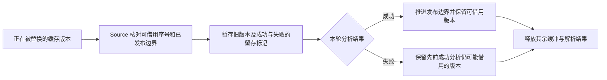
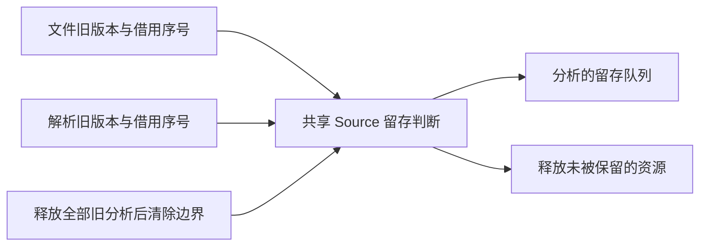

# 常驻文件与解析缓存留存自举

## Intent · 目标

让常驻文件和解析缓存共用 Source 的版本留存规则。发布及整体回收只更新版本边界，保留分析仍借用的旧版本，及时释放失败请求中产生的临时版本。

## Data · 状态表示

`4e6e93a4a` 的 `Files.keepAnalysis` 与 `ParseCache.keepAnalysis` 依次扫描所有活跃记录，设置 `retained`；释放历史时再逐项清除。现在每份可借用的记录保存首次可借用时的待发布版本号。成功发布后，当前边界覆盖所有版本号不大于它的活跃记录。更换记录时，Source 用这个边界决定两种结果下是否保留旧版本。

文件缓存仍允许同一份文本从仅供读取转为可借用。首次允许借用时登记当前待发布版本号。重新读到相同字节时，继续借用旧缓冲、摘要和已登记的版本号。解析缓存只在实际接管新解析结果时写入新版本号，缓存命中沿用原版本号。文件的发布容量在暂存旧版本时累计，提交前直接用这个数量预留。

## Edges · 生命周期

事务开始前按既有顺序结算上次暂存项。分配预留成功后才发布；已暂存项保留被替换时的决定，即使之后清除了历史边界。原生侧继续拥有文件字节、解析 arena、分配器和现有队列，按 Source 的结果执行留存或销毁。初始 seed 能独立执行同一判断。非事务型解析缓存沿用其原有的立即释放或保留所有旧结果两条路径。

## Answer · 验收

初始 seed 构建通过 14 个步骤，正式 Source 引导器通过 25 个步骤。相邻两代 Source 工具生成同一留存清单，排除输入戳后逐字节一致。`test-parse-cache`、`test-semantic-cache` 和 `test-rx-watch` 通过，共 72 个构建步骤和 21 项 Zig 测试。

同一个成功分析过的 ZX 文件连续经历三次不同的无效正文编辑。两版每次都保留同一份已发布的文本与解析结果，后续失败没有累积留存。原有输出逐次核对一致，恢复后 709 个生成文件与冷生成一致。两版随后运行多文件交替与混合编辑，逐次核对分析统计、历史版本数、文件与解析结果的留存项和字节数，结果相同。

### 性能

在 macOS arm64 上用 Zig 0.17.0、ReleaseSmall、16 分区。上一批和候选由 Source 引导器构建，运行 Source 分析与生成路径。固定 735 个入口，三版交错运行，每版取三轮中位数。相邻两版生成的 11,758 个文件及 v18 唯一性缓存载荷逐字节一致。

| 场景与指标                 | 固定基线 | 上一批 |   候选 |
| -------------------------- | -------: | -----: | -----: |
| 冷生成墙钟（秒）           |     2.85 |   2.59 |   2.61 |
| 冷生成 CPU（秒）           |    12.50 |  12.22 |  12.25 |
| 冷生成进程树采样峰值（MB） |   885.21 | 700.68 | 701.38 |
| 冷生成系统峰值（MB）       |   921.40 | 742.95 | 794.53 |
| 热重建墙钟（秒）           |     2.21 |   1.95 |   1.97 |
| 热重建 CPU（秒）           |     8.49 |   8.24 |   8.30 |

为定位冷生成系统峰值上升，单独用系统进程接口约每毫秒读取驻留量和峰值指标，交错比较四对运行。两版峰值均出现在输出完成前约 0.3 秒，早于提交分析和更新留存边界。复测的单进程系统峰值中位数为 727.58 → 723.98 MB，各次峰值分别落在 723.76～779.89 MB 和 721.65～766.03 MB。两版解析缓存记录都是 328 字节、8 字节对齐。首组的 51.58 MB 上升未在复测中稳定出现。

常驻引导器的两文件交替编辑中位墙钟 50.14 → 49.28 毫秒，采样峰值 244.25 → 244.43 MB。四文件混合编辑为 49.11 → 49.01 毫秒，采样峰值 254.43 → 254.23 MB。该组覆盖持续发布和历史复用，冷、热表覆盖分析和 Zig 源码生成。MB 均按十进制计。
