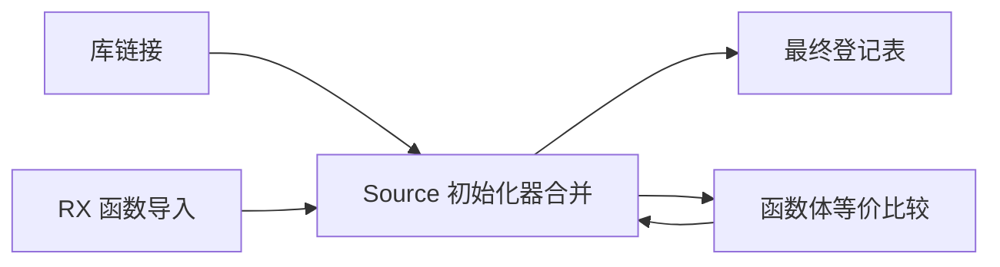
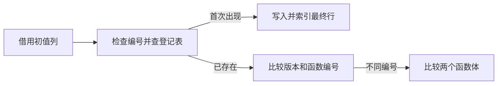

# 库与 RX 共享初始化器登记自举

## Intent

把统一库链接、RX 原有函数表和新接入函数后缀中的初始化器合并为同一项 Source 职责。保留先发生的错误与第一份声明。一个批次内只在需要扩容或深入比较两个函数体时返回宿主。

## Data

起点 `d98ad0de9`。正式入口 `library.link` 登记已链接、显式与借用的初始化器，`rx.analysis.program` 构建契约并导入已存在或新接入的函数。旧 Zig 各自遍历、逐项登记，登记前即使撞上已有项也会给结果表预留空间。

## Edges

库结果拥有名称，RX 可以借用调用方保证存活的名称。共享函数前缀的编号保持不变，后缀按链接起点重映射。相同名字和版本允许不同编号指向等价函数体；已分析和待构造的函数使用各自原有的比较规则。仅在成功写入最终行后发布索引。

## Answer

验收以库、RX 和包管理器的正式入口、生成一致性与重复登记成本为依据。

### 实际执行路径

库链接把每个输入已分析的初始化器整段交给 Source。显式和借用的源码初始化器先验证程序、映射类型，命中已有名称时比较原函数与候选函数，仅在首次出现时构造并登记函数。RX 在读取模块契约、导入已有函数、接入新函数后缀时使用同一登记入口，原有已检查前缀仍可直接复用。

Source 在最终行上按名称探测，版本相同且函数编号相同时直接复用。首次登记才为结果行和桶扩容。桶内保存最终行号，不再另存一份键和行号数组。需要比较两个函数体时，宿主借用共享函数表和本地函数表，交给既有比较实现。包安装器按 digest 去重也复用同一份探测和扩容逻辑。

库逐输入链接、显式初始化器的 IR 构造、函数表借用和分配仍有 Zig 代码。首次引导保留 seed 登记路径。

### 正确性和自编译

六组正式回归涵盖库链接、初始化器、混合库、Store 发布与再次发布、RX Store 执行以及包安装。通过 140/140 个构建步骤，Zig 测试 111/111。现有用例检查借用源释放后库仍可使用名称、相同初始化器复用、版本或函数体冲突、分配失败，以及迁移后库在新目录中的实际行为。

上一阶段的 Source 引导器构建出本批 ReleaseSmall 引导器，16 分区构建通过 25/25 步。两代引导器对本批两个入口生成的 65 个文件逐路径逐字节一致，比较时排除记录引导器身份的输入戳。更新后的原生 seed 从当前源码构建，bootstrap-lexer 的 14/14 个步骤通过；它对同一清单也完成两个入口的生成。改动涉及的 7 个 RX/ZX 文件通过 lint。

### 运行成本

用 Zig ReleaseSmall 构建登记基准，候选的分析与生成实现来自上一阶段 Source 引导器。对照复用上一提交的 RX 登记实现和同一套编译配置。交错运行，预热后每项取 8 次中位数；逐行比较顺序、名称指针、版本和函数编号。前三组每个名称登记四次，最后一组每个名称登记一次。时间为每个进程完成全部轮次的毫秒数；RSS 为单进程峰值字节数。

| 不同名称数 × 轮次 | CPU 上阶段 → 本批（ms） | 墙钟上阶段 → 本批（ms） | RSS 上阶段 → 本批（字节） |
| ----------------- | ----------------------: | ----------------------: | ------------------------: |
| 1 × 5,000         |         12.086 → 11.882 |         12.827 → 12.590 |     1,916,928 → 1,916,928 |
| 16 × 2,000        |           7.126 → 6.594 |           7.813 → 7.348 |     1,916,928 → 1,916,928 |
| 1,024 × 60        |           4.897 → 3.715 |           5.582 → 4.417 |     2,211,840 → 2,080,768 |
| 8,192 × 12        |           5.150 → 4.426 |           5.852 → 5.188 |     3,604,480 → 2,736,128 |

公开入口使用四个 RX 导出、包含 Store 的原有项目，执行 `zxc build pkg.yaml --mode lib --no-cache`。固定对照为 `6e0cf529f`，上阶段为 `d98ad0de9`。候选 CLI 本体由 Zig 构建，使用上阶段 Source 引导生成的分析与后端实现。三套工具交错运行，八次有效测量的 14 个发布产物逐字节一致。

| 指标             |   固定对照 |     上阶段 |       本批 |
| ---------------- | ---------: | ---------: | ---------: |
| 墙钟（ms）       |     35.834 |     36.248 |     35.848 |
| CPU（ms）        |     39.289 |     39.532 |     39.325 |
| 峰值 RSS（字节） | 16,498,688 | 16,490,496 | 16,515,072 |

相对固定对照墙钟增加 0.014 ms、CPU 增加 0.036 ms、单进程 RSS 增加 16 KiB。相对上阶段墙钟减少 0.400 ms、CPU 减少 0.207 ms、RSS 增加 24 KiB。此次测量覆盖变化的登记与库发布路径；整套编译器冷构建没有重新计时。

### 交付范围

共享前缀函数表按引用传给登记入口。最终版本的库初始化器、库发布和 RX Store 执行复核通过 108/108 个构建步骤、65/65 项 Zig 测试。

相对 `d98ad0de9`，RX 增 41 行、删 16 行，ZX 增 248 行、删 17 行，两者净增 256 行。Zig 增 192 行、删 130 行，净增 62 行，包含生成入口、借用列描述、seed 路径和宿主分配适配。排除 docs，相对固定起点 `aa2fcd40`，RX 累计净增 7,252 行，ZX 累计净增 34,859 行。实际退出 Zig 正式路径的是已链接初始化器的逐项编号重映射、名称登记、冲突分派和最终行写入。

原始样本和命令输出在 `.zig-cache/verification-tmp/initializer-registry/`。
