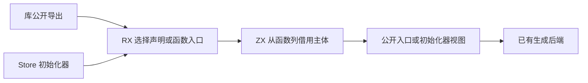

# 库入口视图与发布元数据自举

## Intent

让库公开导出和 Store 初始化器从同一套 RX/ZX 规则选择函数体与 ABI 信息。公开库生成后由 Source 完成源码绑定和纯常量入口标记。函数文件名统一写入预先分配的连续区间。

## Data

起点为 `faaff7377`。旧的 `library.Result.module` 与库初始化器分别从 Zig 函数表取出符号、表达式、控制根、契约与 Store 描述，再逐字段拼出 IR。库发布还需要在 Zig 中计算成员容量、生成带后缀的文件名以及绑定公开源码。

## Edges

- 类型与常量声明保持原有入口路径、导出表和类型状态。可执行公开入口借用选中函数的完整主体，包括原始契约和 Store 信息。
- 初始化器借用相同的主体，使用原程序的 Store 模式和空 Store 表。公开无 Store 入口是否生成转发 IR，仍由原有 RX 模块处理。
- 纯常量入口必须是声明入口，且存在常量，无类型导出和公开函数成员。公开记录、函数名和输入成员顺序保持原有契约。
- Zig 适配器借出和接回 IR 列描述符，不复制符号、表达式和控制节点。命名缓冲区使用 bundle 的分配器，分析失败或命名分配失败时由所在作用域回收资源。
- 各公开入口的分析重新进入、文件任务派发、生成缓存和 bundle 资源租期仍由 Zig 调度。原生 seed 留作初次引导。

## Answer

受影响的七组回归通过 126/126 个构建步骤与 114/114 项 Zig 测试，覆盖公开入口、初始化器、Store 发布、库链接、编解码、bundle 回放和原生 ABI。两代 Source 引导器对 5 个入口各自产生的 59 个文件路径和内容一致，排除记录工具身份的输入戳。上一阶段的 Source 引导器构建候选引导器通过 25/25 步，原生 seed 构建通过 14/14 步并独立生成同一清单。

### 性能

Zig 0.17.0、ReleaseSmall。候选 CLI 由 Zig 编译，正式分析与生成代码由上一阶段 Source 引导器生成。固定对照 `6e0cf529f`、上阶段 `faaff7377` 和候选轮换顺序运行，预热后取八次中位数。CPU 为用户态与内核态之和，RSS 为单进程峰值。

| 完整库发布     | 固定对照墙钟 |   上阶段墙钟 |     候选墙钟 |
| -------------- | -----------: | -----------: | -----------: |
| Store 库       |    40.855 ms |    40.198 ms |    40.490 ms |
| 120 个公开路径 | 1,176.300 ms | 1,169.318 ms | 1,170.557 ms |

Store 库相对上阶段，墙钟增加 0.292 ms，CPU 增加 0.097 ms，RSS 减少 8 KiB。相对固定对照，墙钟减少 0.365 ms，CPU 减少 0.316 ms，RSS 增加 32 KiB。

120 个公开路径相对上阶段，墙钟增加 1.239 ms，CPU 减少 0.198 ms，RSS 减少 152 KiB。相对固定对照，墙钟减少 5.743 ms，CPU 减少 5.905 ms，RSS 减少 176 KiB。两个库分别输出 14 个和 149 个文件，各版本的相对路径和 SHA-256 全部一致。

单独对照文件名装配，8,192 个名称运行 80 轮的 CPU 时间从 140.079 ms 降到 129.763 ms，峰值 RSS 从 3.34 MiB 降至 3.33 MiB。两种实现逐项检查完整名称，Source 额外核对了相邻文件名在同一缓冲区中连续排列。本批只计时受影响的库发布和命名路径，全编译器冷构建沿用独立基线。
