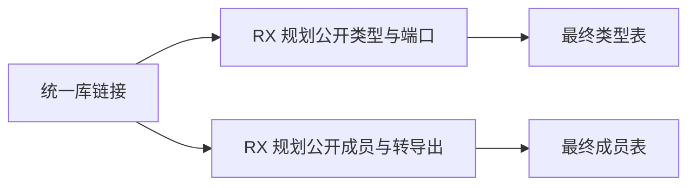

# 库公开接口与函数成员发布自举

## Intent

把统一库链接时公开类型、可执行模块端口、公开函数和入口模块的转导出写入最终导出表的职责交给 RX/ZX。保留初始 seed。沿用源模块链接已有的编号重映射与名称所有权。

## Data

起点为 `6dee29943`。正式入口 `library/link.zig` 调用 `interface.complete` 和 `members.complete`。前者拆出两列输入并在 Zig 中组装接口。后者在 Zig 中按路径扫描模块，拆出六列，在 Source 中筛选重映射，再由 Zig 复制名称、重建每一行。两者都在短命 arena 中建立中间表。

## Edges

声明在前，缺少的 Input 和 Output 依次补入。只处理入口路径精确匹配的转导出，按记录顺序合并。直接公开的匿名成员保留，barrel 中匿名的普通函数跳过，匿名内建函数保留。新库拥有名称，不能借用即将释放的分析 arena。已有库格式和宿主文件系统边界保持原契约。

## Answer

验收覆盖真实库链接、产物所有权、异常输入、阶段生成一致性，另用同一批成员比较临时内存和执行成本。

### 正式调用链与所有权

- `library.link → interface.complete → interface/complete.rx` 借用原始导出行，先核对类型编号、已有端口和冲突，再按确切行数分配。ZX 写入声明和缺少的端口。库持有所需名称，合成的 Input、Output 直接引用静态常量。
- `library.link → members.complete → members/build.rx` 读取模块记录与转导出的原始字段，计算成员数，依次写入直接公开的成员及入口记录的转导出。源模块链接和库链接共用成员映射与写入函数。源模块收集匿名入口，库的直接成员保留匿名项，barrel 跳过匿名的普通函数。
- 原 Zig 正式路径退出了类型行复制、端口追加、逐模块路径选择、公开成员行重建。Zig 仍组装字段视图，提供分配器并翻译错误。库链接的外层逐输入循环、IR 链接与结果封装也是后续工作。

### 正确性与阶段一致性

本批以 `6dee29943` 起步。库链接、编解码、初始化器及正反顺序的混合 RX/ZX 库通过 59/59 个构建步骤、114/114 项 Zig 测试，两个混合执行组各通过 7 项。直接成员、同一路径的多个转导出、匿名内建函数、越界成员、类型冲突与越界同时出现时的错误顺序，使用同一组输入在旧实现、候选和初始 seed 的生成结果上核对。

最终候选从 CLI 发布、搬移、重发布和消费库，连同链接与混合库回归通过 105/105 个构建步骤、46/46 项 Zig 测试，Node 汇总 61 项通过。修改的 11 个 RX/ZX 文件均通过 lint 和格式核对。

最近已验收的 Source 工具生成本阶段 ReleaseSmall 候选引导器，16 分区构建通过 25/25 步。前后两代 Source 工具对本批三个入口生成 153 个相同文件，按路径及字节比较，忽略记录引导器身份的输入戳。初始 seed 也成功生成全部三个入口。

### 成本

同一台 macOS arm64 主机，Zig 0.17.0。直接调用新旧正式适配器，输入包含两条命中的转导出记录、两条应忽略的记录、匿名与具名成员，以及相同数量的类型导出。逐行核对函数编号、端口、名称和最终行数。两个 ReleaseSmall 可执行文件交替运行，去掉首轮，取其余八轮中位数。

| 输入行数 | 每进程发布次数 | CPU 旧 → 新（ms） | 墙钟旧 → 新（ms） | 单进程峰值旧 → 新（B） |
| -------: | -------------: | ----------------: | ----------------: | ---------------------: |
|        8 |          3,000 |      13.62 → 5.43 |      14.25 → 6.11 |  1,916,928 → 1,884,160 |
|      512 |            220 |      13.46 → 6.91 |      14.13 → 7.62 |  2,244,608 → 2,048,000 |
|    8,192 |             50 |     35.83 → 21.96 |     36.51 → 22.59 |  6,488,064 → 4,620,288 |

在公开 `zxc build pkg.yaml --mode lib --no-cache` 路径上，固定对照沿用 `6e0cf529f`，上阶段使用 `4c0117d0c` 安装验收中的 CLI。本批 CLI 由 Zig 构建，分析和生成实现由上阶段 Source 引导。三者用同一项目、输出路径与 solver 轮换执行八次有效测量，每轮核对所有文件。

| 项目                        | 对照顺序             |            墙钟（ms） |             CPU（ms） |                      单进程峰值（B） |
| --------------------------- | -------------------- | --------------------: | --------------------: | -----------------------------------: |
| 五导出混合库，11 个文件     | 固定 → 上阶段 → 本批 | 41.25 → 41.62 → 40.98 | 39.08 → 39.17 → 38.83 | 25,034,752 → 25,042,944 → 25,034,752 |
| 带转导出的 barrel，8 个文件 | 固定 → 上阶段 → 本批 |    6.93 → 7.02 → 7.14 |    6.48 → 6.54 → 6.73 |    8,765,440 → 8,765,440 → 8,716,288 |

barrel 相对固定对照的 CPU 与墙钟增量分别约 0.25 ms 和 0.21 ms。两个项目的发布产物均逐字节一致。以上测量覆盖库发布，没有重新计量整个编译器的冷构建。

### 变更量

相对上一提交，RX 增 30 行、删 50 行，ZX 增 318 行、删 151 行，合计净增 147 行。Zig 增 88 行、删 87 行，净增 1 行，包括描述原记录内存布局的静态适配。相对固定统计起点 `aa2fcd40`，排除 docs 后 RX 累计增 9,792 行、删 2,565 行，ZX 累计增 40,878 行、删 6,250 行，合计净增 41,855 行。

从建立本批记录到三个入口首次生成约 3 分钟。首次正式回归耗时 3 分 39 秒，最终发布与消费回归耗时 6 分 14 秒。期间并行完成的自编译构建耗时 1 分 20 秒，公开 CLI 配对测量耗时 11 秒。

原始运行记录置于 `.zig-cache/verification-tmp/library-surface/`。
