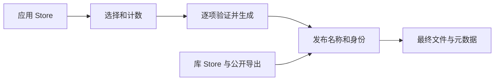

# 应用和库发布初始化器自举

## Intent

把应用 Store 和库发布共用的产物命名、文件身份和初始化器来源顺序迁入正式 RX/ZX。减少应用从已链接库筛选初始化器时反复扫描 Store 路径的成本。

## Data

起点 `597051a1a`。库公开模块、库 Store 和应用 Store 各自用 Zig 计算名称并复制身份。应用先按路径筛选已链接的初始化器，再拼接显式、借用和已链接的三个区间；现有筛选为每个候选从头查找路径。

## Edges

保留公开模块、Store 模块的名称前缀、SHA-256 小写十六进制、原始身份和发布顺序。没有引用的已链接函数继续跳过检查；已使用的函数必须存在且没有原生实现。全局选择检查发生在逐项验证之前。返回对象拥有发布后的名称和身份，Store 类型名继续借用已拥有的类型表。

## Answer

用原有 Store、库发布、非法初始化器回归与自编译对照验收；在已链接条目稀疏和密集的场景分别核对结果与开销。

### 正式入口和内存

应用的 Store 初始化器选择先比较候选数与路径数。任一侧最多四项时直接比较，两侧较大时在较小的一侧建立文本索引。当索引建在候选一侧时，用一个标记数组记录命中；最终仍按候选输入顺序处理。重复名称继续逐项验证。选择结束后由 Source 检查显式、借用、已链接三个区间的长度及输出文件总数。应用和 Gateway 原有的 Store 查找共用相同的索引填充算法。

公开导出名称、库 Store 和应用 Store 的文件名通过同一个 Source 流程生成。SHA-256 原始摘要与十六进制文本共用 96 字节栈空间，最终文件名和对外身份共享一次分配。应用与库改为调用同一处初始化器文件生成代码。最终源码写进输出分配器，准备 IR 和分析函数的内存在每次文件生成后由工作分配器回收。

稳定类型名称的原有两步（验证来源、计算类型名）提取成独立 RX 阶段，完整命名继续沿用它。应用 Store 只请求本身需要的类型名称，省去共享函数名、I/O 与进程能力的计算。逐个初始化器校验名称时借用本项的计算结果，临时 arena 复用上一项的容量。已发布的元数据使用由最终输出拥有的类型名。函数体准备、Zig 发射、逐项编排及确切分配边界仍有 Zig 实现。

### 验证

库初始化器、公开入口、Store 发布与再次发布、RX Store 运行、Gateway、名义类型来源共六组，127/127 个构建步骤、139/139 项 Zig 测试通过。按实测选定小输入直接比较的边界后，受影响的两组通过 101/101 个构建步骤、39/39 项 Zig 测试。改过的 22 个 RX/ZX 文件通过 lint。

上一阶段 Source 引导器生成本阶段候选引导器（ReleaseSmall，16 分区，25/25 个构建步骤）。两代引导器对本阶段七个入口生成的 181 个文件逐字节一致，排除含工具身份的输入戳。原生 seed 从当前源码构建通过 14/14 步，能为同一清单的全部入口生成代码。公开应用用例覆盖多 Object 状态实际执行及错误路径。

### 性能

使用相同优化配置，候选与上阶段交错运行，预热一次后取八次中位数。基准本体由 Zig 构建，候选使用上一阶段 Source 引导的分析与生成实现。选择基准比较候选行号、顺序和分配区间，覆盖重复名称、无关的非法编号，以及实际引用到无效函数或原生函数的拒绝行为。表中时间为包含全部轮次的进程 CPU（毫秒），RSS 是单进程峰值字节数。

| 场景                          | 上阶段 CPU | 本批 CPU | 上阶段 RSS |   本批 RSS |
| ----------------------------- | ---------: | -------: | ---------: | ---------: |
| 1 路径、1 候选，5,000 轮      |      6.517 |    6.443 |  1,884,160 |  1,884,160 |
| 8 路径、4 候选，2,500 轮      |      4.354 |    4.503 |  1,884,160 |  1,900,544 |
| 128 路径、1,024 候选，50 轮   |      9.024 |    2.150 |  1,982,464 |  1,982,464 |
| 1,024 路径、128 候选，50 轮   |      6.402 |    1.736 |  1,966,080 |  1,982,464 |
| 1,024 路径、1,024 候选，16 轮 |     19.891 |    1.575 |  2,031,616 |  2,064,384 |
| 2 路径、8,192 候选，8 轮      |      1.902 |    2.090 |  2,523,136 |  2,539,520 |
| 类型名，0 函数，500 轮        |      2.299 |    2.299 |  1,900,544 |  1,900,544 |
| 类型名，16 函数，150 轮       |      2.022 |    1.359 |  1,949,696 |  1,933,312 |
| 类型名，512 函数，25 轮       |      4.122 |    1.069 |  3,489,792 |  3,047,424 |
| 类型名，4,096 函数，6 轮      |      7.045 |    1.561 | 14,286,848 | 11,059,200 |

小表的固定开销仍可见。两条路径和 8,192 个候选的八轮合计 CPU 增加约 0.19 ms；大表以少量索引内存换取查找时间，1,024 × 1,024 的进程 RSS 增加 32 KiB。类型命名在没有函数的场景持平；4,096 个函数场景的计算结果一致，减少约 3.08 MiB 的峰值内存。

真实应用用现有双 Store 生成器，比较目录中全部文件。公开库使用同一含 Store 的四导出项目、同一输出路径和 `zxc build pkg.yaml --mode lib --no-cache`。每次生成都与对照逐文件比较，CPU 和墙钟单位为毫秒。

| 场景                  | 上阶段 → 本批墙钟 | 上阶段 → 本批 CPU | 上阶段 → 本批 RSS（字节） |
| --------------------- | ----------------: | ----------------: | ------------------------: |
| 双 Store，14 个文件   |     6.117 → 6.161 |     8.685 → 8.880 |   15,015,936 → 14,819,328 |
| 只读 Store，11 个文件 |     5.444 → 5.368 |     6.845 → 6.690 |   12,795,904 → 12,640,256 |
| 公开库，14 个文件     |   36.328 → 36.295 |   39.691 → 39.716 |   16,490,496 → 16,490,496 |

公开库相对于固定对照 `6e0cf529f`，墙钟增加 0.322 ms、CPU 增加 0.233 ms、RSS 增加 16 KiB。同上阶段比较，墙钟减少 0.033 ms，CPU 增加 0.026 ms，RSS 持平。本场景保留提交与输入固定的累计对照；本批没有重新测量整个编译器冷构建。

### 变更量

相对 `597051a1a`，RX 增 119 行、删 30 行，ZX 增 297 行、删 58 行，两者净增 328 行。Zig 增 250 行、删 157 行，净增 93 行。增量包括生成入口注册、对借用列与临时工作空间的适配，以及 seed 中可共享的类型命名阶段。相对固定统计起点 `aa2fcd40`，排除 docs 后 RX 累计净增 7,341 行，ZX 累计净增 35,098 行。

执行日志、核验清单和原始样本在 `.zig-cache/verification-tmp/store-publication/`。
