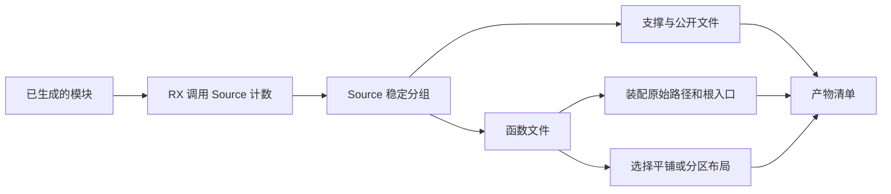

# 引导产物装配与镜像调度自举

## Intent · 目标

把引导生成器在分区前选择函数文件、装配原始函数树，以及镜像写出时选择目录和过期文件的规则迁入 RX/ZX。保持现有生成树布局、输出顺序和增量文件写出行为。

## Data · 实现

正式入口从 `generate_parser.zig` 经 `shared_generation.zig` 到 `shared_output.zig`。文件比对和清单编码已有 Source 实现。此前由 Zig 按文件名前缀收集两张表、逐个计算原树的路径和入口名称、遍历所有文件查找变更行，再循环检查旧清单的过期项。

`output/inventory/group.rx` 安排计数与稳定分组。两个组共用一次分配，按原顺序写入文件描述符。Source 直接读取生成模块的名称和正文视图。`originals.zx` 生成原始树的目标路径，根模块入口名和正文继续借用已生成的内存。根模块仍通过 genz 的结构化 AST 构造及 printer 输出。

## Edges · 写出顺序与宿主边界

父目录选择直接遍历变更行，并按首次遇到的顺序去重。旧清单可用时，Source 以旧清单顺序返回需要删除的行号。写出变更文件后删除过期文件，最后发布新清单。初始引导仍保留等价的 Zig 实现。

正式宿主保留线程工作分配、哈希调用、文件系统读写、无清单时的目录遍历以及编译器分配器和生成模块的 ABI 适配。公开适配器的渲染调用和分区产物实际落盘也仍由宿主协调。无清单路径继续调用 Source 判断每个目录条目是否应删除。

## Answer · 验收

初始种子的 lexer 构建通过 14 个步骤。从 `bc7e4afc5` 的 Source 引导器构建候选，通过 25 个步骤。用两代工具生成同一个装配清单，核对平铺及 16 分区的全部产物，排除本机输入戳后逐字节一致。

删减两个入口后，两代工具都准确删除清单登记的过期文件，保留未登记的文件，并保持未变更产物的修改时间。删去清单后重新生成，目录恢复路径会清掉此前未登记的测试文件，结果与冷生成一致。模拟分区父目录被普通文件占据，两版均报 `NotDir`，删除旧清单及输入戳，恢复目录后能完整重建。通过 Unix socket 向候选常驻进程交替发送完整及精简清单，三次结果均与独立生成一致，随后未变更的请求直接复用生成树。

### 性能

macOS arm64，Zig 0.17.0，ReleaseSmall，16 分区。沿用上一阶段的固定基线和 735 个入口，三版交错运行，每版取三轮中位数。固定基线、上一批和候选均为各阶段的 Source 引导器，运行 Source 分析和生成路径。相邻两版的 11,758 个生成文件和 v18 唯一性缓存载荷逐字节一致。

| 场景与指标                 | 固定基线 | 上一批 |   候选 |
| -------------------------- | -------: | -----: | -----: |
| 冷生成墙钟（秒）           |     2.86 |   2.57 |   2.55 |
| 冷生成 CPU（秒）           |    12.48 |  12.21 |  12.18 |
| 冷生成进程树采样峰值（MB） |   884.60 | 699.07 | 700.19 |
| 冷生成单进程系统峰值（MB） |   920.81 | 782.57 | 778.90 |
| 热重建墙钟（秒）           |     2.21 |   1.98 |   1.98 |
| 热重建 CPU（秒）           |     8.50 |   8.27 |   8.29 |
| 热重建进程树采样峰值（MB） |   892.93 | 698.89 | 698.81 |
| 热重建单进程系统峰值（MB） |   934.22 | 700.76 | 700.71 |
| 无修改墙钟（秒）           |     0.03 |   0.04 |   0.04 |

冷生成的进程树采样峰值较上一批增加 1.11 MB，单进程系统峰值下降 3.67 MB。以上数据覆盖分析及 Zig 生成。Zig 编译与链接另计。运行核验使用 macOS。原始函数路径沿用宿主分隔符，父目录通过当前宿主的路径接口切片。
