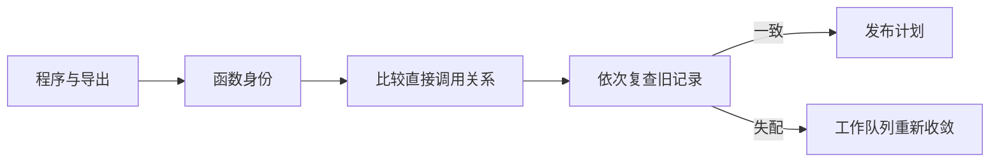
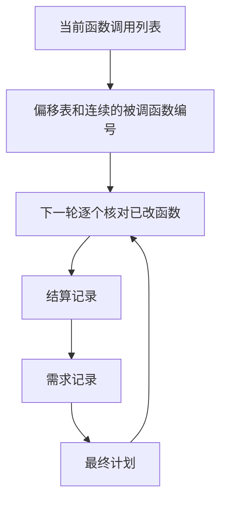

# 所有权分析记录的增量重放

## Intent · 目标

将按函数和阶段复查旧分析记录的遍历，以及跨分析保留调用图的布局和写入迁入 RX/ZX。当前入口是函数分析，经程序级重放进入唯一性缓存。相关 19 个原始 Zig 文件共 2,948 行。

## Data · 现有实现

旧记录按函数分别保存结算、需求和最终计划。可复用的前提是程序与导出相同、已改函数的直接调用关系相同、每次结算及需求与旧结果相同。原实现由 ZX 选择变更函数，Zig 决定记录访问顺序；记录完成时 Zig 逐个分配并复制每个函数的被调列表。

## Edges · 边界

保留初始种子、摘要散列的字节顺序、回退时机以及工作线程的内存和同步。程序入口也占一个函数位置，外部函数没有计划。进程内的旧记录独立于编译临时内存；磁盘缓存格式沿用 v18。

## Answer · 验收

核对 Source 和种子的引导构建。使用现有回归和常驻编辑序列比较增量、冷生成及缓存载荷，固定清单测量冷生成、热生成和无修改请求。

### 迁移后的调用链

- `function_analysis → uniqueness → program/run.rx` 先判断是否有可用记录。重放时，`shortcut/advance.rx` 选择下一个函数或继续当前函数。ZX 使用三张访问偏移表依次给出结算、需求和最终计划的行号。第一次失配即结束，Zig 保留具体函数分析、比较结果、回退清理和最终计划提交。
- 每个函数的身份直接写入一份连续数组，分析单元借用对应元素。程序摘要与函数正文摘要、程序摘要与导出列表的组合都由同一个 ZX 函数按顺序更新 SHA-256。准备分析时已经生成的调用图直接传给重放检查，原来从全部单元再收集一次身份和调用列表的 Zig 遍历已移除。
- 常驻请求结束时，`graph/capture.rx` 先算出各行起点，再写连续的被调函数编号。原先独立保存每一行，现在只保留偏移表和编号表。核对某个已改函数时，ZX 借用这两个偏移之间的编号，直接与新的调用顺序比较。
- 从缓存创建、一次性生成和常驻服务三条路径核对生命周期。磁盘只保存可重用的函数分析结果，完整访问序列只供同一进程的下一次分析使用。一次性生成继续读写磁盘缓存，跳过访问日志的收集与分组；常驻请求保留日志和调用图。初始种子仍有自身的遍历实现。

第一版在固定清单上冷生成的系统峰值中位数从 758.3 MB 升到 823.8 MB，而进程树采样峰值几乎持平。单独交错追踪五轮，2 毫秒采样所得峰值中位数分别为 744.0 MB 与 746.6 MB，系统峰值分别为 750.0 MB 与 773.0 MB。检查生命周期时确认，一次性生成也为没有下次请求的进程保留了重放记录，因而在最终版本中移除了这项开销。首轮峰值差的全部成因尚不能从采样中确定。

### 正确性

上一批已验收的 Source 引导器 `1659df314` 生成本批 ReleaseSmall 工具，两版运行时都使用 Source 所有权分析和生成路径。初始种子构建解析器通过 29 个步骤；以旧 Source 生成新工具和解析器通过 38 个步骤。最终版本通过函数分析、模块生成、缓存所有权和字段事实四组共 249 项回归，14 个改动的 RX/ZX 文件通过格式和 lint 检查。

两版在空缓存下生成同一份 773 入口、5,541 模块的当前工程，排除环境输入戳后 13,133 个文件逐字节一致。v18 缓存载荷均为 14,280,429 字节，SHA-256 为 `9e47cd9d7808705de39ac717633716f9c8a3c935d5cb492a9599b2641ef28919`。

常驻生成器在 379 模块工程上执行首次生成、只改 ZX 正文、增删被调用函数、修改 RX、无效依赖和恢复。成功状态的 709 个生成文件均与同一输入的冷生成一致。另一次保持导入声明、模块数和 335 个函数不变，只增删一个对已有函数的调用。两次编辑均走正文增量路径，各复用 376 个模块、重析 3 个模块，分别重写 2 个和 0 个函数文件；恢复后的输出等于原始输出。

按最终提交 `812b6a4b4` 统计，生产 RX/ZX 净增 208 行，内部 memory 接口另增 6 行，手写 Zig 含引导、宿主适配和种子兼容新增 204 行、删除 122 行，净增 82 行。正式路径退出了身份与调用列表的二次收集、逐行保留调用图、以及宿主决定结算与需求记录访问顺序的嵌套循环。工作队列主循环、后台线程同步、具体复查和最终计划写回仍有手写 Zig。

### 性能

固定 735 个入口、16 个分区，两版交错各跑三轮，取中位数。冷生成使用独立空缓存，热生成保留缓存并重建输出。两版 11,758 个文件及 14,098,494 字节的 v18 缓存载荷逐字节相同，两版热生成也分别等于自己的冷生成。测量范围为分析与 Zig 源码生成。

| 指标                 |   上一版 |     本版 | 本版相对固定基线 |
| -------------------- | -------: | -------: | ---------------: |
| 冷生成墙钟           |   2.60 s |   2.59 s |          −0.26 s |
| 冷生成 CPU           |  12.40 s |  12.34 s |          −0.24 s |
| 冷生成进程树采样峰值 | 717.3 MB | 708.5 MB |        −184.5 MB |
| 冷生成单进程系统峰值 | 797.2 MB | 747.1 MB |        −192.6 MB |
| 热生成墙钟           |   2.01 s |   2.01 s |          −0.24 s |
| 热生成 CPU           |   8.36 s |   8.33 s |          −0.28 s |
| 热生成单进程系统峰值 | 714.2 MB | 706.9 MB |                — |
| 无改动墙钟           |   0.04 s |   0.04 s |                — |

系统冷峰值三次取样范围分别为 748.3～813.3 MB 与 735.2～809.4 MB。应结合进程树采样中位数和实际取消的记录分配看待峰值变化，不能把两组系统中位数之差当作每次都节省的字节数。

常驻场景另外交错三轮，每项都经同一条套接字请求路径，固定导入声明。只改正文、增加调用边、恢复原调用边的墙钟中位数，上一版依次为 87.22、146.78、109.74 毫秒，本版为 87.71、148.10、109.34 毫秒。相应进程 CPU 增量分别为 110/120、510/510、240/240 毫秒，采样分辨率 10 毫秒。本批未重测含 LLVM 和链接的整机冷构建。
