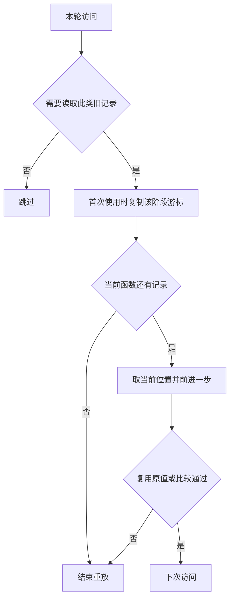

# 所有权重放访问与发布自举

## Intent · 目标

常驻编译器收到后续编辑时，会核对上一轮每个函数访问过的状态。把重放中的游标推进、接受后选择函数计划，以及重新分析后保存调用图和访问记录的顺序交给 RX/ZX。比较失败后必须能从正确的状态重新求解。

## Data · 证据

基线为 `c24e37493`。沿正式入口核对唯一性分析、程序驱动、重放、缓存、工作队列、增长记录和摘要，共涉及 22 个 Zig 文件、2,688 行。这是调用链的盘点范围。此前创建兼容重放时会马上复制三组函数游标，即使所有计划都能直接复用。一次变化访问还要先取游标，再比较结果，最后回到宿主确认游标。旧的临时记录数组原本就由本次分析的内存区持有。

## Edges · 边界

已变函数和未变函数都按原先的访问次序前进。记录耗尽或同一状态下出现新结果时，停止沿用旧记录。重新分析前要清除被试算写入的需求。正式实现中试算的增长记录只在单次访问内使用，初始种子仍需清理自身的增长表。

## Answer · 验收

`replay/select.zx` 负责读取、边界检查和推进。直接复用成功的请求不分配三组游标。函数身份使用相邻字节切片比较。接受后，`shortcut/range.zx` 标明连续的空函数、原记录和替换结果；宿主将选好的计划复制到调用方的内存，全部成功后才写回改动的记录。入口函数与普通函数按同一规则处理。

重新求解的结果由 `replay/publication/build.rx` 依次保存调用图和三组访问记录。三个起点表共用一块最终内存，各自的记录行仍按实际类型分配。排序、反向填充和调用图偏移计算沿用已有 ZX 算法。宿主仍负责记录缓存状态字节、分配有类型的行、跨请求内存交接以及运行实际的函数重算。

### 正确性

- 上一版 Source 工具引导构建通过 38 个步骤，初始种子引导构建通过 49 个步骤。两种工具处理本批 4 个入口，排除输入戳后 106 个文件逐字节相同。
- 上一版和本版的 Source 工具分别从空缓存处理同一份 770 入口、5,561 模块的完整清单。13,125 个生成文件逐字节相同，v18 所有权缓存的载荷同为 14,334,770 字节，SHA-256 为 `9ccf3c4ef879bd2cf5f5e7cc8d4ff6dda73253a162f2dad3a919bcb909cc7534`。
- 函数分析、模块生成、缓存所有权和字段事实四组共 249 项现有测试通过。另用 379 模块的常驻工程依次修改正文、增加和移除被调函数、修改 RX、引入无效依赖再恢复。每个有效状态的 709 个生成文件都与同输入冷生成一致，无效依赖被拒绝。
- 复用缓存所有权测试中的 `fresh.zx` 和 `borrowed.zx`，在同一路径上从返回新数组改为返回借用数组，再恢复。种子引导和 Source 引导的两个工具分别跑过这组常驻编辑，两者的三个状态均与各自独立冷生成的 41 个文件逐字节一致。

### 性能

两版工具均由 Source 引导，使用 Source 分析和生成。四组回归退出后，沿用同一常驻工程、16 个分区及固定导入声明。两版各交错运行三轮，表中为中位数。墙钟和 CPU 使用毫秒，CPU 采样分辨率 10 毫秒。RSS 使用十进制 MB。

| 常驻请求   | 上版墙钟 | 本版墙钟 | 上版 CPU | 本版 CPU | 上版请求完成后 RSS | 本版请求完成后 RSS |
| ---------- | -------: | -------: | -------: | -------: | -----------------: | -----------------: |
| 首次生成   |   381.55 |   381.65 |    1,900 |    1,910 |             256.41 |             257.06 |
| 仅改正文   |    88.35 |    86.35 |      130 |      120 |             269.75 |             270.12 |
| 增加调用边 |   151.15 |   149.98 |      520 |      520 |             276.22 |             276.33 |
| 恢复调用边 |   110.06 |   110.11 |      240 |      250 |             280.85 |             280.54 |

整组请求的服务进程系统峰值从 297.39 MB 到 297.65 MB，三轮范围分别为 296.76～297.86 MB 与 296.44～299.04 MB。收益可确认到接受重放的路径省去了三次游标分配，整进程峰值仍在相近范围。

与[常驻重放最初的配对记录](所有权分析记录的增量重放.md)中的改动前数据相比，正文、增加调用边和恢复的墙钟分别变化 −0.87、+3.20 和 +0.37 毫秒，CPU 分别变化 +10、+10 和 +10 毫秒。固定 735 入口的一次性生成关闭访问记录，LLVM 编译与链接也不执行本批的常驻重放逻辑，因此本批性能测量放在服务请求上。

对完整清单的非驻留生成用于核对文件与缓存内容；构建并行期间的耗时未用作性能结论。自举的后续工作仍包括跨函数工作队列的实际驱动、缓存访问、结果存储以及正式入口的传递依赖核对。

按完整提交统计，手写 Zig 新增 180 行、删除 247 行，净减 67 行。ZX 新增 105 行、删除 215 行，RX 新增 14 行、删除 13 行，两者合计净减 109 行。主要删减来自合并原先分散的读取、预期和确认，以及移除重复的宿主接线。
