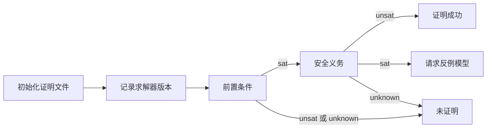
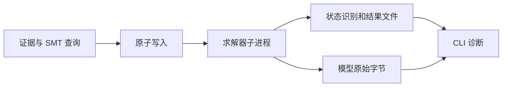

# 求解器执行与证明产物自举

## Intent · 目标

将 verify 的证明流程迁入 Source，包括预写证据、记录工具版本、求解前置条件、检查安全义务和导出反例。ZX、RX 和库公开入口共用这个流程。

## Data · 依据

起点为 `6b9af646b`。验证器先生成两个 SMT 查询，以源码证据和查询字节计算指纹。原实现通过子进程运行指定求解器，原子替换各个证明文件，最后把诊断写入调用方提供的 writer。

## Edges · 边界

前置条件求解成功且可满足时才检查安全义务。每步保留自己的文件写入顺序、子进程退出状态及错误通道。查询状态只接受三种完整答复，模型保留外部进程给出的原始字节。证据 JSON、摘要和对外诊断仍沿用现有宿主接口。

## Answer · 验收

以真实 Z3 和正式 CLI 核对可证明、反例、不可满足前置条件、公开库入口和有限枚举。对照相同查询得到的状态、文件内容和退出码，并检查失败时已有证明文件的状态。

## 正式路径

`verification.check` 保留证据 JSON 和指纹生成，随后直接调用编译后的 `solver/check.rx`。RX 依次初始化证据、读取并保存版本、判定前置条件与安全义务。只有后一次返回 `sat` 才进入 `counterexample.rx`。它先写带 `get-model` 的查询，再运行求解器并保存原始 stdout。宿主只把结果转换成原有诊断和错误，初始 Zig seed 可独立执行旧实现。

状态识别借用 stdout，只跳过两端的空格、制表符、回车和换行。求解前置条件或安全义务时，子进程异常退出、写入 stderr 或返回非法状态都会沿用原来的错误。成功初始化证明文件后，结果为 `not_proved`，直到收到合法的安全义务查询结果。版本及模型保留原始字节，不重新解析或编码。

`std:fs.writeFileAtomic` 提供原子替换和可选的父目录创建。`std:child_process.spawnSyncBytes` 借用已有的 argv 和参数字节，接受操作系统支持的非 UTF-8 路径。普通文本子进程接口继续使用原有参数校验。Source 在调用时构造少量参数描述符，查询和模型内容不会随描述符复制。

## 验收证据

- 用初始 seed 构建第一个 Source 引导器，再由它构建第二个。两个 Source 引导器生成最终的验证入口，涉及 17 个模块，22 个文件逐字节相同（排除记录机器路径的 `.zxc-inputs`）。单独比较初始 Zig 生成器和第一个 Source 生成器时，去除空白的循环中两个局部变量的编号顺序不同。两代 Source 的输出已稳定。
- 最终 CLI 通过 20 个普通验证场景、8 个公开库场景和 74 个枚举场景，以及子进程目标的 41 项 Zig 测试。标准文件系统目标也通过。对照 `6b9af646b`，20 个程序产生的 140 份证明文件、诊断和退出码相同，默认输出目录的指纹也相同。
- 使用空响应和版本失败的外部命令，两个 CLI 的退出码、错误和留下的文件相同。对包含非法 UTF-8 字节的输出路径，当前 macOS 文件系统在两个版本上均返回 `BadPathName`。
- 扩大到标准库回归时，3,100 项 Zig 测试通过，独立 HTTP 应用进程收到 `SIGKILL`。用 `6b9af646b` 的 CLI 单独复跑同一驱动，第一次应用执行也收到 `SIGKILL`，这一项仍未通过。

## 性能

基线为 `6b9af646b` 已验收的 Source CLI，候选为第二个 Source 引导器生成的 CLI。两者使用同一 Zig 0.17.0、ReleaseSmall、Z3 可执行文件、程序、工作目录和输出路径。每组顺序执行 20 次独立的 `zxc verify`，交错测量七对，取中位数。墙钟从各次启动到退出累加，CPU 取各次 `wait4` 的用户与系统时间之和，RSS 取该组各次 `wait4` 的最大值。

| 指标     |            基线 |            候选 |
| -------- | --------------: | --------------: |
| 墙钟     |       214.19 ms |       213.95 ms |
| CPU      |       184.69 ms |       184.62 ms |
| 峰值 RSS | 35,061,760 字节 | 35,045,376 字节 |

本次建立上述端到端求解场景的固定基线。两者的差异都在一毫秒内，峰值 RSS 减少 16 KiB。这个场景包含前端、文件写入与外部求解器，不用于推断编译器冷构建成本。

RX 增加 146 行，ZX 增加 387 行（含标准接口声明），Zig 增加 142 行、删除 68 行。Zig 增量包含初始 seed 和通用 I/O。符号 IR 的遍历、证据序列化和硬件端的 SMT 项解析仍有 Zig 实现。
