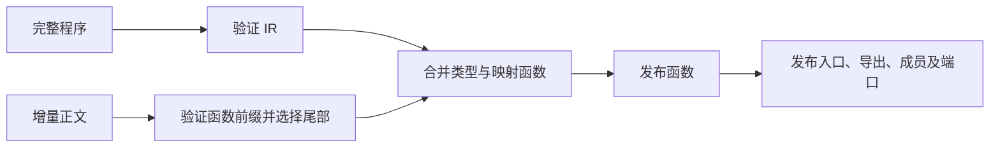

# 源码链接与函数表前缀自举

## Intent · 目标

贯通 RX 混合编译和 ZX 源码模块共享的增量函数表、完整程序链接与导出发布。让已验证前缀和链接前缀共用同一个列比较算法。

## Data · 依据

`link/source.zig` 的增量入口检查函数表前缀，IR 校验器也会计算可以信任的函数行。原有两个 Zig 实现分别按列、按行遍历。两处都要求引用身份相同，即使文本内容相等，独立存储也不能复用证明。类型、函数和原生模块映射必须在写入新函数前确定；导出的成员和端口依赖已发布入口。

## Edges · 边界

共用存储的列直接跳过。仅对分离存储的列执行逐项比较，保留可空值、窄枚举和只读指针的语义。完整程序、已分析正文、调试校验分别保留原有失败顺序和分配器。保留 seed 引导路径。

## Answer · 验收

使用实际的项目推导、独立编译库、递归函数、增量恢复与所有权回归检查正式入口。固定清单配对衡量冷生成与热生成，比较生成内容。

### 已接入的路径

在起点 `3f02dc8b6`，源码链接、混合项目调用、函数表前缀与相关类型分析共涉及 34 个 Zig 文件、3,255 行。完整程序和增量正文如今共用一个链接实现。RX 分别描述两个入口需要的步骤，编译期展开后，只有完整程序执行 IR 校验和原生模块绑定。导出声明、Store 初始化器、成员和端口也共用一个 RX 发布入口，原来的专用 Zig 声明发布适配文件已删除。

链接器和 IR 校验器共用函数表前缀比较。共享同一段存储的列直接复用，分离存储的列按元素类型调用 ZX 比较。切片比较地址和长度，保留原有引用身份要求。找首个不同行时按逐步扩大的行区间比较，首行不同即可退出。宿主仍负责枚举函数表列、借用物理存储、提交 IR 表和 seed 兼容路径。按本批实际 diff，ZX 增 147 行、删 14 行，RX 增 108 行、删 11 行，Zig 增 197 行、删 127 行。3,255 行是核对范围，本批 Zig 净增 70 行。

### 验证与所有权修复

- 上阶段 Source 引导器构建通过 38/38 步，独立 seed 构建通过 36/36 步。两种工具对四个新增前缀比较入口生成的 66 个文件一致。新旧 Source 工具各自冷生成本批完整清单，包含 771 个入口、5,513 个模块，除输入戳外的 12,832 个文件逐字节一致。
- 独立调用项目分析及链接入口，使用 12 个依赖模块生成实际函数表。检查全部 22 列、44 处差异边界，以及独立存储的相同前缀、分离尾部和重叠尾部。候选通过全部检查。
- seed 首次生成时出现含空字节的字段名。单独复现了字段名的所有权错误：表达式使用临时存储，类型表存活更久。释放表达式后，旧版对象的两个字段名仍指向临时存储，修复后两者都归类型表持有。对象与并行任务的字段名统一使用类型表分配器，沿用原有复制次数。首次异常的具体覆写位置未复现。
- 最终 Source 候选运行既有 RX 项目推导、混合库、库执行、Store 初始化器、输入所有权、链接边界与语义缓存七组回归，通过 138/138 步、286/286 项。变更涉及的 12 个 RX/ZX 文件全部通过 lint。候选引导器 SHA-256 为 `6cbc258b9cbd08665f8314c7ed0ee141a7bcb09d6feafc5f5f6d1e770d8b5dcd`。

### 生成器性能

固定 735 个入口，Zig 0.17.0、ReleaseSmall、16 分区，关闭常驻生成器。上一提交和本批工具都由 Source 引导，运行 Source 分析与生成。回归退出后交错测三轮，取中位数。表中冷生成只包含从 RX/ZX 生成 Zig 的过程。

| 指标                 | 固定基线 | 上一提交 |     本批 |
| -------------------- | -------: | -------: | -------: |
| 冷生成墙钟           |   2.85 s |   2.62 s |   2.62 s |
| 冷生成 CPU           |  12.58 s |  12.36 s |  12.40 s |
| 冷生成进程树采样峰值 | 893.0 MB | 700.8 MB | 706.5 MB |
| 冷生成单进程系统峰值 | 939.7 MB | 745.9 MB | 729.4 MB |
| 热生成墙钟           |   2.25 s |   1.98 s |   1.97 s |
| 热生成 CPU           |   8.61 s |   8.21 s |   8.25 s |
| 无修改墙钟           |        — |   0.04 s |   0.04 s |

相对上一提交，冷生成墙钟持平，CPU 增 0.04 秒，进程树采样峰值增 5.7 MB，单进程系统峰值降 16.5 MB。相对固定基线，冷生成墙钟低 0.23 秒、CPU 低 0.18 秒。固定语料的 11,758 个产物逐字节一致，所有权缓存载荷哈希同为 `76562648064cc2080c35869617027c250fbb139033441baa15a9f10bf6a3ef94`。
