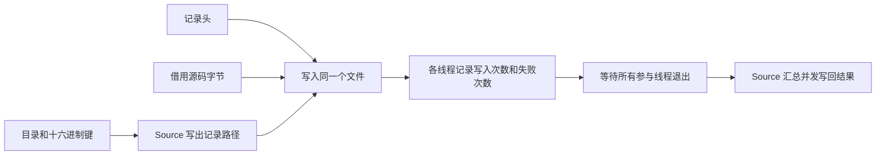

# 生成缓存命中与写回自举

## Intent · 目标

让正式编译器使用 Source 规划函数源码的复用、统计磁盘读取结果、生成记录路径并汇总并发写回结果。保持缓存格式、失效条件和所有权转移顺序。

## Data · 依据与实现

`26f35c690` 先由 Source 分类缓存命中，再由 Zig 遍历从第一个有效结果到最后一个有效结果之间的所有记录。现在 Source 在分类时同时汇总损坏与读取失败，并给出待接管磁盘缓冲的索引。待生成的索引从表头填入，待接管的索引从表尾填入。这两类结果互斥，复用同一份空间。

先复制所有借用的字节，再更新缓存条目。条目被替换时可以立即释放旧缓冲。接管磁盘缓冲若遇到分配失败，保留失败位置之前的统计与已成功转移的缓冲，其余磁盘缓冲仍由读取方释放。纯内存缓存跳过磁盘结果归并。后台写回尚未合并，且同批存在读取失败和磁盘命中时，按输入顺序结算。首次接管会等待后台写回，报错顺序也随之保留。

短路径使用栈内缓冲，长路径复用原有分配器。写回直接把记录头和源码交给 `writeStreaming`，按系统调用返回的字节数补写余量。成功次数在各线程本地累计，最后一次 I/O 错误仍由现有并发逻辑发布。

## Edges · 范围

缓存映射、缓冲区所有权交接、线程队列和文件系统操作继续由原生接口执行。磁盘记录仍采用 v2 格式，保留编译器身份、键与长度校验。初始 Zig seed 保留可独立启动的实现。

库运行回归发现上阶段原生 ABI 别名有两个独立声明。由 Zig 为两个结构体选出的字段偏移不同，借用转换在编译时被拒绝。正式入口现在直接引用 Source 生成类型，保留布局检查和借用方式。

## Answer · 验收

初始 seed 引导通过，新 Source 引导器构建通过。新旧 Source 运行同一份窄清单，生成产物逐字节一致。磁盘记录的键、长度和内容一致，记录头中的编译器身份随版本更新。

已有函数生成缓存测试、原生 ABI 缓存复用、应用缓存更新及损坏恢复、库监听发布与恢复均通过。修复 ABI 类型后，库打包执行回归通过 45 个构建步骤。

缓存记录路径超过 512 字节时，冷读和全命中计数与上一版一致。把四份记录换成指向自身的符号链接后，两版都复用 231 个任务、重新生成 10 个任务，共记录 20 次读写错误。

### 性能

在 macOS arm64 上用 Zig 0.17.0、ReleaseSmall 构建三版 CLI。固定基线 `6e0cf529f`、上批 `26f35c690` 和候选均使用各自通过 Source 引导生成的分析及生成模块。对同一个包含 241 个生成任务的库运行 `zxc build pkg.yaml --mode lib --out <目录> --cache-stats`。冷读前只清空该项目的生成缓存，热缓存重用全部任务。损坏恢复在热缓存后破坏 37 份磁盘记录，触发 54 个生成任务，其余 187 个复用。三版轮换顺序，去掉首轮后取九轮中位数。所有 149 份发布文件逐字节一致。

| 场景         | 版本               |            墙钟（秒） |             CPU（秒） |        峰值 RSS（MB） |
| ------------ | ------------------ | --------------------: | --------------------: | --------------------: |
| 冷生成及写回 | 固定 / 上批 / 候选 | 1.086 / 1.089 / 1.082 | 1.141 / 1.145 / 1.134 | 41.84 / 41.88 / 41.68 |
| 热缓存       | 固定 / 上批 / 候选 | 1.076 / 1.079 / 1.073 | 1.102 / 1.106 / 1.098 | 38.06 / 38.06 / 37.86 |
| 部分损坏恢复 | 固定 / 上批 / 候选 | 1.079 / 1.082 / 1.076 | 1.118 / 1.121 / 1.114 | 41.70 / 41.66 / 41.50 |

RSS 为 CLI 进程的系统峰值。相对两个基线的差异均处于毫秒级，累计 CPU 和墙钟未见退化。测量覆盖本批改动的库生成缓存路径。最后补充的后台写回错误顺序检查在 Source 引导路径复核，表中的正常生成和缓存修复场景没有后台写入与读取失败交叠。
