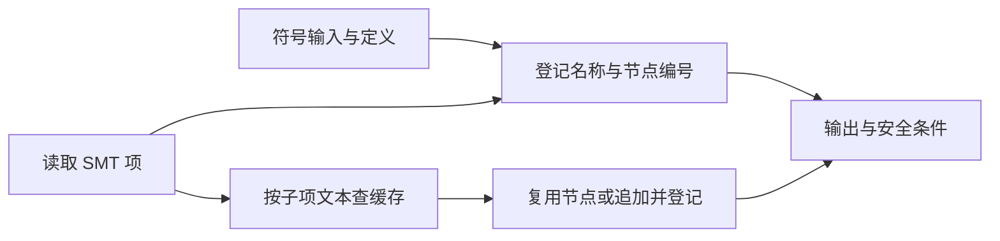
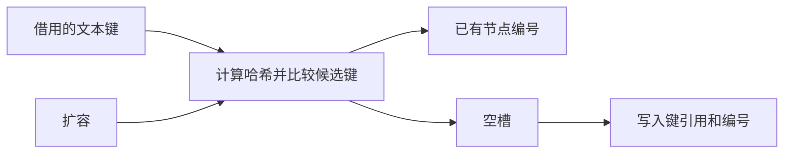

# 硬件图符号绑定与节点复用自举

## Intent · 目标

把硬件图构造中并行使用的两张文本索引一起迁入 Source。变量名按定义顺序可见，同名登记更新绑定。已经存在的子项沿用第一个节点编号和源位置。解析器继续借用 SMT 字节。

## Data · 依据

正式入口依次登记输入、解析并登记各定义、展开输出、解析安全条件。原符号表与子项缓存都使用 Zig 的字符串哈希表。两者都以字节相等判断键，保留到本次建图结束，无删除操作。子项缓存可能超过预留的定义数并触发扩容。

## Edges · 边界

共用字节键到节点编号的开放寻址实现。保持空槽与空键可区分、已有键优先、扩容后重新定位。先准备可失败的空间，再发布节点和对应键。沿用原图的节点数组与递归读取过程。

## Answer · 验收

固定上阶段 Source 引导器，运行硬件资源、错误路径、组合与时序求值。对照上一提交的 RTL 与诊断，测量常规集及两种增长图的分配、峰值、CPU 和墙钟。

## 正式调用链

`hardware.generate → build` 预留两个索引需要的槽位。输入节点按原顺序写入后，ZX 一次遍历借用的输入名称列，登记各自的节点编号。每条定义只在解析完成、位宽与布尔类型匹配之后进入符号表；后续可以引用这个名字。重名更新编号，首次登记的键继续指向原文本。

`Terms.parse → intern` 按完整子项字节查找。命中直接返回原编号；未命中且容量足够时，复用查找得出的空槽。确需扩容时，ZX 按负载确定容量并重排已有键，成功后才替换旧表。节点追加成功后，宿主将键和编号写到预先确定的空槽，这一步无需分配。

Source 共用同一套比较、探测、覆盖与重排规则。空槽使用可空键，允许空字符串作为普通键。Zig 仍分配和释放相邻的键列、编号列，持有占用数和增长阈值，写入现有节点联合。初始 seed 沿用 Zig 标准库的哈希表。

## 核验

使用 `2393ac093` 已核验的两个引导器，分别由上一代 Source 和初始 Zig seed 构建。相同清单包含 6 个正式入口，分析 13 个模块，覆盖输入登记、定义发布、查找、探测、容量与重排。排除记录本机输入的 `.zxc-inputs`，两个输出目录的 32 个文件逐字节一致。11 个新增 RX/ZX 文件通过 lint。

上一阶段保存的 50 份 RTL 和 1 份诊断、结构及操作符组的 8 份 RTL 和两个增长图的 4 份 RTL，分别与候选及 seed 后端对照。这组核验覆盖输出顺序、首个节点编号及诊断文本；所有分配在销毁结果后释放。

正式资源与求值目标完成 78 个构建步骤、5 项既有测试，包括分配失败注入与无效 IR。Yosys 检查两个组合电路各 72 组输入及故障，再对照时序电路的 14 个周期、56 条信号记录。

## 时间与内存

配对工具均使用 Zig 0.17.0、ReleaseSmall 和 Source 生成的硬件后端。候选复用上阶段的 Source 引导器；对照使用 `2393ac093` 保存的可执行文件。硬件生成和两种 RTL 输出计入墙钟，CPU 与峰值 RSS 计整个测量进程。每个负载交错运行七对，取中位数。

| 工作负载                    |      墙钟（ms） |    CPU（s） |        峰值 RSS（字节） |          累计分配（字节） |          分配次数 |
| --------------------------- | --------------: | ----------: | ----------------------: | ------------------------: | ----------------: |
| 26 个程序，400 轮           | 283.10 → 271.58 | 0.28 → 0.27 |   8,830,976 → 8,830,976 | 282,250,000 → 281,458,000 | 130,400 → 130,400 |
| 1,323 与 10,507 节点，20 轮 | 393.97 → 386.24 | 0.41 → 0.40 | 94,683,136 → 94,699,520 | 810,298,940 → 810,267,500 |     1,100 → 1,100 |

常规与大图两组分别缩短 11.52 ms、7.73 ms。大图进程峰值增加 16 KiB，累计分配减少 31,440 字节。相对固定硬件基线 `c32626874`，两组墙钟分别减少 28.37 ms 和 12.64 ms，大图累计分配仍高 9,418,000 字节。本批没有测量整仓冷构建。

本阶段增加 27 行 RX、277 行 ZX。Zig 增加 183 行、移除 17 行，其中 135 行用于连接普通 Zig 节点、宿主分配器和生成接口。两张通用 Zig 哈希表已从正式硬件入口退出；图节点联合、内存分配、定义遍历和子项递归仍待迁移。
