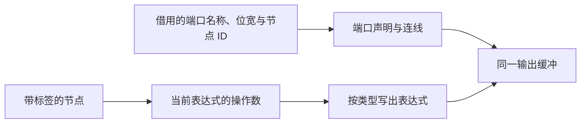

# 硬件电路与时序输出自举

## Intent · 目标

从 FPGA 命令追到硬件图校验和 Verilog 输出。将组合电路、时序封装、运算表达式及端口连接的输出规则迁入 RX/ZX，沿用上一阶段的硬件图与运算定义。

## Data · 依据

起点为 `483616020`。两种电路共用图和节点表达式，时序模块额外处理握手、同步复位和输出寄存器。正式入口从 `fpga.runProgram` 进入 `hardware.generate` 和 `verilog.emit`。原有输出在 Zig 中逐端口、逐节点流式写入。

## Edges · 边界

公开图可由调用者构造，必须在按边访问节点和写出 RTL 前通过校验。复用原有端口、节点以及输出缓冲，保留公开图、JSON 清单、原始位置和逐字节输出。

## Answer · 验收

核对受影响的生成入口、组合与时序 RTL、坏图及分配失败路径。用现有常规程序和大图，与上一阶段进行同口径比较。

## 实现

正式硬件校验器和 Verilog 输出器借用同一张公开硬件图。端口通过原结构的字段偏移和步长访问，节点每次只取当前联合值的标签和有效操作数。没有为整张图新建列数组或指针表。Zig 仍负责从公开联合取出当前节点、遍历节点和交付输出缓冲。

每个输入节点都要指出一个范围内的端口，且该端口必须反向指回当前节点。同一端口因而最多匹配一个输入节点。校验输入节点数等于端口数后，每个输入端口都恰有一个匹配节点。输入名称及有符号布尔值另行检查。输出端口仍逐个检查自己的名称、引用和类型。跨节点的读取先检查拓扑顺序。

组合电路的声明、节点赋值、输出连线和故障输出都由 RX/ZX 写入同一缓冲。时序封装的 RX 依次连接端口声明、核心实例和寄存器。位宽扩展、有符号比较和余数输出沿用已有运算规则。初始 Zig seed 保留原校验器和打印器，正式编译器静态选择 Source 实现。

## 静态模板

原生成器遇到没有插值的模板时，仍调用 `std.mem.concat` 复制单个字符串。启用时序封装后，分配失败回归发现七笔此类分配。现在 seed 和 Source 生成器均对空模板和只有一个字符串字面量的模板直接使用静态文本。其他插值沿用原来逐项求值、格式化和拼接的顺序。输出缓冲拥有最终文本，生成函数的工作内存在返回时释放。

## 正确性

用上一阶段的 Source 引导器构建本阶段 Source 工具，另从初始 Zig seed 构建对照工具。两者分别生成硬件校验、Verilog 和模板生成器共七个入口，分析 92 个模块。排除记录本机输入的 `.zxc-inputs` 后，两个输出目录中的 99 个文件逐字节一致。对照上个提交的硬件后端，常规组的 50 份 RTL 和一份诊断、嵌套结构和运算组的 8 份 RTL，以及大图的 4 份 RTL，在候选和 seed 上均逐字节一致。

硬件和模板相关回归通过 84 项测试。最后加入输出容量预留后，重跑硬件资源与求值目标，通过 5 项测试和实际 Yosys 检查。两个组合电路各通过 72 次独立输入及故障检查，时序电路通过 14 个周期、56 条信号记录的对照。

## 时间与内存

两份测量工具均使用 Zig 0.17.0、ReleaseSmall 和 Source 分析与生成路径。对照为上个提交 `483616020` 的硬件工具，候选使用本阶段 Source 工具生成的硬件后端。墙钟只计前端分析完成后的硬件图生成和两种 RTL 输出，CPU 与峰值 RSS 覆盖测量进程。两种实现交错运行七对，表中取中位数。每次均核对输出摘要及分配释放平衡。

| 工作负载                        |      墙钟（ms） |    CPU（s） |        峰值 RSS（字节） |          累计分配（字节） |          分配次数 |
| ------------------------------- | --------------: | ----------: | ----------------------: | ------------------------: | ----------------: |
| 26 个程序，400 轮               | 269.41 → 276.86 | 0.27 → 0.27 |   8,994,816 → 8,847,360 | 306,945,200 → 282,250,000 | 184,000 → 130,400 |
| 1,323 与 10,507 节点大图，20 轮 | 385.55 → 388.37 | 0.41 → 0.41 | 96,075,776 → 94,683,136 | 830,275,780 → 810,298,940 |     1,940 → 1,100 |

输出器根据节点和端口已经确定要写出的文本长度预留空间，随后直接写入结果。两组的峰值分别下降 144 KiB 和 1,360 KiB，墙钟分别增加约 7.5 ms 和 2.8 ms。相对硬件固定基线 `c32626874`，墙钟分别缩短 23.09 ms 和 10.51 ms。大图累计分配较固定基线仍高 9,449,440 字节（1.18%），已低于上阶段的 3.67%。

本阶段 RX 净增 71 行，ZX 净增 1,062 行。Zig 增 301 行、删 77 行，含保留的初始 seed、借用视图和入口接线。正式路径的节点遍历与联合值读取仍由 Zig 执行。
