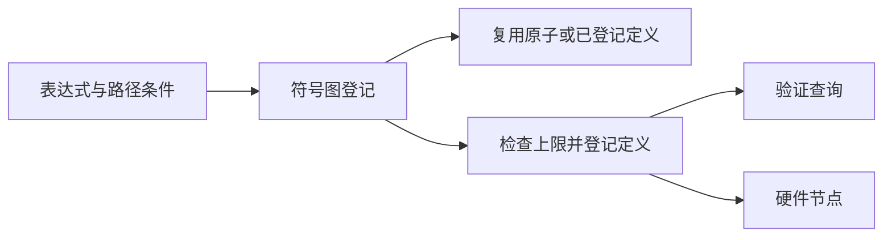

# 符号图登记与查询输出自举

## Intent · 目标

沿形式验证及硬件生成的共用入口迁移符号图的定义登记、复用、索引扩容和 SMT 声明输出。保留复用次序、类型检查和来源位置。

## Data · 依据

起点为 `28be0a7dd`。求值器的 `evaluate` 和条件汇合进入 `Graph.bind`。原实现先查表达式，再对首次出现的复合表达式分配名称、复制文件名并登记进散列表。验证器按登记顺序打印定义，硬件后端按同一顺序解析表达式。

## Edges · 边界

复用已有的字节索引及列视图，保持摊销增长。原子值、重复定义和超过容量的新增定义走不同分支。定义使用的文件名必须在调用者释放原程序后仍然有效。

## Answer · 验收

比较同一批程序的新旧查询，运行 Z3、硬件边界与分配失败覆盖；按既有 26 个程序的基线验收性能，并检查大量不同定义的增长行为。

## 已接入的实现

- 复合表达式使用已有的字节散列表定位。已有定义直接校验位宽并复用名称。新定义在分配名称与稳定的来源文件名之后登记。表容量维持原样时复用查找得到的槽，扩容时才重建索引。同一文件连续产生的定义共享已持有的文件名。
- 验证器和硬件后端借用同一份定义表。验证器按列读取名称、表达式和位宽，直接把声明写到临时输出缓冲。生成可行性与正确性查询后立即释放该缓冲。小查询共用一个 4 KiB 栈缓冲，较大查询按需要增长。
- 被调用函数的 Store、外部实现、递归和深度限制由 ZX 按原顺序判断。源码检查实际表达式种类及其引用的调用记录。函数参数求值与调用结果缓存、复合值递归、表的内存申请以及引导种子仍有 Zig 实现。

## 产物与行为

上阶段正式 Source 引导器生成本阶段的发行版入口。Source 和 seed 两条构建路径均覆盖 779 个入口、5,537 个模块。本阶段的两个引导器再分别生成符号图的 5 个入口，清单覆盖 16 个模块，比较的 97 个文件全部一致。

以 `28be0a7dd` 的正式验证器为对照，26 份既有程序的 50 份查询和 1 份诊断在候选及种子路径上逐字节相同。另用 128 和 1,024 步整数计算并重复部分表达式，实际查询分别包含 530 和 4,226 条定义。两份程序的四份查询在三条路径上逐字节相同。

正式入口通过 87 个构建步骤、8 项 Zig 资源及边界检查，既有 Z3 验证、74 项枚举和 8 项公开接口检查均通过。Yosys 检查了两组共 144 种输入及故障组合，以及时序电路的 14 个周期、56 个信号记录。

## 性能与内存

Zig 0.17.0、ReleaseSmall，两份测量工具分别编入上个提交和本次的正式验证器，分析和生成均启用 Source。先完成解析与分析，测量仅覆盖生成查询。每组交错运行 7 对，取中位数。RSS 为进程峰值；分配字节为累计值。

| 工作负载            | 版本                 |      墙钟 |    CPU | 峰值 RSS（字节） | 累计分配（字节） | 分配次数 |
| ------------------- | -------------------- | --------: | -----: | ---------------: | ---------------: | -------: |
| 26 个程序，1,000 轮 | 固定基线 `845238ad2` | 452.09 ms | 0.44 s |        8,519,680 |      891,914,000 |  285,000 |
| 同上                | 上一提交             | 432.59 ms | 0.43 s |        8,470,528 |      805,072,000 |  283,000 |
| 同上                | 本次                 | 428.66 ms | 0.43 s |        8,503,296 |      653,542,000 |  273,000 |
| 两个大图，40 轮     | 上一提交             | 653.56 ms | 0.68 s |       95,731,712 |    1,402,631,280 |    1,760 |
| 同上                | 本次                 | 641.12 ms | 0.66 s |       95,797,248 |    1,333,042,320 |    1,840 |

常规组比上一提交少分配 18.8%，较固定基线快 23.43 ms。登记新定义时累计名称与表达式的字节，写声明前用这个已知下界预留缓冲。大图组累计分配减少 69,588,960 字节，分配次数增加 80 次。常规组和大图组峰值分别增加 32 KiB 和 64 KiB。每轮查询销毁后，计数分配器的申请与释放字节相等。这组计时覆盖验证器，不能推算整个仓库的冷构建耗时。
