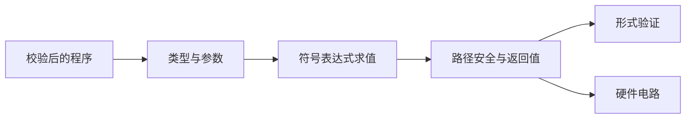
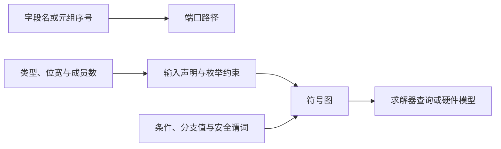

# 符号求值与分支条件迁移

## Intent · 目标

贯通验证器的输入声明、常量、条件与匹配表达式、路径谓词，以及硬件后端复用的字段路径。保留符号图的登记顺序和诊断。沿验证器、求解器和硬件消费者这一组调用链归集仍由 Zig 处理的职责。

## Data · 依据

起点为 `c32626874`。验证入口和硬件入口先校验 IR，再执行符号求值。作用域校验为每个普通绑定分配唯一符号槽，并拒绝跨作用域读取；当前求值器仍为 if、switch 的每个分支复制整张环境表。输入路径和 SMT 形式在多处手写，标量运算已经有可复用的 ZX 谓词。

## Edges · 边界

每次调用和每条契约独立持有环境，分支按原有顺序处理。复合值保留其字段形状，枚举输入声明必须保留最大成员约束，硬件端口的类型限制保持原有行为。

## Answer · 验收

对照常规程序和大图的查询与诊断，运行形式验证和硬件回归，沿用上一阶段的性能基线。

## 硬件消费者

从符号图追到硬件消费者时，发现 SMT 阅读器和硬件 IR 校验器各自实现了一套二元运算位宽与布尔约束，Verilog 输出又靠枚举序号判断有符号运算。把 18 种操作的公开枚举、SMT 名称、类型规则、Verilog 运算符和符号扩展约定放入同一组 ZX 声明。正式编译器在编译期生成查找表，解析和校验共用同一个运算结果规则。

## 实现与覆盖范围

- 形式验证的输入声明、枚举上界、字段与元组路径、整数和枚举字面量、布尔连接、条件选择及其安全谓词由 RX/ZX 生成。硬件直接取得输入名称和端口路径，省去了仅由求解器消费的声明。
- 同一次调用的各个语句分支共用值槽。两条正式入口先走 IR 校验；其中普通绑定只允许声明一次，表达式引用还要通过活动作用域检查。不同函数调用和契约仍有独立环境。条件、匹配与多个返回值的汇合在写入最终字段时登记标量，读取已登记的对象或元组直接借用其字段。
- 硬件模块使用单独的 arena 保存最终节点和端口。符号求值及子表达式索引仅活到电路生成结束。返回的字段路径和端口名直接构造在结果中，节点来源文件名在不同 arena 的边界取得独立存储，连续使用同一文件的节点共享它。
- 原始语句与匹配分支的遍历、符号调用缓存、硬件的 SMT 解析和 RTL 写出仍有手写 Zig。本批把二元运算的规则和验证器的谓词迁出正式 Zig 路径；验证器和硬件后端整体仍在自举中。

## 正确性

正式引导器由上阶段 Source 构建。seed 和 Source 两条路径均成功构建 789 个入口、5,553 个模块。分别用两份新引导器生成本批 10 个入口，所比较的 85 个文件逐字节一致。

26 份常规输入的 50 份查询及 1 份诊断、50 份 RTL 及 1 份诊断均与上一提交逐字节一致。4 份附加输入覆盖跨分支同名局部绑定、匹配、嵌套对象与元组，以及有符号和无符号运算；其 8 份查询和 8 份 RTL 也在候选、种子和上一提交上逐字节一致。另对 96 个分支和两组大图核对了全部 6 份查询。

在独立探针中销毁前端程序和保存源码文件名的全部页，再用返回的硬件模块检查每个节点的来源、端口路径并生成两种 RTL。四个程序逐个运行，返回时仍持有的分配字节数合计从 275,852 降到 28,574，每个模块销毁后均释放全部分配。

正式入口通过 87 个构建步骤、8 项 Zig 边界和分配失败检查、20 个 Z3 CLI 场景、74 项枚举检查和 8 项公开接口检查。Yosys 验证了 144 组组合电路输入与故障，以及 14 个时钟周期的 56 个信号记录。最终调整临时内存布局后重跑硬件入口，78 个构建步骤及 5 项 Zig 检查通过，Yosys 输出一致。

## 成本对照

两份测量工具均使用 Zig 0.17.0 和 ReleaseSmall，使用 Source 引导器生成的分析与生成实现。对照工具编入 `c32626874` 的验证器和硬件后端，候选工具编入本次改动。每组交错运行七对，取中位数。墙钟只计已完成前端分析后的查询生成或电路生成与 Verilog 写出，CPU 和 RSS 覆盖整个测量进程。每次运行均核对输出摘要和分配释放平衡。

| 工作负载                                 |      墙钟（ms） |    CPU（s） |        峰值 RSS（字节） |              累计分配（字节） |          分配次数 |
| ---------------------------------------- | --------------: | ----------: | ----------------------: | ----------------------------: | ----------------: |
| 26 个程序生成查询，1,000 轮              | 437.22 → 405.17 | 0.43 → 0.40 |   8,503,296 → 8,503,296 |     653,542,000 → 606,058,000 | 273,000 → 270,000 |
| 两个大图生成查询，40 轮                  | 652.57 → 647.50 | 0.68 → 0.67 | 95,797,248 → 95,797,248 | 1,333,042,320 → 1,334,604,160 |     1,840 → 1,840 |
| 96 分支程序及两份嵌套输入生成查询，30 轮 |   46.02 → 43.22 | 0.04 → 0.04 | 11,288,576 → 10,813,440 |       90,197,610 → 66,038,430 |     1,470 → 1,380 |
| 26 个程序生成电路及两种 RTL，400 轮      | 299.95 → 269.19 | 0.29 → 0.27 |   8,978,432 → 8,994,816 |     543,889,200 → 306,945,200 | 221,600 → 184,000 |
| 两个大图生成电路及两种 RTL，20 轮        | 398.88 → 386.43 | 0.43 → 0.41 | 97,222,656 → 96,075,776 |     800,849,500 → 830,275,780 |     2,000 → 1,940 |

常规查询较固定基线 `845238ad2` 的 452.09 ms 缩短 46.92 ms，累计分配较基线减少 285,856,000 字节。大图查询累计分配上升 0.12%，峰值 RSS 持平。本次改动的计时范围限于验证器和硬件后端。

硬件生成的临时符号和索引共用 32 KiB 栈缓冲，超出部分进入本次调用的临时 arena。结果节点按已知符号数预留空间。常规组累计分配减少 43.6%，进程峰值增加 16 KiB。用同一工具加载全部输入、在硬件生成前退出，对照和候选的峰值分别为 8,339,456 和 8,355,840 字节，已相差 16 KiB。大图的进程峰值下降 1,146,880 字节，累计申请量增加 3.67%，这项成本仍需跟踪。

## 源码变化

本批在 `docs/` 外新增 55 行 RX 和 413 行 ZX。Zig 增 367 行、删 167 行，净增 200 行，包含初始 seed 的对应实现、Source 入口接线和硬件临时内存管理。已退出正式 Zig 路径的职责列在上文。相对 `aa2fcd40`，RX/ZX 累计新增 41,852 行、删除 8,663 行，净增 33,189 行。
