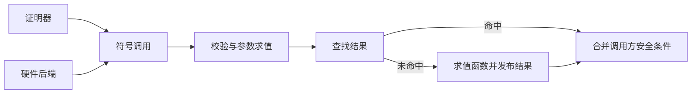

# 符号调用缓存迁移

## Intent · 目标

让证明器与硬件后端共用 Source 定义的调用身份和精确匹配规则，移除生成缓存键时的 JSON 和文本拼接。

## Data · 依据

两个正式入口在处理调用表达式时，经同一张符号图缓存函数结果。图只在本次求值中存活。前端先验证调用的参数类型。每个函数的参数只有一种对象、元组和标量布局，按声明顺序读取其标量叶子即可比较同一函数的两个输入。参数的安全条件由当前调用方单独合入返回值。

## Edges · 边界

命中仍检查当前调用的合法性和深度。哈希相同后逐项核对函数编号和参数内容。嵌套调用可扩容缓存，父调用只在子调用成功后发布结果。初始 seed 沿用原入口。

## Answer · 验收

对照同一组现有多模块程序的 SMT 和 RTL，检查调用安全条件及诊断。对相同输入测量求值开销与分配量，并注明仍由 Zig 执行的职责。

## 实现与剩余职责

正式入口直接借用符号文本，依次将函数编号和每个标量字段送入哈希函数。哈希表选出候选后，由 ZX 检查目标函数、字段数和每个字段的内容。生成的比较调用 `std.mem.eql`。命中时撤销本次附加的字段描述符，未命中时保留其在数组中的起点和长度。子调用扩容后，父调用仍能按下标读取原字段。缓存只保存被调函数的安全条件，调用方每次独立合入参数的安全条件。

`std:bytes.hashSeeded` 直接复用原有字节哈希实现，读取切片时无分配。初始 Zig seed 保留旧文本键。符号值联合的遍历、借用描述符的存储、哈希表和函数执行仍由 Zig 管理，调用缓存尚有宿主状态需要迁移。

## 正确性与阶段对照

- 对照提交为 `4db26d187`。五个多模块输入覆盖同一函数重复命中、连续不同参数、不同函数共用参数、嵌套对象、元组及返回聚合值。用现有导入路径用例、枚举验证用例、分支汇合样例和历史并行证明样例构建统一库，两端解码相同 IR。历史并行样例的两次同名调用分别放入具名 Task，以兼容当前 RX 的结果绑定规则。
- 五份可行性查询和五份正确性查询逐字节相同。三个程序的组合与时钟 RTL 共六份，逐字节相同。其余两个三成员枚举程序在前后两版硬件后端均得到相同的类型表达式诊断。这两例只计入诊断对照。
- 通过 20 个证明 CLI 场景、8 个公开入口场景、74 个枚举场景，以及 8 项 Zig 测试。首次调用硬件求值测试缺少 `ZXC_TEST_YOSYS`，指定仓库已有的 YoWASP 工具后，复用同一候选通过了 144 次组合输入及故障检查、14 个周期的 56 条信号记录。
- 使用 Zig 0.17.0 和 small 优化模式，从初始 seed 构建第一份 Source 引导器，再由它构建第二份。两份 Source 工具用同一清单分析并生成缓存入口，排除本机输入标记 `.zxc-inputs` 后，全部 12 个文件逐字节一致。另行比较初始 Zig seed 的直接输出时，两个函数的局部变量编号顺序不同，规范编号后正文一致，对应文件摘要也随之不同。

## 耗时与内存

两端均运行 Source 分析和生成实现。验证与硬件工具复用原阶段的生成配置，候选使用第一份 Source 工具生成的模块。对已分析的输入交错测量七对，取中位数。墙钟覆盖符号求值和产物输出，CPU 与峰值 RSS 覆盖进程。累计分配由测试分配器记录，每次确认申请与释放平衡。

| 工作负载                      |          墙钟（ms） |    CPU（s） |        峰值 RSS（字节） |          累计分配（字节） |
| ----------------------------- | ------------------: | ----------: | ----------------------: | ------------------------: |
| 5 个多模块程序，证明 1,200 轮 | 1,848.45 → 1,848.66 | 1.84 → 1.84 |   3,309,568 → 3,309,568 | 372,619,200 → 368,666,400 |
| 同组程序，硬件 1,200 轮       | 1,938.72 → 1,926.82 | 1.93 → 1.92 | 26,558,464 → 26,558,464 | 304,441,200 → 304,441,200 |
| 常规 26 个程序，证明 1,000 轮 |     402.43 → 385.43 | 0.40 → 0.38 |   8,503,296 → 8,470,528 | 606,058,000 → 600,504,000 |
| 常规 26 个程序，硬件 400 轮   |     271.67 → 265.10 | 0.27 → 0.26 |   8,830,976 → 8,863,744 | 281,458,000 → 281,458,000 |

多模块证明累计分配减少 3,952,800 字节，底层分配次数均为 86,400。多模块硬件底层分配均为 84,000 次。常规组分别沿用上一份相同场景的已验收工具；相对固定基线 `845238ad2` 和 `c32626874`，常规证明、硬件的墙钟分别缩短 66.66 ms、34.85 ms。常规硬件的峰值 RSS 比同机对照高 32 KiB，仍低于固定基线。此处没有测完整冷构建。
