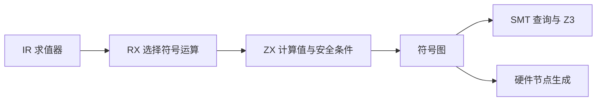

# 符号运算与安全条件自举

## Intent · 目标

正式验证器和硬件后端从同一个 IR 求值器取得表达式与安全条件。本批迁移布尔、枚举相等、整数比较、算术及取负，保留求值顺序和有符号边界。

## Data · 依据

起点为 `845238ad2`。原求值器在 `verification/expressions.zig` 中递归取数、选择 SMT 运算并构造安全条件。在 `conditions.zig` 中汇合控制流，在 `graph.zig` 中登记子式。验证器将结果提交给 Z3，硬件后端从同一表达式构建带类型的节点。

## Edges · 边界

ZX 持有算术、比较、短路和安全条件语义。RX 根据运算种类编排。求值缓存、IR 遍历、图节点登记及初始 seed 的独立实现分别核算。共享输入字符串，保留声明及安全条件的顺序。

## Answer · 验收

用真实 Z3、验证资源边界和硬件已有测试核对；比较迁移前后的 SMT 查询及仅包含符号求值的测量结果。

### 正式调用链与迁移边界

自 `845238ad2` 追到了 CLI 验证、库验证、FPGA 入口、验证器及硬件图构造，共 15 个 Zig 文件、1,461 行。正式版的 `Expressions.evaluateRaw` 依原顺序取得操作数，随后进入 `scalar/binary.rx` 或 `scalar/unary.zx`。RX 选择短路、相等、算术、除法和比较；ZX 生成对应结果和安全条件。加减法扩一位，乘法扩至双倍位宽。除法和取余检查零除数；有符号除法单独排除最小值除以负一，有符号取余沿用原行为。枚举相等和布尔短路保持各自的类型规则。

SMT 片段存放在独立的 `.tpl` 资源中。生成位宽与边界数值时，生成 Zig 在栈内打印数字并一次拼合最终片段。整数类型属性由 ZX 描述，编译期求出整个标量表供验证器和硬件端口查询。查询构建器直接借用输入描述符。图登记、递归求值、复合值遍历、约束执行、求解器进程和硬件节点存储仍在 Zig；初始 seed 单独保留原标量算法。

### 已验证的行为

- 上阶段 Source 引导器构建候选通过 38/38 步，初始 seed 引导通过 36/36 步。两条引导路径生成三个标量入口，排除输入戳后，74 个文件逐字节一致。
- 受影响的既有回归通过 87/87 步。真实 Z3 通过 20 个 CLI 场景、74 项枚举验证和 8 项公开入口验证；另外 8 项 Zig 回归覆盖验证器及硬件图的内存失败与输入边界。
- 既有硬件测试夹具仍使用分号分隔类型字段。安装版和候选均在 ZX 解析处报错。将两个输入声明及三个函数体按现行 ZX 语法排版后，YoWASP Yosys 通过 72 组条件加法、72 组有符号除法与取余，以及 14 个时钟周期的 56 条信号记录。输入向量、期望值和故障断言沿用既有测试。
- 上一提交与候选分别从正常前端分析 20 个既有验证场景和 6 个不同整数类型的算术夹具，再执行查询生成。25 组查询的可行性及正确性 SMT 文件与 1 个诊断共 51 个文件，逐字节一致。
- 用初始 seed 的实际编译模块另行构建同一查询入口，上述 51 个产物与正式 Source 版本也完全相同。

### 性能与规模

使用 ReleaseSmall，上一提交与候选都启用 Source 前端和生成的模块。每轮预先分析同一批 26 个程序，然后分别调用验证器 1,000 次，合计 26,000 次查询生成。两版交替七轮取中位数；墙钟只覆盖生成循环，CPU 和系统峰值 RSS 覆盖探针进程。累计申请字节是验证器向底层分配器请求的总量。

| 指标           |      上一提交 |          本批 |
| -------------- | ------------: | ------------: |
| 查询生成墙钟   |     452.09 ms |     439.98 ms |
| 进程 CPU       |        0.44 s |        0.44 s |
| 单进程峰值 RSS |   8,519,680 B |   8,470,528 B |
| 累计申请字节   | 891,914,000 B | 805,072,000 B |
| 分配次数       |       285,000 |       283,000 |

累计申请量下降 9.74%，生成墙钟下降 2.68%。本语料以 `845238ad2` 为首次固定对照；整仓冷构建沿用既有基线。RX 增 106 行，ZX 增 374 行，另有 12 个 SMT 片段。Zig 增 185 行、删 90 行，净增 95 行，其中 79 行是保留原行为的 seed 标量实现。正式路径退出了原先 `expressions.zig` 中的二元运算函数及一元安全条件构造，数值类型映射在编译期生成。
