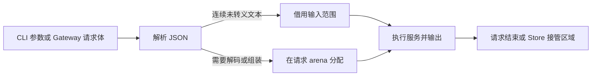
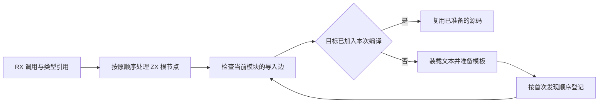
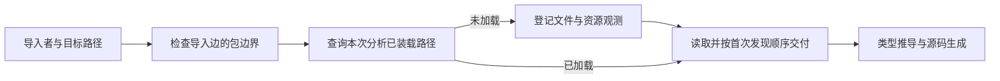

# 编译与运行时性能核查

## Intent · 目标

按本地正式入口核查外部诊断提出的编译、内存和并发瓶颈。修复已确认的重复解析、重复快照和 JSON 字符串复制。用同一输入比较生成结果、运行行为及开销。

## Data · 源码核查

| 假设                           | 当前实现与证据                                                                                                                                                                                                                                                                                    |
| ------------------------------ | ------------------------------------------------------------------------------------------------------------------------------------------------------------------------------------------------------------------------------------------------------------------------------------------------- |
| 全闭包重编且生成单个 Zig 文件  | 冷启动仍需加载入口依赖。正式构建在 `backends/zig/modules.zig` 和 `library.zig` 分开生成入口、类型和函数单元；`function_sources.zig` 按内容键复用单元。`cli/build/observed.zig` 为 Zig 后端设置持久本地及全局缓存。watch 启动后端子进程，磁盘缓存复用与 Zig 常驻声明级增量是两层能力。             |
| 重复解析与跨模块类型推导       | `rx/analysis/project/history.zig` 和 `mixed/reuse.zig` 已支持常驻 Source 引导器重放模块分析。`cli/rx/analyze.zig` 的公开构建路径原先在收集和推导各用一份解析缓存，库的多个 RX 入口也无法复用同一次发布中已解析的 ZX。公开 RX watch 仍按次建立前端分析。                                           |
| SMT 分支膨胀                   | `verification/call_cache.zig` 复用函数及符号实参完全相同的调用。`verification/calls.zig` 对未命中的实参仍展开函数体，符号执行有步数限制。由此能确定复用边界，复杂输入在 Z3 上的实际成本需要按查询和求解阶段分别观测。                                                                             |
| 所有权退化为复制               | 生成器已有只读借用、唯一性复用和集合结果投影。普通集合链仍可能物化中间数组，融合需要证明回调求值、错误和副作用顺序。此次确认并消除的是入口 JSON 中可直接借用的字符串复制。                                                                                                                        |
| `$ctx` 动态累积                | `rx/analysis/result_name` 在编译时为结果绑定符号；`$ctx` 是引用方式，运行时持有局部结果。仍需用大集合和多阶段调用检查局部值实际存活多久、何时可以释放请求内的临时分配。                                                                                                                           |
| 请求逐对象使用通用分配器       | `gateway/host/request_scope.zx` 已为请求建立作用域并清理 arena。`gateway/invoke/input/read_body.zx` 用该 arena 读入完整请求体。CLI 参数也在整个调用期间有效。这两个解析入口原来设置 `.alloc_always`，导致可借用的连续字符串仍被复制。                                                             |
| 每个 Parallel 分支创建系统线程 | `tasks/start/invoke.zx` 生成 `std.Io.async` 或 `std.Io.concurrent`。Zig 0.17.0 的 `Io.Threaded` 复用空闲线程。线程全忙时，`concurrent` 可以扩充线程池，默认上限为 `unlimited`。`gateway/host/accept.zx` 同步处理连接，完成后才接受下一条。并发任务共用 arena 时有分配锁，尚无锁等待占主导的测量。 |
| Store 全局互斥与整块克隆       | 当前 Gateway 串行接入。Store 请求持有对象引用，更新及回收由 `state/request_commit.zig` 和区域发布规则负责。要并发接入有写入的路由，需要先核对请求期间借用快照、提交顺序和退役区域的回收。                                                                                                         |
| 紧凑循环的取消轮询             | `analysis/tasks/future` 生成 Future 的取消与等待。当前普通 `loop` 的生成路径未发现通用逐次原子轮询；网关连接层显式检查 I/O 的取消错误。                                                                                                                                                           |

Zig 的 ZIR 文件缓存与常驻声明级增量是独立机制。LLVM 的前端性能建议用于提出测量假设，具体开销由本地生成产物和采样确认。[Zig 增量编译实现](https://mlugg.co.uk/posts/incremental-compilation-internals/) · [LLVM 前端性能建议](https://llvm.org/docs/Frontend/PerformanceTips.html)

## Edges · 本批改动与生命周期

一次 RX 构建在收集依赖和项目推导之间共享解析缓存。一次库发布的所有入口也共用同一份缓存。缓存的生命周期覆盖使用它的分析结果，文件版本被替换时旧解析保留到这些结果销毁。

watch 成功时，同一份输入快照兼作下次比较的基准。失败时仍保存最近一次成功的输入集合，并记录本次失败的观察值，供缺失文件恢复和后端重试使用。

入口继续由 Source 的 AST 构造生成普通 Zig。Zig 的完整切片解析默认在需要时分配。Gateway 读入的请求体与解码结果在同一个 arena 中，Store 若保留请求区域，相关字节随区域一起保留。Wasm 及外部宿主需要按各自缓冲区的所有权约定处理，本批只改 CLI 进程和 Gateway。

## Answer · 验收

`test-gateway`、`test-application-json-gateway`、`test-rx-watch`、`test-watch-library`、`test-watch-recovery`、`test-parse-cache` 和 `test-library-bundle` 通过，共 108 个构建步骤及 62 项 Zig 测试。Gateway 覆盖转义文本、无效输入以及跨请求读取先前写入 Store 的字符串。Source 引导器构建通过 25 个步骤。两个相邻 Source 引导器生成同一份 CLI 与 Gateway 窄清单，排除输入戳后逐字节一致。

完整 `test-library-publish` 另通过 78 个构建步骤，覆盖公开 ZX 与 RX 模块、原生依赖、发布失败回滚及已编译库复用。生成的 Gateway 和 CLI 使用同一条 `parseFromSliceLeaky` 路径，省去了强制复制选项。独立运行含转义字符的 CLI 输入得到预期值。

### 性能对照

macOS arm64，Zig 0.17.0，ReleaseSmall。对照 CLI 和候选 CLI 都通过已验收的 Source 引导器生成编译模块，执行时使用 Source 分析和生成。每组按版本交错执行，去掉首轮后取七轮中位数。RSS 为被测 CLI 或服务进程的系统峰值，MB 按十进制计。

库发布使用 16 个 RX 入口，共用 49 个 ZX 模块，带 `--no-cache` 隔离磁盘生成缓存的影响。每次重建发布目录，三版生成的 70 个发布文件逐字节一致。固定对照是 `6e0cf529f`，直接对照是 `b001219cf`。

| 库发布         | 固定对照 | 直接对照 |  候选 |
| -------------- | -------: | -------: | ----: |
| 墙钟（秒）     |    0.996 |    0.994 | 0.902 |
| CPU（秒）      |    1.210 |    1.205 | 1.041 |
| 峰值 RSS（MB） |   102.81 |   106.00 | 94.26 |

Gateway 对照用同一监听地址、路由和执行参数，每轮依次发送 120 个各含 1 MiB 未转义文本的请求，逐个验证 HTTP 状态和长度。转义字符串另在预热时验证。CPU 统计服务进程启动到结束，墙钟只计请求窗口。

| Gateway        | 直接对照 |  候选 |
| -------------- | -------: | ----: |
| 墙钟（秒）     |    0.229 | 0.199 |
| CPU（秒）      |    0.203 | 0.172 |
| 峰值 RSS（MB） |     4.72 |  3.67 |

在本地单独验证了连接排队。一个已接入而尚未发完请求头的连接，使第二条正常请求无法在 250 毫秒内得到响应。请求处理与 Store 共享状态发布当前在同一串行路径。这个结果与 JSON 借用收益分开，后者衡量单连接处理成本。

## 复查 · 同一 RX 入口的共享 ZX 依赖

### Intent · 目标

减少正式 `zxc` 在单个 RX 项目中加载共享 ZX 依赖的次数。覆盖普通编译、库导出和 Gateway 服务编译共用的装载入口。

### Data · 根因

`cli/rx/analyze.zig` 为 RX 引用的每个 ZX 根节点创建独立的遍历列表。解析缓存能复用语法树，依赖路径选择、文件观测、模板准备和源码复制仍在每个根节点重新执行。每轮加载结束后才从并集中去掉重复文件。单入口 ZX 装载也用逐项扫描查找已加载的路径，依赖越多，查重开销越高。

### Edges · 正确性边界

一次 RX 分析共享路径索引和有序源码列表。每个根节点继续以广度优先顺序读完本次新增的依赖。文件目标的包边界检查仍按导入来源执行，只有已装载的文件才命中索引。模板从磁盘加载并参加 watch 输入核对，重新构建时按本轮文件重新装载。源码列表中的内容由本轮分析调用方持有，加载 RX 定义的临时 arena 可以按原顺序释放。

### Answer · 验收

对照工具与候选使用同一输入，核对生成物、路径错误、编译库消费和 watch 更新。主要测量 `zxc` 到 Zig 源码的端到端开销，以单个 ZX 入口和单根 RX 作为小规模对照，再用具有不同 ZX 根节点的 RX 项目检查共享依赖带来的规模差异。

六组仓库回归通过，共 94 个构建步骤、48 项 Zig 测试。回归覆盖公开库发布与消费、缺失传递依赖、RX 和库的 watch 恢复、ZX 导入路径以及 Gateway 的 86 项应用检查。五种性能输入在直接对照和候选上生成的文件逐字节一致。64 根节点的 RX 样本编译为原生程序，输入 `7` 得到 `1527`。

macOS arm64，Zig 0.17.0，ReleaseSmall。固定对照为 `6e0cf529f`，直接对照为 `bc7e4afc5`。各工具由对应阶段的 Source 引导器生成分析和生成模块，候选使用 `bc7e4afc5` 的 Source 引导器。使用 `--no-cache` 生成 Zig 源码，版本交错执行，首轮预热后取九轮中位数。RX 的各个 ZX 根节点导入同一份包含 49 个 ZX 文件的依赖闭包。

| 输入                 | 墙钟（ms，固定 / 直接 / 候选） | CPU（ms，固定 / 直接 / 候选） | 峰值 RSS（MB，固定 / 直接 / 候选） |
| -------------------- | -----------------------------: | ----------------------------: | ---------------------------------: |
| 单文件 ZX            |             2.68 / 2.71 / 2.73 |            2.52 / 2.45 / 2.51 |                 7.13 / 7.11 / 7.08 |
| 49 文件的 ZX 闭包    |          19.27 / 19.23 / 19.13 |         21.00 / 20.94 / 20.79 |              16.42 / 16.45 / 16.35 |
| RX · 1 个 ZX 根节点  |          20.74 / 19.00 / 18.73 |         33.00 / 26.52 / 26.20 |              18.48 / 18.12 / 18.15 |
| RX · 16 个 ZX 根节点 |          38.92 / 37.01 / 23.35 |         55.46 / 47.58 / 33.60 |              21.23 / 20.48 / 20.43 |
| RX · 64 个 ZX 根节点 |          96.40 / 94.09 / 37.99 |       125.50 / 111.72 / 55.68 |              27.03 / 26.18 / 23.56 |

64 根节点的样本相对直接对照，墙钟减少 59.6%，CPU 减少 50.2%，峰值 RSS 减少 10.0%。这些数据覆盖源码装载、前端分析与 Zig 生成，原生后端耗时另计。

### 已知边界

- 公开 `build --watch` 的后端每轮启动新的 Zig 进程，使用磁盘缓存。常驻 Source 引导器已有分析版本复用，但公开 watch 还需要单独验证跨编辑的前端复用和后端声明级增量。
- `verify` 的符号调用缓存按同一函数及相同符号实参命中。不同实参仍展开，应分开测量生成 SMT 查询、查询体积与 Z3 求解时间，才能判断函数摘要的收益。
- 只读借用和独占更新复用已经存在。对数组链进行融合需要测量中间数组的分配，并保留求值、错误和副作用顺序。`$ctx` 在静态编排时映射为结果绑定，分析运行内存时应跟踪绑定引用的区域。请求结束仍可能有 Store 持有其中一片区域，不能按局部变量作用域释放整个区域。
- Gateway 已复现队首阻塞。并发处理涉及连接调度以及 Store 快照、提交和退役区域的生命周期。在这些约定得到验证以前，串行宿主的结果无法用来推断 Store 锁竞争。
