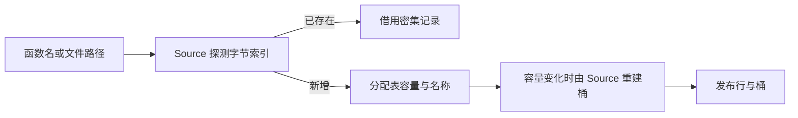
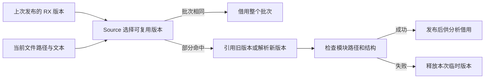

# 自举缓存索引与常驻版本复用

## Intent · 目标

让生成结果缓存和常驻文件缓存使用解析缓存已有的 Source 字节索引。将常驻 RX 模块的版本匹配迁入 Source，保留只读并发查询、分析借用、失败恢复和磁盘缓存兼容性。

## Data · 实现依据

`9fc2bb8aa` 的生成缓存和常驻文件缓存分别持有 Zig 字符串哈希表。解析缓存已有基于密集键和值数组的索引。索引的探测和扩容重建由 ZX 执行，桶中保存从 1 开始的行号。生成缓存和常驻文件缓存接入该索引后按行借用记录，可直接读取摘要、版本和源码缓冲。常驻文件的元数据校验与读取后发布沿用首次查到的位置。新增条目在扩容和拥有名称之后才发布。

常驻引导器在包配置未变时比较整个 RX 批次。若批次有变化，Source 按排序后的路径走一遍旧版本和当前输入，从旧版本中选取路径及字节均相同的项。旧版本位于指针数组后方，比较时借用路径和原文列，写入的仅是待复用的行号。

## Edges · 边界

保留只有写入方可以修改索引的约束。旧文本仍由分析的借用决定释放时机。生成缓存仍先复制借用内容至最终产物，再接管或替换缓存项。平台文件操作、数组分配、引用计数和退役缓冲的实际释放依旧在原生接口中。初始 Zig seed 使用相同的密集索引表示，并能用自身的探测和版本比较启动。

## Answer · 验收

初始 seed 的 14 个构建步骤通过，正式 Source 引导器的 25 个步骤通过。新旧 Source 工具使用同一窄清单生成版本匹配入口，排除输入戳后逐字节一致。`test-module-generation`、`test-generation-runtime`、`test-native-generation`、`test-parse-cache` 和 `test-library-bundle` 通过，共 111 个构建步骤和 37 项 Zig 测试。

379 模块的常驻工程在首次生成、修改函数正文、修改 RX、缺失依赖及恢复后均符合预期。四次有效状态各有 709 个 Zig 文件与对应冷生成逐字节一致。修改正文时复用 376 个模块，重写一个函数文件；修改 RX 时复用 377 个模块。无改动请求直接返回。

### 性能

使用 Zig 0.17.0、ReleaseSmall、16 分区、固定 735 入口清单。上一批引导器和候选均由 Source 构建并运行 Source 分析和生成路径。每版交错运行三轮，取中位数。冷生成使用空的生成目录和缓存，热重建仅清空输出。进程树峰值为采样值，单进程峰值为系统记录，MB 按十进制计。

| 场景   | 指标             | 固定基线 | 上一批 |   候选 |
| ------ | ---------------- | -------: | -----: | -----: |
| 冷生成 | 墙钟（秒）       |     2.86 |   2.60 |   2.60 |
| 冷生成 | CPU（秒）        |    12.49 |  12.20 |  12.22 |
| 冷生成 | 进程树峰值（MB） |   885.56 | 702.10 | 700.60 |
| 冷生成 | 单进程峰值（MB） |   948.90 | 761.51 | 759.10 |
| 热重建 | 墙钟（秒）       |     2.24 |   1.99 |   1.99 |
| 热重建 | CPU（秒）        |     8.55 |   8.33 |   8.31 |
| 无改动 | 墙钟（秒）       |     0.04 |   0.03 |   0.04 |

上一批与候选的冷生成产物在排除输入戳后，11,758 个文件逐字节一致；各版热重建与各自冷生成一致。上一批和候选的 v18 唯一性缓存载荷均为 `e9e3d5b2caace901ee98d61440aac25cb252daab17bf2ddd76bace5f25bf61de`。固定基线保留当时的生成格式及 v17 缓存，用于跟踪相同输入下的累计开销。此次计时覆盖 Source 分析和生成路径，LLVM 冷构建另有独立基线。

常驻工程另交错执行三轮。仅改正文的中位墙钟为 88.48 → 89.22 毫秒，修改 RX 为 65.81 → 67.85 毫秒，恢复为 62.76 → 64.49 毫秒。三种编辑的 CPU 增量在 10 毫秒采样精度内持平。常驻进程在整轮验证的系统峰值为 294.40 → 294.98 MB，增加 0.57 MB，约 0.2%。
