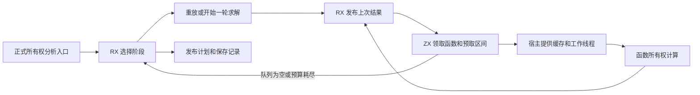
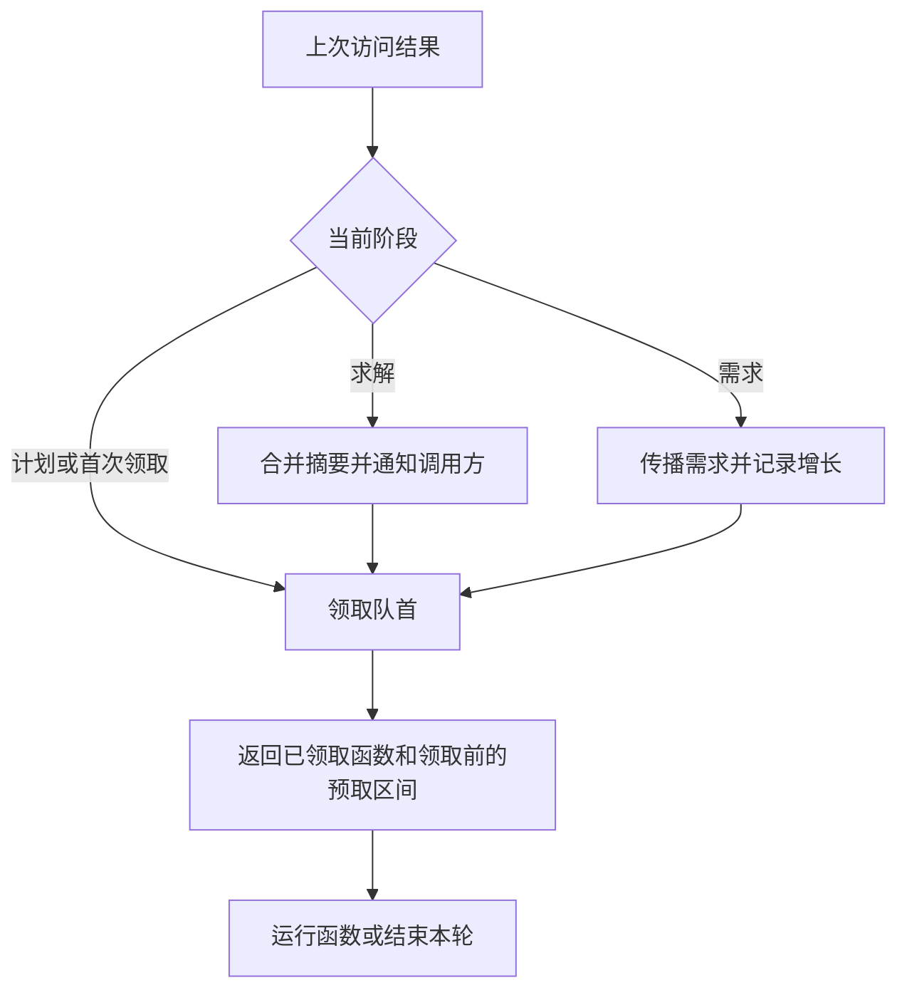

# 跨函数所有权轮次与工作队列自举

## Intent · 目标

从跨函数所有权分析的正式入口，贯通重放、摘要求解、需求传播、计划生成和记录提交。让 RX 决定下一个阶段、上一份访问结果如何发布，让 ZX 决定下一个函数和待预取的队列范围。线程、分配器和有类型的分析结果继续遵守现有所有权契约。

## Data · 证据

起点为 `00ef44076`。程序入口、轮次、前后台分析、摘要、缓存和调用图合计 18 个 Zig 文件、3,540 行。旧的程序模块通过 7 个专用原生符号回调 Zig。三个 Zig 循环分别负责领取函数、处理缓存和后台结果、重新入队以及判断停止。先前的 ZX 已实现入队去重和摘要弱化规则。旧队列保留本轮已经出队的前缀，尾部在重新入队时继续增长。

## Edges · 边界

同一个函数最多有一次待处理访问，可以按函数及入口的总数分配环形队列。普通函数、原生函数、仅类型模块和入口沿用原来的入队规则。重新入队先去重，再写入队尾；索引到达最后一格后回到第一格。后台预取同时看到队尾和绕回队首的部分，保留原有窗口宽度、次序、递归排除和原子状态协议。

求解预算仍按全部函数及入口计算。预算用完时，若队列本来为空，正常结束；若尚有下一项，取走该项并在需求轮清除保证。一次函数访问的变更列表可能借用轮次内存，必须等 RX 发布完变更后才重置。后台任务在跨轮重置摘要前结束。

## Answer · 验收

`program/run.rx` 直接给出阶段决定；`work/round/prepare.rx` 执行相应的摘要重置和队列填充；`work/round/advance.rx` 合并上一函数的结果，累积增长标记并领取下一项。三种轮次共用一个宿主循环来执行返回的访问。环形队列按函数数目取得最终空间，后续重新入队不会扩容。队列、标志、摘要和调用方列表均通过借用访问。

构建清单、包接口、各分区的 Zig 模块依赖及链接符号已移除原有的七个专用回调。宿主仍负责线程和工作区的生命周期，执行函数时还要读取缓存、复用后台结果、在需要时重算、写回缓存。上述职责继续计入剩余 Zig。

四个新入口分别用 seed 和上一阶段的 Source 引导器构建，128 个输出文件逐字节一致。用上一阶段和本阶段的 Source 工具处理当前清单，766 个入口、5,551 个模块产生的 13,073 个文件均一致（排除记录运行路径的 `.zxc-inputs`）。v18 所有权缓存的 14,330,019 字节载荷也一致，SHA-256 为 `14d1d58b3c8a935ef77267915e449c23a624fab3115e5893e58a010e4479ef67`。函数分析、模块生成、所有权缓存和字段事实四组已有测试共 249 项通过。

常驻生成器在修改函数体、增删被调用函数、修改 RX、引入错误依赖再恢复时，均给出预期结果。每次有效修改后的 709 个生成文件与独立冷生成一致。另用同一调用图将函数返回值从新建改为借用再恢复，各次的 41 个文件也与冷生成一致。

固定性能清单包含 735 个入口，16 个分区。上一阶段和当前的 ReleaseSmall 自举工具均执行 Source 分析和生成。两版交替测量三次，以下取各指标中位数。计时止于 Zig 源码生成，不含 LLVM 编译和链接。固定清单上另核对了 11,758 个输出文件和磁盘缓存载荷。

| 指标                 |  上一阶段 |    本阶段 | 固定基线 | 距固定基线 |
| -------------------- | --------: | --------: | -------: | ---------: |
| 冷生成墙钟           |    2.62 s |    2.59 s |   2.85 s |    −0.26 s |
| 冷生成 CPU           |   12.34 s |   12.30 s |  12.58 s |    −0.28 s |
| 冷生成进程树采样峰值 | 703.02 MB | 702.94 MB | 893.0 MB | −190.06 MB |
| 冷生成单进程系统峰值 | 737.31 MB | 737.77 MB | 939.7 MB | −201.93 MB |
| 热生成墙钟           |    1.98 s |    1.98 s |   2.25 s |    −0.27 s |
| 热生成 CPU           |    8.28 s |    8.20 s |   8.61 s |    −0.41 s |

未修改输入的重复请求两版墙钟均为 0.03 s。379 模块常驻场景中，修改函数体、增加被调用函数、恢复的请求分别从 87.37、148.67、111.18 ms 变为 87.68、150.34、111.18 ms。相对固定记录分别增加 0.46、3.56、1.44 ms。常驻服务的系统峰值中位数从 297.14 MB 变为 298.01 MB。

相对起点，Zig 新增 331 行、删除 477 行，净减 146 行。RX 新增 115 行、删除 56 行，ZX 新增 185 行、删除 281 行。原有 3,540 行统计的是相邻调用链的核查范围，仍由 Zig 执行的函数访问与缓存操作继续列入后续迁移。
