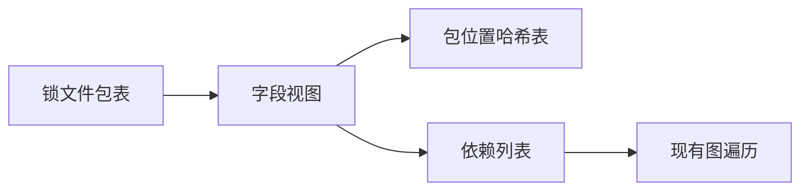

# 锁文件校验自举

## Intent · 目标

把锁文件的包身份、依赖约束和图校验接到同一条 Source 流程，保持命令行和库入口的错误顺序。

## Data · 证据

起点为 `48fdddc24`。锁文件用四个字符串哈希表判断包重复，每条归档包身份额外拼接包名和版本。每个包单独建立依赖名称表。版本解析、路径规则与图遍历已有 Source 实现。

## Edges · 边界

直接借用锁文件中的字符串、包表和依赖列表。保持包名和版本原文组成的身份，不按版本优先级合并。保留锁文件格式、公共 Zig 数据类型和工作区寻址规则。

## Answer · 验收

从公开锁文件解析、安装和依赖图入口核对结果，同时对照原实现的首个错误、分配故障和正常输入的耗时与空间。

### 已迁移的正式入口

- `Lock.parse` 和 `Lock.validate` 按顺序进入 Source 的头部、包表、依赖边与图校验。工作区包分别按路径和名称去重，归档包分别按摘要与「包名、版本原文」去重。哈希碰撞后比较原始字段，省去了为每个归档包拼接身份字符串的分配。
- 两个包身份索引和每包依赖名索引共用一块可增长的临时区。先完成整张包表的校验，再从头复用空间处理当前包的依赖，最后复用上批的深度优先遍历。锁文件的来源标签只需读取一次，路径与归档字段直接取自原始活动分支。
- 版本分量在寻找分隔符的过程中同时解析数值。工作区依赖查找、CLI 工作区图和锁文件复用同一份 Source 原始版本匹配。库仍区分版本非法、数值溢出、范围非法，以及合法但不匹配。
- Zig 仍负责 JSON 解析、借用字段、临时区的分配释放以及对外错误转换。安装器的包选择、工作区候选查找循环、下载与文件发布仍有 Zig 实现。

### 正确性

公开包索引、索引资源、锁文件解析、依赖图、工作区清单和安装六组回归通过（86/86 构建步骤、69/69 项 Zig 测试，各 Node 测试组均无失败）。在联调中发现把状态映射到宽泛的错误集合时，Zig small 构建中的解析测试有 18 项返回了错误的诊断。将库入口的错误集合收窄并显式逐项映射后，这 20 项解析测试全部通过。

包身份索引与每包依赖索引改为复用同一块临时区后，重新运行锁文件解析、图与安装用例，75/75 个构建步骤、63/63 项 Zig 测试通过。内部 memory 接口按读取职责拆分，构建前后合成的接口逐字节一致，正式构建入口另通过 36/36 项图测试。本批涉及的 18 个 RX/ZX 实现与接口文件全部通过 lint。

初始 seed 直接生成的实现与 Source 自编译引导器生成的实现，各自与上一提交对照 9,523 次锁文件解析及首个错误。共用版本解析器另核对 111,930 个版本范围结果、4 个模拟 32 位上限、72,828 个索引结果。65,536 张四节点图的遍历结果与原实现相同。由 seed 构建与由上一阶段 Source 构建的两个引导器，分别启用 Source 分析和生成同一清单，排除输入路径记录后 97 个文件逐字节一致。

### 性能与内存

同机 arm64、Zig small、相同输入。候选由 Source 自编译引导器生成包规则，比较对象为上一提交 `48fdddc24`。下表每次只校验已经解析好的包表，连续 32 次，交替测 7 轮取中位数。内存数为使单次校验成功所需的最小固定缓冲容量，包含对齐开销。除小图外，每组均有 3,072 个包。

| 依赖图               | 上一版耗时 | 本版耗时 | 上一版临时容量 | 本版临时容量 |
| -------------------- | ---------: | -------: | -------------: | -----------: |
| 工作区二叉树         |   19.98 ms | 19.26 ms |      569,784 B |     38,912 B |
| 归档二叉树           |   25.83 ms | 22.46 ms |    1,067,600 B |     38,912 B |
| 根包直接依赖全部归档 |   27.24 ms | 23.59 ms |    1,333,888 B |     38,912 B |
| 32 包小图            |    0.27 ms |  0.18 ms |       14,584 B |        576 B |
| 互不依赖的工作区包   |   10.20 ms |  8.64 ms |      569,624 B |     38,912 B |

以库的公开解析入口单独启动进程，读取相同 JSON、完成解析与校验并释放结果，交替测 11 轮。根包直接依赖全部归档时，墙钟 5.44 → 5.38 ms、CPU 4.87 → 4.81 ms、进程峰值 RSS 5,210,112 → 4,734,976 字节。工作区二叉树的墙钟 4.26 → 4.31 ms、CPU 3.68 → 3.75 ms、RSS 4,292,608 → 3,997,696 字节。

对共用的版本路径，176,400 次范围判断 16.52 → 16.31 ms（之前固定对照 32.99 ms）。相同的 2,304 个版本索引运行 `zxc pkg resolve`，墙钟 3.03 → 3.17 ms，CPU 2.44 → 2.58 ms，RSS 4,505,600 → 4,472,832 字节。该公开命令原固定对照墙钟 5.67 ms、CPU 4.73 ms。本批未测整仓冷构建。
