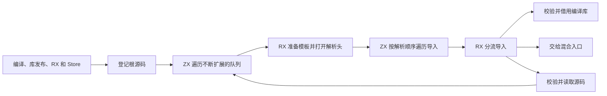

# CLI 源码依赖与模板装载自举

## Intent · 目标

把 CLI 公用的 ZX 依赖遍历和模板资源装载迁入 RX/ZX。保持源码遍历次序、缓存及发布快照边界，避免引入文本复制。

## Data · 调用路径

`compile.zig`、库入口分析、RX 原子函数收集和 Store 类型解析共用 `sources.Traversal.readEntry`。原来的 Zig 实现按发现顺序扩展源码队列，遍历 ZX 导入并处理编译库、RX 和普通源码。模板准备先扫描静态引用，再逐条解析、核对并读取资源。两层遍历及模板去重已纳入 Source。

## Edges · 数据与生命周期

`discovery/load_import.rx` 保留编译库优先于源码后缀分类的次序。纯文件目标继续先按已有规则选择路径，再核对包边界和重复路径。预装载的文本、解析缓存和库批内文本缓存继续借用原字节。解析诊断、非内存的解析路径错误，以及发现阶段允许延后的缺失文件保持原有处理方式。

Zig 仍作为解析结果、路径索引、编译库载入和文件观察的宿主。模板展开和位置映射保留原有实现，普通源码不会因本批产生额外的模板解析。RX XML 的物理路径登记、专用入口分类和引用队列仍在 `rx/collection.zig`。后续还需迁移这些状态和规则。

## Answer · 验收

`test-library-publish`、`test-rx-project-cli`、`test-rx-watch`、`test-watch-recovery`、`test-semantic-lint` 和 `test-native-packages` 均通过，共 141 项 Node 检查。额外的 `test-template-preparation` 有两条入口报缺少 `core/const` 项目依赖。上一阶段的二进制执行相同入口也报相同错误。两组错误在打开应用源码队列之前的 RX 引用收集路径产生。

使用公开 CLI 另核验既有外部模板夹具。冷生成与上一阶段逐字节一致，模板编辑后的缓存输出与干净生成一致。删除模板时两版返回相同诊断，恢复模板后二进制生成的源码回到原始内容。窄清单的初始 seed 和 Source 引导器生成同一批 300 份 Zig 文件。269 份逐字节一致，31 份仅临时变量编号有差异。

测量平台为 macOS arm64、Zig 0.17.0、ReleaseSmall。固定对照为 `dadb1f21a`，直接对照为 `ae8307dff`（CLI 由其实现提交 `a5532a0d8` 构建）。三套工具均由 `7c9b225c3` Source 引导器构建，执行 Source 分析和生成。关闭生成缓存，版本交错，每版取预热后八轮中位数。RSS 是被测 CLI 进程的系统峰值。先前有两轮脚本同时启动，产生冲突的记录已废弃，以下数据来自独立运行。

| 输入                  | 墙钟 ms（固定 / 上阶段 / 候选） | CPU ms（固定 / 上阶段 / 候选） | 峰值 RSS MB（固定 / 上阶段 / 候选） |
| --------------------- | ------------------------------: | -----------------------------: | ----------------------------------: |
| 单 ZX 入口            |              2.68 / 2.71 / 2.74 |             2.56 / 2.49 / 2.53 |                  7.48 / 7.45 / 7.49 |
| 49 文件 ZX 闭包       |           20.08 / 19.99 / 19.84 |          21.78 / 21.47 / 21.43 |               16.83 / 16.61 / 16.54 |
| RX 引用 ZX 闭包       |           18.98 / 18.58 / 18.83 |          26.66 / 26.49 / 26.46 |               19.07 / 18.86 / 18.88 |
| 外部模板源码生成      |              2.63 / 2.67 / 2.61 |             2.57 / 2.46 / 2.44 |                  7.03 / 6.97 / 7.01 |
| 16 个公开 RX 入口发布 |        801.53 / 763.67 / 762.69 |       959.75 / 922.45 / 921.49 |               70.92 / 55.06 / 55.01 |

五组输入的生成产物和发布文件在三版间逐字节一致。相较上阶段，墙钟、CPU 和峰值 RSS 的最大增量分别为 0.25 ms、0.04 ms 和 0.04 MB。相对固定对照，CPU 五组均下降，墙钟最大增量为 0.06 ms，峰值 RSS 最大增量为 0.01 MB。此次测量覆盖源码生成和库发布，完整自举冷构建有独立验收。

测量、回归和模板核验记录见 `.zig-cache/verification-tmp/source-loading/`。按场景和路径排序后的完整产物摘要为 `25887814b950c9140285c6ba45aa1bf2314a6692d8c784dde4caa6866f205089`。
