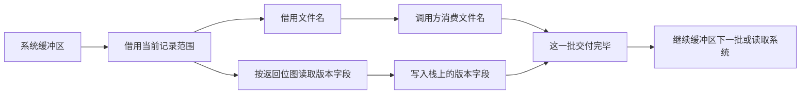

# Darwin 目录批量属性解码自举

## Intent · 目标

把 Darwin 目录枚举结果的解码迁入 ZX，供源码收集和输入快照共用。保持文件身份、类型和版本字段一致，并保留目录扫描的系统调用粒度。

## Data · 正式调用链

源码收集和输入快照都通过 `source_collection.scan` 进入 `directory_listing.Reader`。Darwin 宿主调用 `getattrlistbulk` 填充系统缓冲区，每次从缓冲区交给 Source 最多 16 条记录。ZX 按返回的属性位图读取记录长度、文件名、文件类型以及完整的文件版本字段。系统接口在记录开头返回长度和实有属性位图，名称由相对于引用字段的偏移和含终止字节的长度表示。[Apple 批量接口说明](https://github.com/apple-oss-distributions/xnu/blob/main/bsd/man/man2/getattrlistbulk.2) · [Apple 属性记录说明](https://github.com/apple-oss-distributions/xnu/blob/main/bsd/man/man2/getattrlist.2)

## Edges · 借用和平台边界

保留原有 32 KiB 系统缓冲区。文件名只借用其中的字节，批量结果写入固定大小的栈上记录。每批记录全部交付后才覆盖系统缓冲区。读取没有返回完整元数据的文件时，沿用既有独立 stat 路径。

平台系统调用、重试和错误码映射保留在宿主。宿主把两个 ABI 时间戳字段还原为带符号的秒数和纳秒数，并转换为 Zig 的 96 位时间戳。初始 seed 保留等价解码。其余平台仍使用原来的目录迭代器。

## Answer · 验收

目录样本加入 400 个可能跨越系统缓冲区的普通文件、子目录和断开的符号链接，覆盖跨批次枚举、模板编辑与恢复、重复模板路径和无变化复用。两代工具的产物及 lexer 源码一致。源码和外部接口样本的路径、inode、长度、修改时间和状态变更时间一致，读取时间随各次运行变化。常驻进程的初次发布、模板编辑、恢复和无变化复用与独立生成一致。

候选和下一代引导器均通过 25 个构建步骤。两代引导器针对解码入口生成的 66 个分区文件逐字节一致，输入戳除外。初始 seed 的 lexer 通过 14 个构建步骤，模块生成和解析缓存回归通过 39 个构建步骤及 37 项测试。

固定清单包含 735 个入口和 16 个分区。三套工具均由 Source 引导器构建，执行 Source 分析和生成，环境为 macOS arm64、Zig 0.17.0、ReleaseSmall。交错三轮取中位数，每套工具另精确计时 18 次无变化请求。

| 生成器指标               |  固定基线 |  上一阶段 |      候选 |
| ------------------------ | --------: | --------: | --------: |
| 冷生成墙钟               |    2.83 s |    2.54 s |    2.53 s |
| 冷生成 CPU               |   12.31 s |   12.14 s |   12.05 s |
| 冷生成进程树采样峰值 RSS | 885.46 MB | 698.93 MB | 697.30 MB |
| 冷生成单进程系统峰值 RSS | 922.22 MB | 796.87 MB | 736.58 MB |
| 热重建墙钟               |    2.16 s |    1.96 s |    1.91 s |
| 热重建 CPU               |    8.38 s |    8.12 s |    8.10 s |
| 无变化墙钟               |  37.20 ms |  38.36 ms |  39.08 ms |
| 无变化 CPU               |  36.15 ms |  37.35 ms |  37.95 ms |

相对上一阶段，无变化请求墙钟中位数增加 0.72 毫秒，两套工具的样本范围重叠。相对固定基线，冷生成墙钟减少 0.30 秒、CPU 减少 0.26 秒，无变化请求增加 1.88 毫秒。以上覆盖生成器。相邻两代的 11,758 个生成文件及 v18 唯一性缓存载荷逐字节一致，输入戳随工具身份变化。固定基线的历史产物差异与上阶段逐项一致。
