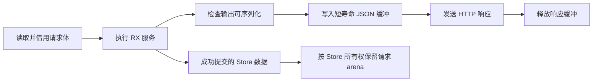

# Gateway 响应缓冲生命周期

## Intent · 目标

让 Gateway 在发送 JSON 后释放序列化缓冲。部分 Store 提交会长期持有请求 arena，响应缓冲只需活到发送完成。核对已有性能诊断的实现进展，并以正式生成的应用验证内存和响应行为。

## Data · 根因与现状

Gateway 在请求 arena 中读入请求体、解析 JSON、运行服务。写入 Store 后，生成的 `Request.deinit` 可以把整个 arena 交给 Store 区域。旧的 JSON 序列化也使用这个 allocator，因而即使响应字节和 Store 值毫无引用关系，它们仍可能一起保留到应用退出。

| 外部诊断               | 本地实现                                                                                                                                                                              |
| ---------------------- | ------------------------------------------------------------------------------------------------------------------------------------------------------------------------------------- |
| 全闭包编译和跨模块推导 | 正式构建生成多个 Zig 单元，同轮共用解析和依赖装载结果。公开 RX watch 仍重新分析，Zig 子进程复用磁盘缓存。                                                                             |
| SMT 展开               | 相同符号实参的调用可命中缓存，符号执行有步数上限。不同实参仍可展开函数体。                                                                                                            |
| 隐式复制和 `$ctx`      | 已有只读借用和独占集合更新，`$ctx` 生成静态局部绑定。连续集合变换及请求 arena 内的局部值仍有优化空间。                                                                                |
| 请求分配               | 请求体和可借用的 JSON 文本已在请求 arena 中共享。旧响应缓冲跟随 Store 提交的 arena 留存。                                                                                             |
| 并发和取消             | 已复现 Gateway 半个请求头阻塞后续连接。普通 `loop` 没有通用逐次取消轮询。部分语句型 Parallel 生成系统线程，ZX Future 使用 Zig I/O。现有串行 Gateway 的排队缺少归因于 Store 锁的证据。 |

编译、watch 和验证的已有改动与测量见[编译与运行时性能核查](../2026-11-18/编译与运行时性能核查.md)、[编译器与应用性能诊断复查](编译器与应用性能诊断复查.md)和[监听空闲扫描复用文件版本](监听空闲扫描复用文件版本.md)。

## Edges · 所有权与兼容性

Gateway 的 RX 编排在检查输出后创建响应缓冲，Source 与 seed 通过结构化 AST 生成普通 Zig。编码直接写入 `std.Io.Writer.Allocating`，发送借用已写入的字节，结束时释放缓冲。成功和发送失败共用清理路径。编码内存不足仍返回 `OutOfMemory`，void 响应仍为 JSON `null`。响应仍以已知长度发送，非有限数值先走原有错误响应。

请求体、JSON 输入和服务结果仍遵守现有 Store 借用与提交契约。一般共享 Store 的区域回收和 Gateway 并发调度需要一起处理，本阶段沿用串行宿主。

## Answer · 验收

`test-gateway`、`test-application-json-gateway`、`test-store-reclamation`、`test-store-alias-lifetime` 和 `test-rx-store-io` 通过，共 94 个构建步骤、48 项 Zig 测试及 86 项 Gateway 行为检查。覆盖 JSON 输入输出、非有限值、HEAD、Store 写入后的跨请求读取以及错误恢复。对 seed 另行检查了字符串和 void 两类生成产物的语法和缓冲清理位置。

使用 macOS arm64、Zig 0.17.0、ReleaseSmall。直接对照为 `34a469631`。两套 CLI 都由 `7c9b225c3` 的 Source 引导器生成，执行 Source 分析和生成。对照与候选按轮反转运行顺序，去掉预热后取七轮中位数。墙钟只计请求窗口，CPU 和峰值 RSS 取服务进程。客户端校验每个响应的状态、Content-Length、Content-Type，并核对整批响应字节摘要。

| 请求场景                                           |      墙钟，秒 |       CPU，秒 |   峰值 RSS，MB |
| -------------------------------------------------- | ------------: | ------------: | -------------: |
| 360 次 Store 写入，每次返回 256 KiB 固定文本及状态 | 0.123 → 0.126 | 0.077 → 0.079 | 114.28 → 14.29 |
| 2,400 次 Store 写入，每次返回小对象                | 0.160 → 0.159 | 0.041 → 0.045 |  80.61 → 80.63 |
| 2,400 次无 Store 写入的短文本回显                  | 0.156 → 0.160 | 0.041 → 0.045 |    1.98 → 2.00 |

三组响应的 SHA-256 分别为 `2b81617630f49a5d19f7c73b88c2faa814edb12f30f5d43f61c9f0d9e55da2e9`、`0179155b99c0049d7738135cb42fb560e714502ebdba1fd14fd26835942a3766` 和 `232706a538858ab275be226815e540826211b1456aa5d48edb43881cbb5d7ad0`。Store 样本沿用 Gateway 的 `/advance` 夹具。大响应附加同一固定字符串，写入行为及请求体与小响应一致。

大响应的峰值 RSS 下降 87.5%。小响应的 CPU 增量约 4–5 ms。小响应写入样本仍达到约 80.6 MB，暴露出共享 Store 继续保留旧请求 arena 的成本。HTTP 宿主仍按连接顺序处理，公开 watch 的跨轮语义复用、一般集合链融合与不同符号实参的契约摘要仍是独立工作。
