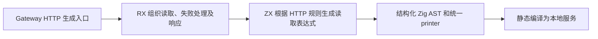

# Gateway 定长请求体分配

## Intent · 目标

根据真实编译入口和生成程序复核性能诊断。此批消除已知长度的 HTTP 请求体反复扩容的成本，保留请求体上限、协议错误和 Store 的生命周期约定。

## Data · 证据

前几轮确认了公开 watch、跨模块复用、SMT 查询、不可变值和 Gateway 的当前边界，并修复了重复装载、复制、监听扫描和符号调用判断。[编译与运行时性能核查](../2026-11-18/编译与运行时性能核查.md) · [编译器与应用性能诊断复查](编译器与应用性能诊断复查.md)

Gateway 给每次请求建立 arena，JSON 解析可借用连续的未转义字符串。HTTP 体原来统一调用 Zig `Reader.allocRemaining`。这个方法动态增长一个字节列表，最后转为调用方持有的切片。请求已知长度且通过上限检查时，可以直接分配最终缓冲区，消除列表增长和收缩时潜在的重新分配与复制。

## Edges · 协议和内存边界

`Content-Length` 先与服务配置的上限比较，通过后才进入读取阶段。定长路径使用 Zig `Reader.readAllocAll`，把收到的字节读入最终缓冲区。读完前遇到正常流结束仍回复 400 和原来的截断说明。分块路径继续按解码后的字节限制增长并校验最终状态。未声明长度且无分块编码时沿用空请求体行为。

请求体仍由请求 arena 持有，成功写入 Store 的借用值保留原有区域生命周期。服务的连接接收顺序与共享状态提交顺序沿用既有实现。校验过的定长请求在读入数据前就会预留声明长度的存储，受配置上限约束。底层网络读缓冲与 JSON 转义解码仍可能复制字节。

## Answer · 验收

`test-gateway`、`test-application-json-gateway`、`test-verification` 和 `test-verification-resources` 通过 77 个构建步骤和 51 项 Zig 测试。Gateway 的 86 项应用检查覆盖定长与分块大小边界、`100 Continue`、截断请求、转义 JSON 和跨请求 Store。另用原始连接确认截断定长请求在两版中均返回 HTTP 400 和相同的响应正文。初始 seed 的 14 个构建步骤全部通过。

使用 macOS arm64、Zig 0.17.0、ReleaseSmall。两套 CLI 均由 Source 引导器构建，使用 Source 分析与代码生成。对照采用上次 [性能诊断复查](编译器与应用性能诊断复查.md) 用的 CLI，期间没有修改 Gateway 读取逻辑。两版生成程序在相同监听地址处理 120 次约 1 MiB 的无转义 JSON 请求，逐个验证状态和返回值。两版交错执行，排除首轮后取七轮中位数。墙钟覆盖请求窗口，CPU 和 RSS 取服务进程整个采样生命周期。

| 场景     | 墙钟（对照 → 候选） | CPU（对照 → 候选） | 峰值 RSS（对照 → 候选） |
| -------- | ------------------: | -----------------: | ----------------------: |
| 定长请求 |    0.200 → 0.199 秒 |   0.172 → 0.155 秒 |          3.67 → 3.00 MB |
| 分块请求 |    0.225 → 0.226 秒 |   0.198 → 0.198 秒 |          3.54 → 3.54 MB |

定长样本的 CPU 下降约 10%，峰值 RSS 下降约 18%。测量覆盖单连接处理。串行接入的排队、Store 保留区域的回收、数组链中间分配、不同符号实参的契约摘要，以及公开 watch 的跨轮分析复用仍分别需要验收。
