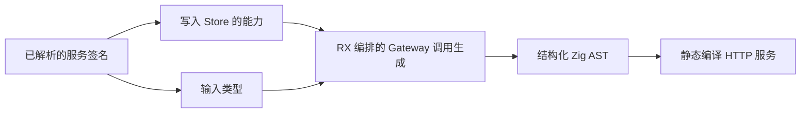

# Gateway 请求体与共享 Store 生命周期

## Intent · 目标

核对外部诊断提出的全闭包编译、隐式复制、请求分配和并发问题。修复一处已经确认的 Gateway 内存保留问题。较大的原始 HTTP 请求体在解码后只剩临时用途时，应在请求结束时释放，即使该请求写入共享 Store。

## Data · 源码核对

| 说法                             | 目前的正式路径                                                                                                                                                                                |
| -------------------------------- | --------------------------------------------------------------------------------------------------------------------------------------------------------------------------------------------- |
| 应用统一生成一份大型 Zig 文件    | 入口、类型和函数已有独立的生成单元，内容未变时复用。公开 watch 会跨轮复用 ZX 解析及已核验的文件版本。RX 语义分析仍按轮调用，Zig 后端启动新的进程并使用磁盘缓存。自举另有分区对象缓存。        |
| 公共依赖重复加载、推导           | 同一轮 RX 构建共享已加载的 ZX 依赖与解析。多入口库还会按入口组装自己的推导结果。公开 watch 没有接通常驻自举工具的 RX 语义历史。                                                               |
| SMT 查询内联导致求解膨胀         | 符号图复用等价项，函数调用按目标及符号实参缓存，执行有步骤上限。不同实参仍会展开函数体。已有大样本的峰值由 Z3 主导，改进查询写出主要降低了求解前的内存。                                      |
| 调用与上下文的隐式深拷贝         | 只读聚合已有借用，确定独占的更新可复用原有存储。RX 的 `$ctx` 解析为静态结果绑定。集合连续操作仍可物化中间数组，应依据求值顺序和所有权证明选择可融合的场景。                                   |
| 每次请求逐个分配、释放 JSON 对象 | 已有请求 arena，使用进程分配器作为底层。定长 HTTP 请求体一次分配，JSON 字符串在连续且无转义时可借用。已知可保留旧状态引用的 Store 写入仍会让整个请求区域进入应用状态。                        |
| 并发慢来自 Store 全局锁          | Gateway 目前在接受连接的循环内同步读头并执行服务。慢请求头阻塞下一条连接已复现，锁争用暂无实测。部分 RX Parallel 会创建系统线程，ZX Future 使用 Zig I/O。普通 `loop` 无通用逐轮原子取消检查。 |

历史结果见[编译与运行时性能核查](../2026-11-18/编译与运行时性能核查.md)、[监听重建复用已核验输入](监听重建复用已核验输入.md)、[性能实测与验证查询直接写入](性能实测与验证查询直接写入.md)和[Gateway 请求底层分配器](Gateway请求底层分配器.md)。磁盘缓存和常驻的声明级增量具有不同的失效边界。[Zig 增量编译实现](https://mlugg.co.uk/posts/incremental-compilation-internals/)

本次触发路径是 Gateway 的标量输入服务写入带共享字段的 Store。HTTP 请求体与服务执行都从同一个请求 arena 分配。将 JSON 数字转为 `u64` 后，服务只得到数值。Store 接管请求 arena 时，原始字节随之进入保留区域。在发送带空白填充的等价数字时，保留的字节与请求大小近似成比例，业务状态大小保持稳定。

## Edges · 分配与借用边界

把服务的输入类型编号随已有输出类型与调用信息传入 Gateway 生成器。对可能写入 Store 且输入为无引用标量、枚举或它们的可空形式的服务，生成器为原始请求体和 JSON 解码准备一个局部 arena。分块请求，以及声明长度超过 arena 描述符大小的定长请求，使用这个局部 arena。极短的定长请求沿用请求 arena，有限的字节可与服务分配合用已有块。解码结果按值交给服务，服务执行与 Store 发布继续使用请求 arena。局部 arena 在调用退出时统一释放。

字符串、对象、数组和元组沿用已有请求区域。它们可能借用原始字节，读写 Store 时这些借用仍须有效。局部 arena 也覆盖 HTTP 限额、截断、解析失败和服务错误的退出路径。Source 与初始引导路径均通过结构化 AST 生成普通 Zig。

## Answer · 验收

五组正式回归通过，包括 `test-gateway`、`test-application-json-gateway`、`test-store-reclamation`、`test-store-alias-lifetime` 和 `test-rx-store-io`。共通过 94 个构建步骤、48 项 Zig 测试、86 项 Gateway 检查及 52 项 JSON 输出检查。覆盖定长和分块请求上限、截断、无效 JSON、连续 Store 写入、嵌套对象中的借用字符串及回滚。另用初始 seed 的生成器检查了标量、可空标量、枚举、字符串、可空字符串与只读服务的生成分支，输出通过 Zig 语法检查。

性能样本采用 macOS arm64、Zig 0.17.0、ReleaseSmall。固定对照来自 `dadb1f21a`，直接对照来自 `7359b388e`。三套 CLI 都由 `7c9b225c3` 的 Source 引导器构建，并执行 Source 分析与生成。生成的服务在同一监听地址逐次处理请求，版本轮换。每版排除预热轮后取五轮中位数。墙钟覆盖请求窗口，CPU 与峰值 RSS 覆盖整个服务进程，内存按十进制 MB 计。

| 输入                         | 墙钟 ms（固定 / 直接 / 候选） | CPU ms（固定 / 直接 / 候选） | 峰值 RSS MB（固定 / 直接 / 候选） |
| ---------------------------- | ----------------------------: | ---------------------------: | --------------------------------: |
| 600 次定长写入，每次 256 KiB |      129.45 / 129.48 / 123.08 |        92.70 / 92.50 / 87.18 |            170.10 / 170.10 / 2.54 |
| 600 次分块写入，每次 256 KiB |      193.15 / 191.20 / 182.20 |     143.10 / 143.55 / 131.99 |            386.50 / 386.48 / 2.97 |
| 5,000 次单字节写入           |      328.12 / 321.68 / 322.75 |        62.44 / 62.45 / 62.68 |                3.52 / 3.54 / 3.54 |
| 5,000 次只读文本回显         |      317.16 / 316.89 / 337.74 |        61.71 / 61.86 / 61.78 |                1.97 / 1.97 / 1.97 |

每次 Store 更新都核对新值、列表和借用的标签。所有响应的状态、媒体类型、长度和每批完整正文摘要一致。正式生成产物仅三处写入服务的输入分配发生变化。同批其他三个构建入口文件逐字节一致。

相对直接对照，定长和分块样本的峰值 RSS 分别下降 98.5% 和 99.2%。短写入的 RSS 与直接对照一致，较固定对照高约 0.02 MB。只读回显的墙钟中位数增加 20.86 ms，CPU 与峰值 RSS 基本持平，生成的回显函数逐字节一致。两版逐条响应结果相同。首轮把所有标量请求体拆开的试验在 5,000 次短写入上多占约 0.34 MB，最终实现采用表中的限长路径。

后续成本集中在公开 RX watch 的跨轮语义分析、不同符号实参的求解展开、集合链的中间数组，以及 Gateway 的串行接入和共享 Store 退役区域。此次改动后，可能借用原始请求体的聚合数据仍依靠原有区域生命周期。已知的连接队首阻塞依然存在。端到端自举冷构建未在本阶段重新计时。

原始记录在 `.zig-cache/verification-tmp/gateway-body-lifetime/`，包括 `comparison.json`、`generation-parity.log`、`regression.log` 和 `seed-layout.log`。
