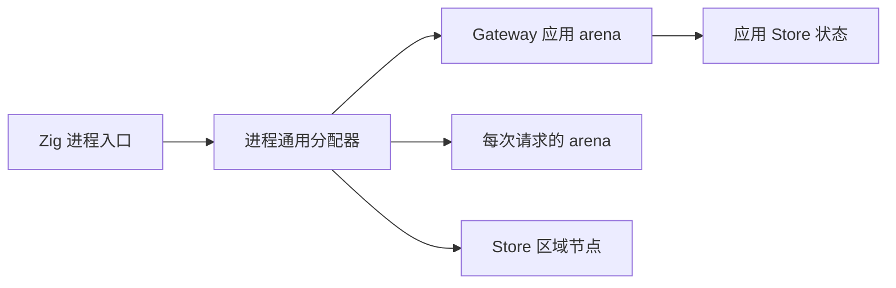
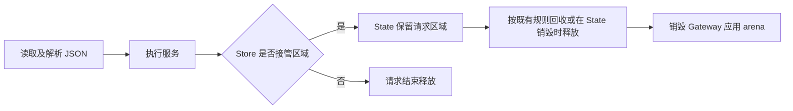

# Gateway 请求底层分配器

## Intent · 目标

核对外部性能诊断在当前正式入口的适用范围。降低 Gateway 请求内存的分配成本，保留 Store 跨请求借用和请求结束后的回收顺序。

## Data · 证据

正式 Gateway 把 Zig 的 `init.arena` 交给应用 State。State 的请求区域及写入 Store 时创建的 `Region` 都使用该 arena 的 `child_allocator`。Zig 0.17 的原生进程入口使用页分配器建立 `init.arena`。一次只写入几十字节数据的请求，区域节点与 arena 的小块各自分配页。已有 `/advance` 测量中，2,400 次短请求写入带共享字段的 Store，峰值 RSS 约 80.6 MB。见[响应缓冲生命周期](Gateway响应缓冲生命周期.md)。

| 核对项         | 正式路径和已有证据                                                                                                                                                                                                                                                                                                                             |
| -------------- | ---------------------------------------------------------------------------------------------------------------------------------------------------------------------------------------------------------------------------------------------------------------------------------------------------------------------------------------------- |
| 构建及增量     | 入口、类型和函数已分别生成，按内容复用。一次库构建的多个导出共享原始源码，公开 watch 跨编辑共享 ZX 解析。公开 RX watch 的语义分析仍会按轮执行，Zig 后端每轮启动子进程并复用磁盘缓存。参见[监听构建](监听构建复用解析结果.md)、[库构建](库构建共享源码读取.md)和 [Zig 增量机制](https://mlugg.co.uk/posts/incremental-compilation-internals/)。 |
| SMT            | 相同函数和符号实参可命中缓存，符号求值有步数上限。临时求值区域按作用域回收，符号图在调用 Z3 前释放。不同实参仍可能展开函数体。参见[符号验证临时内存](符号验证临时内存优化.md)。                                                                                                                                                                |
| 借用与集合     | 生成器已有只读借用和独占更新，`$ctx` 生成局部结果绑定。集合链仍可能物化中间数组，局部值所在区域也可能随 Store 延长存活。参见[编译与运行时性能核查](../2026-11-18/编译与运行时性能核查.md)。                                                                                                                                                    |
| 请求分配       | Gateway 已有请求 arena，连续且未转义的 JSON 文本可借用请求体，定长请求体一次分配，响应序列化缓冲在发送后释放。这里进一步处理请求 arena 和 Store 区域的底层分配成本。                                                                                                                                                                           |
| 并发、锁与取消 | Gateway 同步处理连接，已复现慢请求头阻塞后续连接。现有宿主没有 Store 并发锁争用的实测证据。部分 RX `Parallel` 生成系统线程，ZX Future 使用 Zig I/O，普通 ZX `loop` 没有通用逐迭代原子取消轮询。参见[诊断复查](编译器与应用性能诊断复查.md)。                                                                                                   |

## Edges · 生命周期

Gateway 为 State 创建使用 `init.gpa` 的独立 arena。正常退出或错误返回时，先销毁 State 接管的请求区域，再销毁应用 arena。请求的输入、执行结果与 Store 数据继续按现有规则共享和移交，同一请求的分配器仍覆盖完整生命周期。Source 和 seed 都通过结构化 AST 生成相同的宿主语义。

## Answer · 验收

Gateway、共享 JSON 输出、Store 回收、跨请求别名和 Store I/O 五组回归通过，共 94 个构建步骤、48 项 Zig 测试及 86 项 Gateway 行为检查。覆盖失败写入、借用请求体的值跨请求读取及重启后重新使用初值。seed 生成的宿主另行通过 Zig 语法检查，并核对 `State.deinit` 先于应用 arena 的销毁顺序。

macOS arm64、Zig 0.17.0、ReleaseSmall。直接对照为 `bcb5b009b`。两套 `zxc` 都由 `7c9b225c3` 的 Source 引导器构建，执行 Source 分析与生成。用同一组输入生成应用，版本交错运行，去掉首轮后取七轮中位数。墙钟覆盖发送请求到读取最后一个响应，CPU 与 RSS 取服务进程。MB 按十进制计。

| 请求场景                            |        墙钟，ms |       CPU，ms | 峰值 RSS，MB |
| ----------------------------------- | --------------: | ------------: | -----------: |
| 2,400 次共享 Store 写入，小响应     | 159.54 → 151.95 | 45.58 → 32.04 | 80.63 → 2.75 |
| 360 次共享 Store 写入，256 KiB 响应 | 125.50 → 115.60 | 78.14 → 69.13 | 14.30 → 2.69 |
| 2,400 次回显，无 Store 写入         | 162.48 → 152.28 | 44.82 → 32.06 |  2.00 → 1.97 |

小响应写入样本的峰值下降 96.6%。三组每个响应的状态、类型、长度和全批响应 SHA-256 在前后版本一致。原始对照及回归日志保存在 `.zig-cache/verification-tmp/gateway-request-allocator/`。

本次测量覆盖生成应用的运行期，编译器完整冷构建耗时未纳入测量。共享 Store 在缺少区域独占证明时仍保留已接管的请求区域，长时间写入的内存上界仍待解决。Gateway 的连接队首阻塞也待独立验收，只有建立并发下的 State 借用与发布规则，才能测量真实的 Store 争用。
