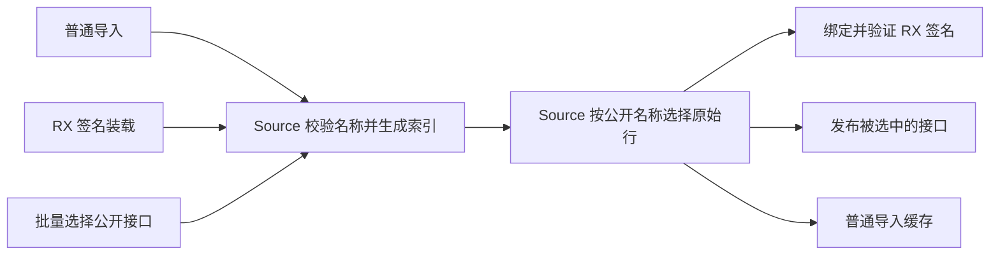
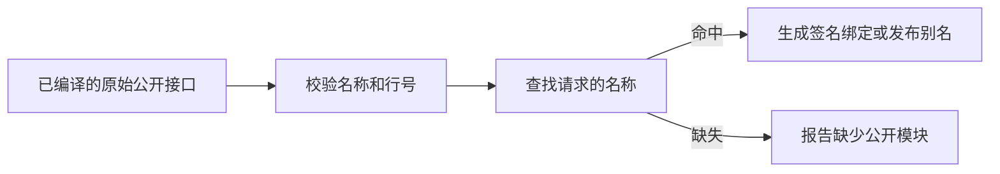

# RX 编译库选择复用索引

## Intent · 目标

让 RX 签名检查、批量选择性发布及普通 ZX/RX 导入共用编译库公开索引。让旧的 Zig 签名名称表构造退出正式路径，保留链接与验证顺序、Store 授权和分配器归属。

## Data · 正式路径

## Edges · 存储与错误边界

普通导入把桶放在项目工作区。RX 签名绑定把桶放在绑定缓存所在的临时 arena。批量选择只在本次装载保留索引，发布后的别名和顺序继续来自选择计划。单项选择仍可直接查找，避免为一次查询分配桶。类型、原生模块、函数体和接口输出分别沿原有生命周期保留。

## Answer · 验收

源码引导器 `7c9b225c3` 生成两套 CLI，运行时均使用 Source 分析和生成。库链接、独立导入、原生链接、RX 推导、Store 公开发布、RX 边界、编译库调用、选择性发布与契约复验共通过 118 个构建步骤和 190 项 Zig 测试。公开 CLI 回归覆盖不同别名引用同一导出、缺少公开名称、损坏工件、授权与发布回滚。

使用同一批已编译工件并关闭生成缓存。macOS arm64、Zig 0.17.0、ReleaseSmall 下交错执行，去掉前两轮后取十轮中位数。六组 ZX、RX 和别名发布生成的 153 个文件逐字节一致。固定对照为 `dadb1f21a`，直接对照为 `86d103872`。

| 场景                     | 墙钟，固定 / 直接 / 候选（ms） | CPU，固定 / 直接 / 候选（ms） | 峰值 RSS，固定 / 直接 / 候选（MB） |
| ------------------------ | -----------------------------: | ----------------------------: | ---------------------------------: |
| 普通 RX 调用             |          12.82 / 12.83 / 12.85 |         13.86 / 13.79 / 13.79 |              10.72 / 10.68 / 10.72 |
| 256 个公开名称的 RX 调用 |         100.31 / 95.38 / 95.66 |      120.43 / 115.42 / 115.66 |              30.33 / 30.15 / 30.10 |
| 重发三个别名             |          21.84 / 21.64 / 21.61 |         23.79 / 23.66 / 23.71 |              12.01 / 11.98 / 12.09 |
| 重发 129 个别名          |    2169.64 / 2038.93 / 2055.25 |   2207.85 / 2075.85 / 2092.32 |              37.87 / 37.72 / 37.75 |

批量重发包含完整的工件生成与写出。索引消除了逐别名扫描，大样本端到端比直接对照慢约 16 ms，比固定对照快约 114 ms。该结果不能归为本次查表的独立提速。完整编译器冷构建不在此批测量范围。本地对照日志和产物摘要在 `.zig-cache/verification-tmp/compiled-selection-index/`。
