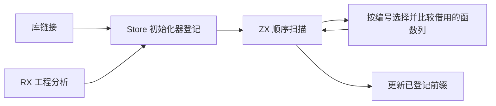
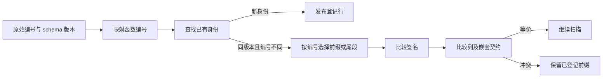

# Store 初始化器冲突处理自举

## Intent · 目标

让库链接和 RX 工程分析在一次 Source 调用内完成 Store 初始化器登记，包括同名记录指向不同函数时的等价检查。保持原有编号映射、诊断顺序及失败后已登记的前缀。

## Data · 正式调用路径

`library/link.zig` 与 `rx/analysis/program/builder.zig` 调用同一登记表。现有 ZX 循环负责索引查询和发布，遇到两个不同函数 ID 时退出。Zig 宿主查找各 ID 所属的函数表、物化两个函数的描述，再调用等价比较。比较后宿主重新进入 ZX 扫描。

## Edges · 数据与错误边界

函数表在登记过程内只读，按原顺序由已有前缀和本地尾段组成。签名、Store、符号、表达式、控制流及契约列借用原存储。发布行和哈希槽后更新前缀计数，同名版本冲突仍先于内容比较。源码初值类型映射和引导 seed 的兼容入口沿用现有约定。

借用边界由 Zig 提供列地址和编译期布局，函数编号选择和整个登记循环均在 ZX 执行。共用比较器支持左右编号不同。相同底层表可按指针直接匹配，独立存储继续逐列核对。生成的窄清单中，扫描初始游标和函数体比较均无需临时堆对象。新增登记行的容量增长、索引增长及名字需拥有存储时的分配沿用原实现。

## Answer · 验收

初始 Zig seed 和 `7c9b225c3` Source 引导器均生成登记及比较入口。正式 Source 回归通过 94 个构建步骤和 239 项 Zig 测试，覆盖库链接、编解码、库重放、独立导入、原生链接、语义缓存及 RX 推导。

macOS arm64、Zig 0.17.0、ReleaseSmall。登记对照使用 `05765ff39` 的宿主调度和已保留的 Source 登记扫描。两种登记方式复用同一套已验证的比较原语和同一进程中的 IR 夹具。样本分别从两个独立解码的库取得前缀和尾段，核对原有身份字符串地址、编号、版本和失败后有效前缀。计时只覆盖登记和结果核对，排除解码和构造输入。版本交替，去掉预热后取七轮中位数。

| 登记场景                   | 每轮规模          | 对照墙钟，ms | 候选墙钟，ms |
| -------------------------- | ----------------- | -----------: | -----------: |
| 只新增一个身份             | 24,000 次登记     |        1.139 |        1.402 |
| 只新增多个身份             | 120 次 × 1,024 个 |        4.037 |        4.362 |
| 复用相同函数编号           | 120 次 × 1,024 个 |        5.248 |        5.784 |
| 两个编号的函数体相同       | 90 次 × 1,024 个  |      239.891 |       86.982 |
| 两个编号的非空契约相同     | 70 次 × 1,024 个  |      181.567 |       65.237 |
| 首个冲突来自函数体         | 6,000 次 × 24 个  |       13.547 |        7.742 |
| 首个冲突来自契约内部表达式 | 6,000 次 × 24 个  |       17.972 |        8.165 |
| 首个冲突来自 schema 版本   | 6,000 次 × 24 个  |        3.175 |        3.231 |

新增和同编号复用场景每轮增加 0.26 至 0.54 ms。正式库档案另与固定基线 `4f06eeba7`、直接对照 `05765ff39` 比较。三套工具的编译模块均由 `7c9b225c3` Source 引导器生成，运行时执行 Source 分析与生成。直接对照复用 `7741eba37` 的档案生成器，这两个提交间的差异只涉及 CLI 源码读取。八组档案全部逐字节一致。每个场景轮换执行顺序，去掉首轮后取九轮中位数。

档案入口相对直接对照的最大墙钟、CPU 和峰值 RSS 增量分别为 0.104 ms、0.016 ms 和 0.049 MB。相对固定基线的最大增量分别为 0.150 ms、0.036 ms 和 0.049 MB。正序 Store 档案墙钟为 3.604 / 3.613 / 3.615 ms，CPU 为 3.027 / 3.009 / 3.007 ms。测量范围为登记和真实库档案生成，完整冷构建需要独立对照。

回归、生成与性能原始记录位于 `.zig-cache/verification-tmp/initializer-registry/`，分别为 `compare-regression.log`、`compare-generate.log`、`compare-seed.log` 和 `compare-performance.json`。
