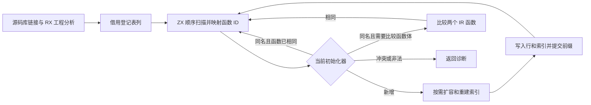

# Store 初始化器登记扩容自举

## Intent · 目标

在库链接和 RX 工程分析的正式入口，让 Source 连续完成 Store 初始化器登记、容量增长和索引重建。沿用原有的函数 ID 映射、重复检查及已发布前缀，支持源码、编译库和借用的初始化器。

## Data · 调用路径

`library/link.zig` 和 `rx/analysis/program/builder.zig` 共用 `InitializerRegistry.merge`。原实现遇到行表扩容时退出到 Zig，更新行表后重建读写视图并重新查找本条输入。索引达到负载上限时，由 RX 触发重建，随后也退回 Zig 才重新进入扫描。新扫描循环保留已解析的初始化器位置，在同一次调用内完成增长、重建和发布。

## Edges · 存储和兼容性

新增的行缓冲原语按既有容量策略扩容。分配器能原地扩展时直接重绑定读写列，需要迁移时只复制已初始化的行。数据内容和行的顺序保持一致，函数和名字仍使用原来的绑定方式。索引达到相同负载上限后使用原有刷新规则。发布一行时，先写字段和哈希槽，再更新已完成行数。分配失败后将有效前缀交还调用方。

原 RX 入口只为单次扫描后的索引刷新提供分支。刷新属于遍历内部的算法步骤，现放在 ZX，与行容量增长在同一个循环中执行。Zig 仍在边界创建借用视图，并在同名初始化器指向两个不同函数 ID 时投影 IR 列，调用现有 Source 比较规则。该投影及 seed 的兼容入口仍保留。

## Answer · 验收

统一库链接、编解码、Store 初始化器、独立进程重放、编译库导入、公开契约复验、RX 编译库消费和原生库重发通过 141 个构建步骤和 120 项 Zig 测试。覆盖借用和拥有的初始化器、排除版本或函数体冲突以及分配失败。窄清单确认 Source 直接调用行增长和索引刷新，并使用同一份读写列绑定继续工作。

使用 macOS arm64、Zig 0.17.0、ReleaseSmall。登记专项沿用初始登记迁移的基线 `597051a1a`。两套二进制均以 Source 规则执行，测试重复登记 1、16、1,024、8,192 个身份。两版保留相同的顺序、映射和借用字符串地址。去掉预热后取八轮中位数，各组墙钟变化在 0.15 ms 内，CPU 变化在 0.13 ms 内。

公开库发布仍使用固定对照 `fe2b69bd9`，直接对照 `4d7a53af7`。候选及对照均由最近已验收的 Source 引导器生成，候选、直接对照采用 `7c9b225c3` 的引导器。执行时使用 Source 分析和生成。关闭磁盘生成缓存，版本交错执行，各场景排除首轮后取中位数。

| 发布场景           | 墙钟（秒，固定 / 直接 / 候选） | CPU（秒，固定 / 直接 / 候选） | 峰值 RSS（MB，固定 / 直接 / 候选） |
| ------------------ | -----------------------------: | ----------------------------: | ---------------------------------: |
| 普通编译库         |          0.805 / 0.808 / 0.803 |         0.862 / 0.864 / 0.860 |              90.11 / 77.12 / 73.38 |
| 含原生模块的编译库 |       0.0170 / 0.0186 / 0.0172 |      0.0182 / 0.0195 / 0.0184 |              11.42 / 11.14 / 11.12 |
| 多别名编译库       |          4.914 / 4.936 / 4.910 |         4.979 / 5.002 / 4.976 |              81.26 / 81.02 / 77.25 |

三个场景的 272 份发布产物逐字节一致。登记和库发布在本批测量范围内没有观察到实质退化，完整编译器冷构建未重复计时。
