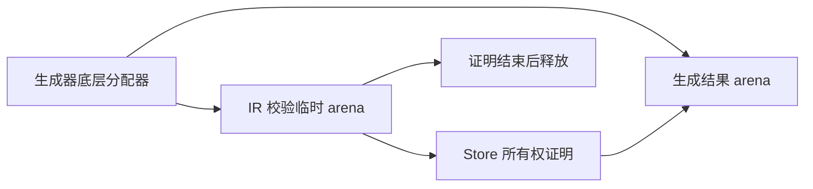

# Store 所有权复用 IR 校验

## Intent · 目标

让应用与 Gateway 生成 Store 时复用 IR 校验已经得到的所有权证明。缩短编译器临时工作区的生命周期，保留合法共享值、独占区域回收和外部工件验证。

## Data · 正式路径

生成 State 前，Source 的 IR 校验已经检查根函数及函数表中的所有权，但原来只传出校验是否成功。随后 `storesOwnValues` 又检查根函数及含 Store 的 ZX 函数，决定生成独占区域回收还是保守共享。第二次证明的工作区，以及本次校验的工作区，原本以生成结果的 arena 为底层分配器。局部释放不能保证这些内存立即归还。

## Edges · 正确性和生命周期

IR 校验继续检查声明的输出所有权，并收集每个函数体的 Store 写入证明。结果为空表示校验失败，合法但存在借用的写入返回 false。原生函数不参与 ZX Store 写入证明。使用可信函数前缀的语义缓存只更新既有的前缀信息，完整校验才提供可用于生成 State 的所有权结果。

只把布尔结果交给 State 生成器。应用与 Gateway 将证明的临时内存交给生成 arena 的底层分配器，供证明结束时回收。初始 seed 继续用原校验和证明，隔离临时分配的边界与正式路径一致。

## Answer · 验收

Store 所有权证明、分配失败、独占与共享区域、跨请求借用、Gateway、库链接和复验、语义缓存与原生引用回归通过 157 个构建步骤、206 项 Zig 测试。另用正常生成的 Gateway 复现连接排队，半开的请求头导致第二条完整请求在 250 ms 内无响应，关闭第一条连接后返回。该样本确认连接队首阻塞。

以 `dadb1f21a` 为固定对照，`722a51afa` 为直接对照。三个 CLI 均用 `7c9b225c3` 的 Source 引导器构建，运行时使用 Source 分析和生成。macOS arm64、Zig 0.17.0、ReleaseSmall 下关闭 zxc 生成缓存，版本交错执行，排除首轮后取八轮中位数。大样本在原有 Gateway 上增加 40 个读取并更新同一 Store 的路由。普通样本和扩展样本的 160 个生成文件，以及两个原生可执行文件，均逐字节一致。

| Gateway 构建          | 墙钟，固定 / 直接 / 候选（s） | CPU，固定 / 直接 / 候选（s） | 系统峰值 RSS，固定 / 直接 / 候选（MB） |
| --------------------- | ----------------------------: | ---------------------------: | -------------------------------------: |
| 普通                  |         1.327 / 1.325 / 1.325 |        1.416 / 1.414 / 1.413 |               211.71 / 211.63 / 211.89 |
| 增加 40 个 Store 路由 |         5.560 / 5.570 / 5.571 |        5.731 / 5.739 / 5.738 |               262.98 / 263.84 / 264.00 |

真实构建耗时接近，峰值由 Zig 后端主导。用核验探针在启动 Zig 后端时截取编译器 RSS，并在执行 Zig 编译前结束采样。预热后取七轮中位数。大样本的编译器峰值 RSS 从直接对照的 85.13 MB 降至 80.87 MB，下降 5.0%。在同一边界采样的 RSS 从 85.11 MB 降至 80.86 MB。普通样本的编译器峰值从 28.66 MB 到 29.00 MB。大样本墙钟从 3.729 到 3.725 秒，CPU 从 3.812 到 3.808 秒。

再用 16 条每次写入独占值的路由核对证明完整遍历的情况。生成的 State 带独占区域回收。与直接对照相比，预热后五轮墙钟中位数从 408.35 ms 降至 396.67 ms，CPU 从 427.09 ms 降至 415.59 ms，编译器峰值 RSS 从 31.42 MB 降至 30.13 MB。固定对照对应 406.62 ms、425.83 ms 和 31.62 MB。

本轮对照覆盖 Gateway 生成和后端调用。完整编译器冷构建未重测。原始测量和回归日志位于 `.zig-cache/verification-tmp/store-proof-reuse/`。
