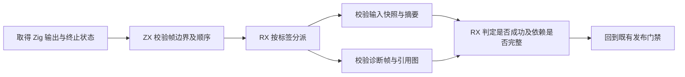
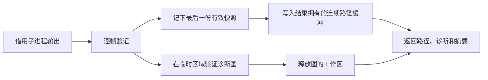

# Zig 后端响应与诊断引用图自举

## Intent · 目标

贯通正式 CLI 的普通 Zig 后端与 `translate-c` 响应读取。迁移协议帧边界、版本检查、终止和结果准入，以及诊断引用图的限制与遍历。保持依赖快照、诊断字节、错误顺序和产物发布门禁。

## Data · 正式调用链

`backend.process.run` 收集 Zig 子进程的两个输出流，随后进入共用的 `backend_protocol`。ZX 逐帧读取长度和标签。RX 显式分派版本、配置、输入快照、摘要与诊断，并据终止状态选择成功结果。普通构建以诊断帧结束，`translate-c` 也可在摘要帧结束。协议测试、真实后端和正式 CLI 使用同一个解码实现。

诊断图以深度优先遍历区分新节点、正在访问与已完成节点。ZX 校验消息、源码位置、引用和字符串范围，按实际展开的引用数以及路径深度限制复杂度。共享子图允许复用已完成的结果，每次引用仍计入展开数。Zig 保留标准库错误包解析、哈希表、工作栈和区域分配。所有线协议布局都在编译时与 Zig 的类型核对。

## Edges · 结果所有权与成本

解码借用整个输出流直至返回。每份输入快照都检查路径前缀和条目边界，只有最终有效帧被写入结果。保留的路径统一存入按有效字节数预留的连续缓冲。空分隔字节和前序快照在校验后即可随响应流释放。结果能脱离子进程原缓冲独立使用，错误包和标准错误文本也由结果持有。

诊断图的边存入一份可增长的连续表。记录只保存各节点边的范围。已完成节点的深度和展开数复用哈希表中的标量。标准库继续负责 I/O、错误包存储格式与诊断渲染。后端输出限额和翻译依赖的合并仍在 Zig 宿主。

## Answer · 验收

整批首次回归共通过 104 个构建步骤、61 项 Zig 测试，覆盖真实后端、发布校验、watch 恢复、C 头文件补齐、NAPI 和 Wasm 协议。路径分配收紧后，后端协议、发布、真实后端和 C 头文件回归通过 96 个构建步骤、61 项测试。诊断图进一步复用新节点的边范围和待写回记录，去掉每节点两次重复的哈希表查找。随后后端协议、真实后端和 C 头文件回归通过 89 个构建步骤、43 项测试。

初始 seed 和已验收的 Source 引导器 `7c9b225c3` 分别生成同一份后端清单。48 个 Zig 文件中 39 个逐字节一致，其余文件统一生成的局部临时变量编号后相同。正式回归使用 Source 生成模块。

macOS arm64，Zig 0.17.0，ReleaseSmall。旧解码器取自 `bca169ffc`，其相关实现与固定对照 `689d854f8` 一致。候选使用上述 Source 引导器生成的协议模块。每组排除首轮预热后，取七轮交错采样的中位数。

| 样本                                             |    墙钟（ms） |     CPU（ms） | 进程峰值 RSS（MB） |
| ------------------------------------------------ | ------------: | ------------: | -----------------: |
| 2,000 份单快照响应，每份 512 条路径              | 22.47 → 25.02 | 21.70 → 24.40 |        2.16 → 2.03 |
| 200 份多快照响应，每份 8 个含 2,048 条路径的快照 | 63.51 → 38.11 | 62.86 → 37.44 |        4.49 → 3.67 |
| 1,000 份诊断图响应，每图 512 个节点              | 37.81 → 37.87 | 37.22 → 37.22 |        2.20 → 2.16 |
| 30 份含 4 MiB 空分隔字节的快照响应               | 30.58 → 28.32 | 29.97 → 27.70 |      10.37 → 10.34 |

前后四组解码结果摘要一致。诊断样本的工作区调整使候选墙钟从原先的 50.49 ms 降至 37.87 ms。单快照样本增加约 2.56 ms，均摊后每份响应增加约 1.28 µs。该测量覆盖响应解码，完整自举冷构建沿用已有阶段记录。原始结果和回归日志位于 `.zig-cache/verification-tmp/backend-source/`。
