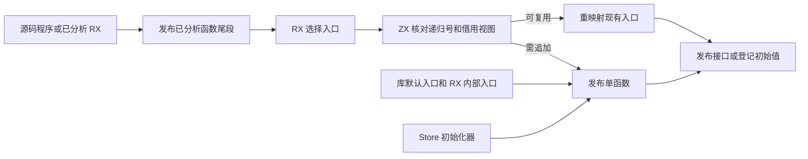
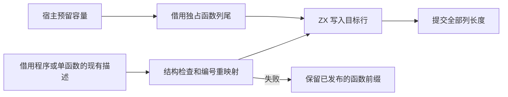

# 入口函数发布自举

## Intent · 目标

迁移源码链接中的入口复用和单函数写入。直接链接的程序、已分析的 RX 模块、库默认入口和 Store 初始值共用正式单函数写入入口。继续使用现有函数列、分配归属和失败语义。

## Data · 正式路径

源码链接先发布普通函数尾段，再决定入口复用最后一行还是追加一行。此前 Zig 调用生成的递归检查后，重新组装 `ir.Function` 并用 `std.meta.eql` 判断两份函数描述是否一致。单函数发布也先在 Zig 为每个字段构造单元素列，再进入批量流程。直接链接的程序在 IR 校验和类型登记中重复验证同一份类型表。

## Edges · 语义与所有权

入口复用仍要求最后一行是非原生的递归入口，文件、端口、所有权、Store 模式、根块、控制指针及其他列描述一致。ZX 复用已验证前缀使用的视图身份比较，按指针及长度检查列，不遍历列上的表达式或契约数据。

需要追加函数时，宿主按原顺序预留一个位置，并借用容量变更后的同一组独占列尾。ZX 直接从借用的函数视图重映射签名和函数体，调用批量路径共用的函数行写入器，成功后提交列长度。原生调用属性也按原接口保留。直接链接的程序通过同一轮 IR 校验后，类型登记复用其结构检查结果，继续检查名义来源、编号范围和冲突。

宿主仍负责从分配后的 Zig 列构造独占尾部、启动生成入口和传递错误。编译库重载已有单独的批量重映射和接口发布流程，本批通过相同回归核对它的兼容性。此前的准备流程见[源码链接共享表准备自举](源码链接共享表准备自举.md)。

## Answer · 验收

当前源码构建初始 Zig seed 的 14 个步骤通过。初始 seed 和 `7c9b225c3` 的 Source 引导器均生成入口复用、单函数写入以及批量写入入口。生成代码在单函数写入中保留独占尾部并就地更新列。

库链接、原生接口、Store 请求分配与失败、语义缓存、类型校验和名义来源通过 189 项 Zig 测试。库重放、独立导入、库发布和 RX 项目集成通过。库发布覆盖独立 ZX 与 Zig 消费者、编译库重载和转发、Store 初始值，及发布失败后保留原产物。

沿用上批的源码库与编译库重发夹具。macOS arm64、Zig 0.17.0、ReleaseSmall。对照与候选均由 `7c9b225c3` 的 Source 引导器构建，执行 Source 分析与生成。直接对照为 `689d854f8`，源码库固定对照为 `6e0cf529f`，编译库重发固定对照为 `fe2b69bd9`。版本按轮交错，关闭发布缓存，排除首轮。

源码库取八轮中位数，五组的 115 个发布文件逐字节一致。

| 源码库             | 墙钟（ms，固定 / 直接 / 候选） | CPU（ms，固定 / 直接 / 候选） | 峰值 RSS（MB，固定 / 直接 / 候选） |
| ------------------ | -----------------------------: | ----------------------------: | ---------------------------------: |
| 混合库             |          40.52 / 40.09 / 39.78 |         37.80 / 37.62 / 37.33 |              25.03 / 25.04 / 25.03 |
| 具名转导出         |             6.96 / 6.84 / 6.83 |            6.51 / 6.30 / 6.43 |                 8.77 / 8.70 / 8.75 |
| 公开常量           |             4.79 / 4.80 / 4.89 |            4.12 / 4.19 / 4.30 |                 7.32 / 7.23 / 7.27 |
| RX 入口共享依赖    |       996.29 / 870.90 / 869.95 |   1209.07 / 1014.89 / 1013.13 |             102.24 / 91.41 / 95.42 |
| 含原生绑定的源码库 |          18.74 / 17.43 / 17.96 |         20.01 / 18.87 / 19.27 |              12.68 / 12.57 / 12.62 |

共享依赖样本的候选峰值 RSS 中位数比直接对照增加 4.01 MB，比固定对照低 6.82 MB。直接对照与候选的峰值采样范围分别为 87.74～95.52 MB 和 88.16～102.89 MB。该场景的 CPU 和墙钟中位数均略降。

编译库重发的普通和原生库各取七轮中位数，多别名取五轮。三组共 272 个发布文件逐字节一致。

| 编译库重发 | 墙钟（秒，固定 / 直接 / 候选） | CPU（秒，固定 / 直接 / 候选） | 峰值 RSS（MB，固定 / 直接 / 候选） |
| ---------- | -----------------------------: | ----------------------------: | ---------------------------------: |
| 普通库     |       0.8034 / 0.8021 / 0.7998 |      0.8607 / 0.8591 / 0.8564 |              86.36 / 73.35 / 73.29 |
| 原生库     |       0.0169 / 0.0180 / 0.0180 |      0.0180 / 0.0188 / 0.0193 |              11.44 / 11.21 / 11.24 |
| 多别名     |       4.9173 / 4.9133 / 4.8899 |      4.9851 / 4.9803 / 4.9558 |              81.33 / 81.02 / 81.05 |

多别名重发的 CPU 比直接对照低约 25 ms，比固定对照低约 29 ms。原生重发的 CPU 比固定对照高约 1.3 ms，单轮样本在毫秒量级。此次测量覆盖源码库发布和编译库重发。完整编译器冷构建未重跑。构建、回归、生成和性能证据见 `.zig-cache/verification-tmp/compiled-install/` 下的 `entry-*` 记录。
