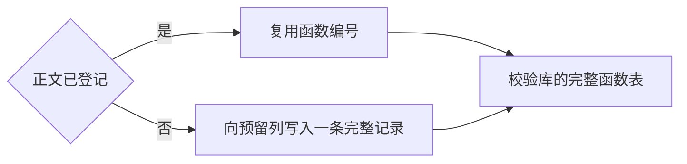

# 公开库函数表批量发布修复

## Intent · 目标

恢复公开 RX 库构建和验证，保证函数表中的每条记录写到最终预留位置。公开 ZX 入口补写函数正文时也复用已迁入 ZX 的发布路径。

## Data · 根因

同一个 RX 入口直接验证成功，登记为库导出后报 `InvalidIr`。探针确认 RX 推导结果和逐条重映射都保留了函数名及输入、输出类型。批量发布后，第二条函数记录的文件名为空，输入类型编号从 `u8` 变成了 `void`。

签名列原来经单独函数返回为不可变的切片。生成 Zig 再将它包装成列视图时使用 `.plain`，循环下一次更新会执行写时复制。发布阶段依然推进原始列的长度，因此读到部分未写入的值。修复后签名和正文都在同一个 ZX 写入步骤更新，保留预留列的存储标记。

## Edges · 所有权和失败边界

公开入口已经位于函数表时继续沿用既有编号。需要补写正文的入口复用同一个批量写入函数，省去 Zig 再分配一份表描述符。列容量、函数表布局、重映射、错误顺序和验证保持原约定。失败只发布已完成的前缀，外层链接失败仍释放整个暂存结果。

## Answer · 验收

公开验证八项全部通过，原先报 `InvalidIr` 的混合 RX/ZX 库已成功用 Z3 验证。同一最小入口经包清单和直接入口两条路径均能发布。库链接、编解码、发布、混合执行、原生链接、验证和验证资源检查合计通过 126 个构建步骤和 97 项 Zig 测试。

同一份包含 16 个 RX 入口和 49 个共享 ZX 文件的库，用关闭生成缓存的 `build --mode lib` 交错测量，预热后取七轮中位数。对照为 `fe2b69bd9` 阶段可正常发布的 Source CLI，因为直接前一版在部分公开 RX 输入上会失败。候选使用 `5c5ee03db` 的 Source 引导器生成，运行 Source 分析和生成。环境为 macOS arm64、Zig 0.17.0、ReleaseSmall。

| 发布库指标 | 可运行对照 |     候选 |
| ---------- | ---------: | -------: |
| 墙钟       |    0.898 s |  0.904 s |
| CPU        |    1.041 s |  1.046 s |
| 峰值 RSS   |   97.98 MB | 94.22 MB |

两版发布的 70 个文件逐字节一致。墙钟和 CPU 分别增加约 7 ms 和 5 ms，峰值 RSS 降低约 3.75 MB。对比覆盖实际库发布，含前端分析和代码生成。
