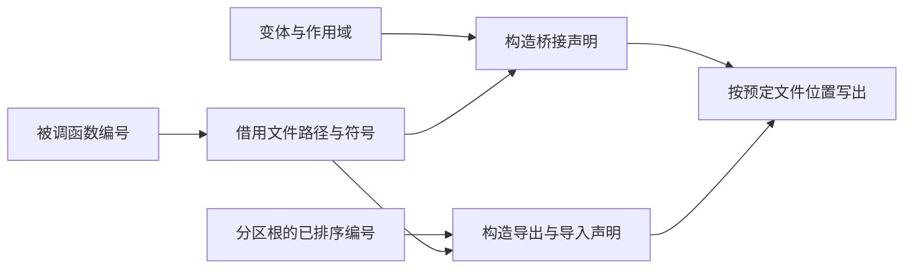

# 分区入口与桥接源码自举

## Intent · 目标

让正式引导器根据同一份分区计划装配函数名、桥接项和分区根 AST。消去写出阶段重复建立的导出表及逐次解析文件名的工作。保持分区布局、符号、输出顺序和初始引导的契约。

## Data · 正式调用链

`shared_output.zig` 调用 `build/partition/layout.zig`。Source 已按调用关系划分成员、计算跨作用域需求并决定目标路径。随后宿主重新穿过 `scopes` 寻找桥接项，从根计划再建两份列表，导出渲染时重新建立对象与指针数组。源文件名及符号在同一轮保持固定，可以借用并供这些入口共用。

## Edges · 借用与宿主职责

函数名是文件名的借用切片。路径、符号和正文长度在装配原始函数树时一并登记，分区计划与两种根生成共用。桥接任务借用分区计划的变体列表，根生成按索引读取同一份路径和名称表。写入字节切片列表的 `memory/columns` 接口复用已有切片描述符写入实现。所有任务结束后才能释放分区计划及输入列。宿主保留扫描及渲染的工作线程调度、分配器桥接、AST 到文本的打印和产物写出。初始种子继续使用已有原生实现。

## Answer · 验收

用 `2f409e7eb` 的 Source 工具构建候选，再用候选重建下一代。两次 16 分区构建各通过 25 个步骤，完成 Zig 编译与链接。初始种子的 lexer 构建通过 14 个步骤。下一代工具独立生成同一分区清单，223 个文件与候选逐字节一致，排除本机输入戳。

相邻两版分别对照平铺与 16 分区的全量和精简输出。删减入口会清理清单内的旧文件，保留未登记文件及内容相同的产物修改时间。移除清单、模拟写入失败并恢复目录后的结果与冷生成一致。常驻生成器在相同目录交替生成完整与精简清单，再恢复完整清单，三次结果均等于独立生成，未变更请求直接复用生成树。

### 性能

macOS arm64，Zig 0.17.0，ReleaseSmall，16 分区。使用相同的 735 个入口和固定基线，三版交错取三轮中位数。对照与候选均由各阶段的 Source 工具生成并运行 Source 分析、生成路径。相邻两版的 11,758 个产物及 v18 唯一性缓存载荷逐字节一致。

| 指标                       | 固定基线 | 上一阶段 |   候选 |
| -------------------------- | -------: | -------: | -----: |
| 冷生成墙钟（秒）           |     2.84 |     2.59 |   2.58 |
| 冷生成 CPU（秒）           |    12.47 |    12.17 |  12.24 |
| 冷生成写出阶段（毫秒）     |      311 |      313 |    316 |
| 冷生成进程树采样峰值（MB） |   885.19 |   699.53 | 698.96 |
| 冷生成单进程系统峰值（MB） |   923.44 |   739.33 | 759.53 |
| 热重建墙钟（秒）           |     2.23 |     1.98 |   1.98 |
| 热重建 CPU（秒）           |     8.50 |     8.26 |   8.28 |
| 热重建写出阶段（毫秒）     |      324 |      303 |    303 |
| 热重建单进程系统峰值（MB） |   934.40 |   700.63 | 700.47 |
| 无修改墙钟（秒）           |     0.04 |     0.04 |   0.04 |

冷生成的系统峰值中位数在三轮对照中上升 20.20 MB。追加四对高频采样后，系统峰值中位数为 716.94 → 726.66 MB，两版的单次峰值范围有重叠。用临时阶段标记再观察三轮，进程的物理内存历史峰值均在分区写出开始前达到，提前 15～63 毫秒。分区写出窗口内的采样峰值 RSS 约为 697 MB。两类数据都保留，未把整进程峰值的波动归因于分区装配。临时标记未进入提交。

以上性能覆盖分析和 Zig 源码生成。原生编译与链接由下一代引导构建另行验证。
