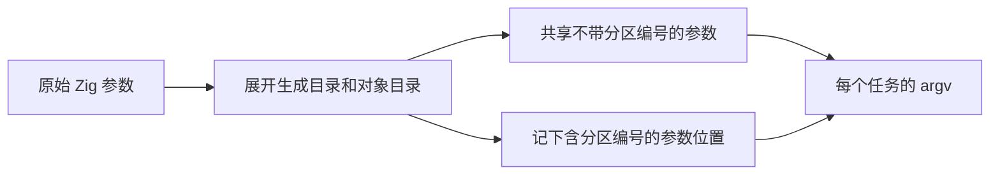

# 分区对象缓存请求与任务调度自举

## Intent · 目标

让分区对象工具由 Source 解释命令行、决定对象位置、准备失效后的编译任务，并按同一顺序处理外部依赖。保留缓存键、状态格式、对象命名和失败恢复行为。减少命中时的额外工作和每个编译任务重复搜索的参数。

## Data · 正式调用链

`parser.zig` 启动 `partition-objects`。此前工具在 Zig 中拆分参数、确定对象名并组织缓存检查与下一次编译，Source 已负责内容摘要编码、分区输入筛选和有效记录的编解码。外部目录路径排序仍在 Zig。

## Edges · 状态与宿主边界

命令行文本使用借用切片。目录遍历将短寿命的条目路径保存在外部输入专用 arena，Source 排序复用这些路径文本，摘要更新后即可释放。编译前已经确认失效的旧记录先原子移除。任务完成后按原分区顺序提交成功记录并报告失败。宿主继续负责文件系统观察、标准整数解析、外部工具进程、线程汇合、原子文件换名与 Blake3 状态。摘要直接编码到最终的小写十六进制数组，省去保存所有二进制摘要的中间表。

## Answer · 验收

沿正式入口用 `7ac9cc89c` 的 Source 引导器构建候选。16 分区的 `bootstrap-stage` 通过 25 个步骤，实际执行新版对象工具、编译并链接。相邻版本生成同一份 host 清单，排除本机输入戳后，67 个文件逐字节一致。

用同一份具有 16 个分区的生成树和真实 Zig 编译命令，对照两版对象工具。冷生成全部分区。全命中保留缓存状态和对象的时间戳。修改分区 3 只重编该分区。删除分区 7 的对象后只重编分区 7。外部目录中超过读缓冲大小的文件变动后重编全部分区。命令行缺失参数及非法计数的错误一致。

分区 3 编译失败时，两版都保留其余有效记录并移除该分区记录。另在子进程写入对象时终止工具与子进程，确认磁盘状态已移除旧记录。恢复旧输入后，两版都补编该分区，结果与正常对象一致。所有对照的对象摘要、缓存状态和工作进程参数逐项一致。

### 性能

固定 735 个公开入口的已生成文件清单，使用上一阶段原生对象工具作为同机对照。两版工具均由 Source 引导器生成 host 规则并通过 `ReleaseSmall` 构建，在 macOS arm64、Zig 0.17.0 下交错运行。相同的外部文件和目录参与摘要。预热后取九轮中位数。

| 场景       | 指标           | 上一阶段 |  候选 |
| ---------- | -------------- | -------: | ----: |
| 全命中     | 墙钟（毫秒）   |     7.26 |  7.41 |
| 全命中     | CPU（毫秒）    |     6.31 |  6.44 |
| 全命中     | 峰值 RSS（MB） |     3.60 |  3.64 |
| 单分区失效 | 墙钟（毫秒）   |    21.40 | 21.49 |
| 单分区失效 | CPU（毫秒）    |    19.68 | 19.79 |
| 单分区失效 | 峰值 RSS（MB） |    17.92 | 17.99 |

单分区计时使用只写入测试对象的工作进程，覆盖摘要检查、参数装配及状态发布，隔离 LLVM 和链接器开销。真实 Zig 对象及链接结果由前述正确性验收覆盖。整仓冷构建耗时未在本批重测。
