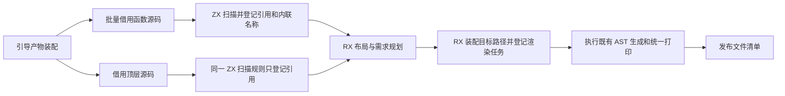
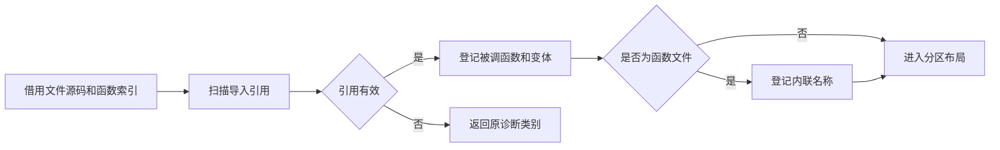

# 分区批量扫描与渲染任务自举

## Intent · 目标

将分区生成的批量源码扫描、扫描结果登记及渲染任务准备迁到 RX/ZX。保留调用图、变体、输出文件顺序和错误处理，减少按文件调用生成入口及领取并行任务的次数。

## Data · 正式调用路径

`build/partition/layout.zig` 位于引导生成器的产物装配和文件清单写出之间。原实现逐个将函数源码交给生成入口，再由 Zig 把被调函数、变体及内联名称登记到三列。顶层文件另用 Zig 循环调用只扫描引用的入口。布局和放置已经由 Source 完成，渲染时仍由 Zig 根据任务序号推导调用的渲染器和目标文件位置。

## Edges · 并行、顺序与借用

函数文件按每批最多八项交给既有工作线程调度。每批用自己的暂存空间，按原索引写入不重叠的列。批内遇到无效导入即停止，宿主按已有规则报告并行扫描的错误。顶层扫描在函数扫描完成后按原序执行，只需要函数引用与变体。

渲染任务与桥接文件、分区根路径在同一遍历登记，引用已有的函数索引、根计划和变体切片。桥接任务使用预定目的行。分区根任务仍依次输出导出入口和函数模块。线程执行和打印由现有 Zig 宿主调度。初始 seed 保留原扫描和布局语义，公用的驱动按批提交任务。

## Answer · 验收

上一阶段构建候选、候选构建下一代引导器，各通过 25 个步骤。下一代生成的 193 个分区文件与候选逐字节一致，输入戳除外。初始 seed 的 lexer 构建通过 14 个步骤，模块生成回归通过 32 个步骤和 23 项 Zig 测试。

相邻两代引导器的完整和精简产物在平铺模式下分别为 82 和 60 个，在 16 分区模式下分别为 193 和 151 个。除随引导器身份变化的输入戳，产物和清单逐字节一致。删减入口保留未变化文件的时间戳，清单缺失及写出失败均可恢复。常驻进程依次发布完整、精简和恢复后的完整产物，结果匹配独立生成。

固定 735 个入口、16 个分区，macOS arm64、Zig 0.17.0、ReleaseSmall。基线与相邻两代均由 Source 引导器构建，实际运行 Source 分析和生成。三轮交错运行取中位数。相邻两代的 11,758 个生成文件和 v18 唯一性缓存载荷逐字节一致，输入戳除外。固定基线的历史文件差异和上一阶段相同。

| 生成器指标               |  固定基线 |  上一阶段 |      候选 |
| ------------------------ | --------: | --------: | --------: |
| 冷生成墙钟               |    3.07 s |    2.58 s |    2.59 s |
| 冷生成 CPU               |   12.45 s |   12.20 s |   12.24 s |
| 冷生成写出               |    306 ms |    313 ms |    308 ms |
| 冷生成进程树采样峰值 RSS | 885.37 MB | 695.04 MB | 695.45 MB |
| 冷生成单进程系统峰值 RSS | 968.20 MB | 767.87 MB | 793.61 MB |
| 热重建墙钟               |    2.22 s |    1.99 s |    2.00 s |
| 热重建 CPU               |    8.53 s |    8.31 s |    8.31 s |
| 热重建单进程系统峰值 RSS | 934.36 MB | 693.49 MB | 693.53 MB |
| 无变化墙钟               |    0.04 s |    0.04 s |    0.04 s |

以上只覆盖分析、生成和写出。相邻两代的墙钟和 CPU 差异小于约定容差。相对固定基线，冷生成墙钟减少 0.48 秒，CPU 减少 0.21 秒。

首轮三对样本的系统峰值中位数增加了约 26 MB。核查这一差异时，以相同输入再交错运行四对冷生成，并约每毫秒采样进程内存，用生成报告和输入戳时间定位写出窗口。系统峰值中位数为 725.98 → 724.52 MB，物理内存历史峰值中位数为 720.73 → 719.22 MB，写出窗口内的 RSS 采样峰值为 694.26 → 694.63 MB。两版的物理内存历史峰值均出现在写出窗口之前。首轮系统峰值差异在追加对照中未复现。
