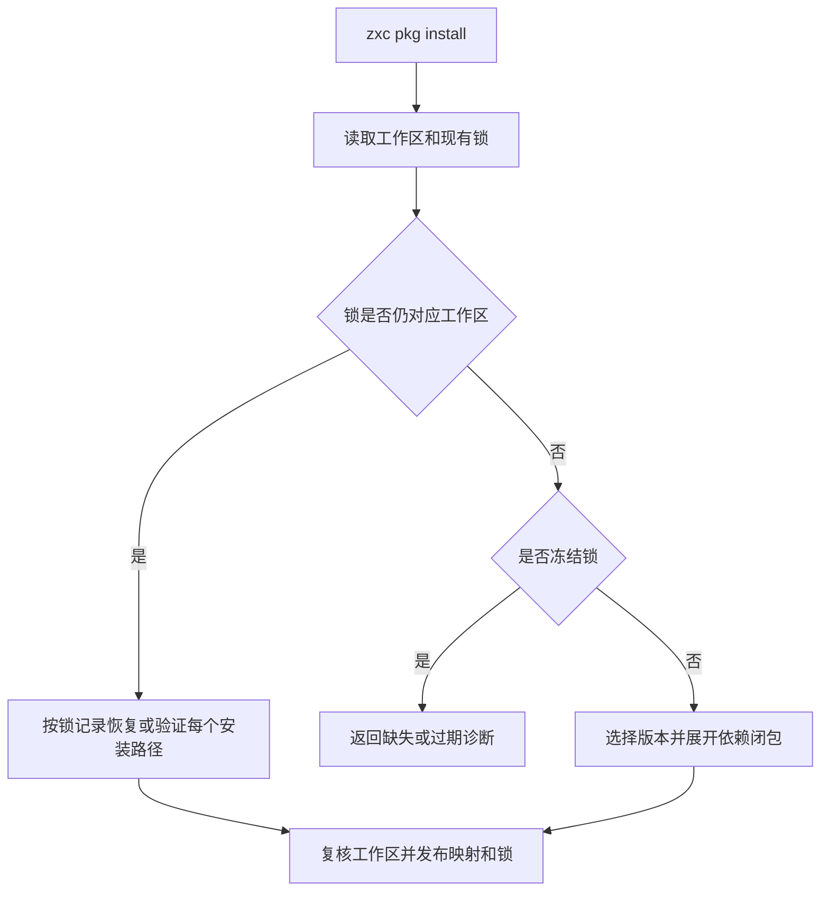
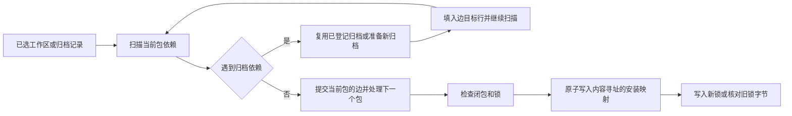

# 包安装解析与锁文件重放自举

## Intent · 目标

从正式 `zxc pkg install` 入口迁移完整的安装编排。覆盖现有锁复用、冻结模式、重新解析工作区与归档依赖、锁文件重放和发布。沿用已迁移的依赖扫描、版本选择、归档去重和锁校验规则。保持输出、错误优先级、锁文件与安装映射的发布顺序。

## Data · 调用链

安装命令原先进入 Zig 的 `install`、`resolve` 和 `replay.prepare`。版本选择和单次依赖扫描已由 Source 执行，外层包遍历、恢复归档后继续扫描、离线重放和末尾发布仍由 Zig 调度。此前迁移的包清单读写提供了无需重新映射字段的 Manifest。现有锁校验和安装图回归覆盖循环、最大深度、归档身份与清单一致性。[包清单记录装配](包清单记录装配自举.md)

## Edges · 语义与资源

新锁先登记工作区成员，再按发现顺序遍历包。扫描遇到归档依赖时先检查现有摘要记录，未命中才定位、准备、解码和校验归档。归档包接在当前尾部，此后按相同顺序参与依赖扫描。开发依赖、重复边、上下限与排序行为沿用已有规则。重放仍使用锁中的来源路径，且重用锁的原始字节。新旧路径都在写入前重新发现工作区。

原来的 Zig 新锁遍历和重放循环已移除。宿主仍持有既有锁记录、索引、归档清单和安装路径的存储，并调用底层文件、归档和 JSON 接口。Source 按行索引驱动这些操作，通过借用视图复用已迁移的包规则。安装入口的结果是一个状态值。真实宿主错误短路并原样返回给 CLI。独立生成清单让安装编排静态绑定这些接口，通用清单和归档部分仍可独立链接。

## Answer · 验收

初始 Zig seed 与 `7c9b225c3` Source 引导器用同一安装清单生成 42 份 Zig 文件。其中 38 份逐字节一致，其余仅局部变量编号不同。生成的闭包遍历和重放以普通循环执行，传递宿主引用与行号。参数及状态结果没有额外的堆分配。

安装、安装监听、包索引、归档、缓存、HTTP 下载、锁图、包清单和原生包九组回归通过。覆盖 104 个构建步骤、95 项 Zig 测试及 2,121 项命令和运行检查。原生包回归同时验证了发布后的包可以再次独立安装。

同一工作区在三个版本下生成逐字节一致的锁与安装路径映射。重放时传入不存在的索引路径，断言离线冻结安装仍然成功，并确认原锁的修改时间保持一致。锁缺失和过期时的退出码与诊断相同，过期锁及其映射保留原样。

三版工具均由 `7c9b225c3` Source 引导器构建，使用 Source 分析与生成。固定对照为 `dadb1f21a`，直接对照为 `6d8e4f85f`。测量环境是 macOS arm64、Zig 0.17.0、ReleaseSmall。按版本轮换，去掉首轮后取九轮中位数。含归档的场景使用同一个已预热的本地缓存。新锁场景移除旧锁和映射，重放紧接同一场景的新锁运行。

| 输入                                | 墙钟 ms（固定 / 直接 / 候选） | CPU ms（固定 / 直接 / 候选） | 峰值 RSS MB（固定 / 直接 / 候选） |
| ----------------------------------- | ----------------------------: | ---------------------------: | --------------------------------: |
| 513 个工作区包，新锁                |      32.153 / 32.305 / 31.689 |     31.476 / 31.479 / 30.961 |             8.471 / 6.767 / 6.816 |
| 513 个工作区包，离线重放            |      28.945 / 28.880 / 28.971 |     28.178 / 28.172 / 28.084 |             8.978 / 7.389 / 7.406 |
| 33 个工作区包和 96 个归档，新锁     |      14.276 / 14.450 / 14.371 |     13.469 / 13.576 / 13.535 |             6.832 / 6.996 / 7.045 |
| 33 个工作区包和 96 个归档，离线重放 |      11.769 / 11.912 / 11.838 |     11.006 / 11.127 / 11.017 |             6.636 / 6.668 / 6.734 |

相对直接对照，墙钟中位数最大增量为 0.091 ms，四项 CPU 中位数均下降，峰值 RSS 最大增加 0.066 MB。相对固定对照，墙钟最多增加 0.095 ms，CPU 最多增加 0.066 ms，峰值 RSS 最多增加 0.213 MB。纯工作区样本的峰值仍较固定对照低约 1.6 MB。上述数据覆盖真实安装命令。完整自举冷构建未在此阶段重新计时。

接下来仍需迁移安装结果装载到编译项目的路径与记录处理，以及宿主保留的安装表操作。日志与生成对照在 `.zig-cache/verification-tmp/package-install-source/`。
