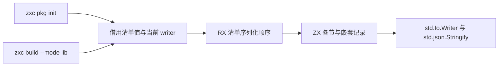
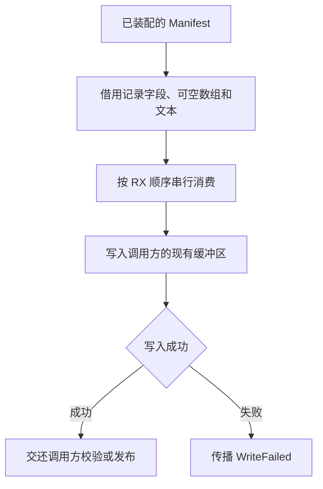

# 包清单写入自举

## Intent · 目标

将包清单的序列化迁入 RX/ZX，覆盖 `zxc pkg init`、源码库发布和已编译库重新发布。保留字段顺序、YAML 字节布局、可空字段行为和文件写入失败语义。

## Data · 实现证据

两个生产入口共用 `manifest/write.zig`。此前该文件决定整个 YAML 布局，并按原生类型的字段顺序将嵌套记录转成内联 JSON。

现在 RX 排定包身份、公开导出、可见性、依赖、工作区、原生接口、外部接口、原生模块以及路径字段的写入顺序。ZX 写入每类字段并遍历原始记录。字段名和读端共用清单常量。嵌套记录逐字段写入当前缓冲区，JSON 标点和转义使用 Zig 标准库。可空列区分缺失与显式空数组，包括空工作区、ABI 别名、包含路径和错误列表。内存适配仅借用原生记录并建立栈上列描述符。

## Edges · 边界

Zig 宿主持有文件 writer、原子替换和回滚，继续使用标准库进行 JSON 基础编码。LibYAML 的文档解析和类型化装配仍由宿主执行。本阶段对照清单写入和库发布，完整自举冷构建及阶段依赖审计属于后续验收。

## Answer · 验收

九组回归目标全部通过，覆盖 95 个构建步骤、2,094 项 CLI 用例及 6 项 Zig 清单资源用例。独立对照在同一工具链下比较了五种完整清单，包含 Unicode、转义、原生声明、空数组和缺失字段。逐一缩小固定缓冲区容量，共核对 2,195 次写入失败和已写字节前缀。

用初始 Zig seed 和 Source 引导器处理同一份 CLI 清单，278 个 Zig 文件的集合一致。232 个逐字节一致，其余只有局部变量编号不同。上一阶段的 136 个生成函数文件逐字节一致。新写入函数内没有生成临时分配调用。

三版 CLI 均由 `7c9b225c3` Source 引导器生成，实际执行 Source 分析与生成。环境为 macOS arm64、Zig 0.17.0、ReleaseSmall。下表按固定基线 `dadb1f21a`、上一提交 `8661a3214` 和本阶段依次列出。每个场景交错运行三版 CLI，取预热后八次的中位数。8 个场景的 326 份产物和命令输出逐字节一致。

| 输入                              |               墙钟 ms |                CPU ms |           峰值 RSS MB |
| --------------------------------- | --------------------: | --------------------: | --------------------: |
| 默认 `pkg init`                   |    1.78 / 1.78 / 1.90 |    1.10 / 1.11 / 1.13 |    3.34 / 3.54 / 3.52 |
| 带入口、版本和可见性的 `pkg init` |    1.83 / 1.84 / 1.77 |    1.10 / 1.11 / 1.10 |    3.36 / 3.57 / 3.56 |
| 发布源码库                        | 17.32 / 17.92 / 18.03 | 18.41 / 19.33 / 19.46 | 12.62 / 12.40 / 12.42 |
| 重新发布已编译库                  | 16.20 / 15.76 / 16.08 | 17.31 / 17.09 / 17.41 | 11.27 / 11.01 / 11.01 |
| 发布含多组原生别名的源码库        | 19.74 / 18.65 / 18.85 | 20.92 / 19.67 / 20.15 | 14.39 / 13.82 / 13.80 |
| 重新发布含多组原生别名的已编译库  | 19.24 / 17.27 / 17.27 | 20.53 / 18.53 / 18.67 | 13.62 / 12.74 / 12.69 |
| 发布含依赖的源码库                | 75.82 / 75.46 / 75.40 | 76.97 / 76.52 / 76.54 | 16.20 / 15.81 / 15.83 |
| 重新发布含依赖的已编译库          | 76.00 / 74.64 / 75.03 | 77.12 / 75.99 / 76.03 | 15.74 / 14.55 / 14.51 |

相对上一提交，端到端墙钟最大增加约 0.39 ms，CPU 最大增加约 0.49 ms，峰值 RSS 最大增加约 16 kB。相对固定基线，墙钟最大增加约 0.71 ms，CPU 最大增加约 1.05 ms。

独立写入对照把旧写入器和本阶段写入器编译到同一可执行文件，复用固定缓冲区，交错测量 64 次写入的总耗时。固定基线与上一提交使用同一份旧写入器源码。两个场景的输出哈希一致。

| 输入                                | 墙钟 ms（原实现 / 本阶段） | CPU ms（原实现 / 本阶段） | 峰值 RSS MB |
| ----------------------------------- | -------------------------: | ------------------------: | ----------: |
| 2,048 项原生模块记录                |              28.30 / 28.75 |             27.59 / 28.02 | 2.88 / 2.88 |
| 原生模块、接口和外部声明各 2,048 项 |              78.88 / 80.42 |             78.19 / 79.65 | 3.60 / 3.60 |

混合场景的 CPU 每次写入增加约 0.023 ms，峰值内存相同。原始结果位于 `.zig-cache/verification-tmp/manifest-write/`，包括 `regression.log`、`smoke.log`、`generation-parity.log`、`writer-parity.log` 和 `comparison.json`。
