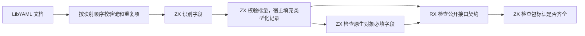
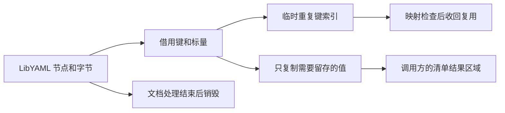

# 包清单字段与校验自举

## Intent · 目标

将 YAML 文档之后的包清单字段分派、标量规则、原生声明必填规则和公开接口契约迁入 RX/ZX。保持 `pkg inspect`、项目装载、安装包、库发布及 watch 的既有诊断和结果。

## Data · 正式调用链

`manifest.parseInto` 在 LibYAML 取得文档后调用包清单解码器。宿主按文件顺序借用节点和位置。字段标识由 ZX 根据所在映射及键名决定，覆盖清单、工作区、编译库导出和原生声明。标量和布尔值由 Source 检查。每个原生对象读完后交给 ZX 校验必填字段，根映射的 RX 先检查公开入口、编译库和导出的一致性，再检查包名及版本是否缺失。

## Edges · 诊断与所有权

保持先校验整个映射的键，再按声明顺序消费值的约定。未知原生 ABI 别名字段仍先校验它的值。根级字段冲突先于包名和版本缺失。所有 Source 错误由宿主使用原 YAML 节点位置报告。

重复检测复用 Source 名称索引，借用 LibYAML 的键文本，映射检查结束后复用索引的临时内存。只有最终清单引用的文本复制到结果区域。YAML 词法与语法、通用 SemVer 解析、C 节点访问和清单记录的存储装配仍经宿主。

## Answer · 验收

八组回归通过，共 86 个构建步骤、6 项 Zig 测试和 2,052 项命令检查。覆盖清单解码与分配失败、工作区、安装与离线重放、原生包、库发布和 watch 恢复。另逐字节对照了 20 个清单，涵盖复合键、显式 YAML 标签、NUL、布尔值、编译库导出冲突、原生字段和 legacy 外部实现。成功结果、错误内容和位置均一致。

初始 seed 和 `7c9b225c3` Source 引导器从同一 CLI 窄清单生成 233 份 Zig 文件。36 份只涉及文件内一致的局部变量重命名，其余逐字节一致。

macOS arm64、Zig 0.17.0、ReleaseSmall，关闭生成缓存。固定基线为 `dadb1f21a`，直接对照为 `3932b47b8`。三版 CLI 均由 `7c9b225c3` Source 引导器构建，运行时执行 Source 分析和生成。版本交错运行，排除首轮后取八轮中位数。11 个场景的 329 份产物逐字节一致。

| 场景                            | 墙钟 ms（固定 / 直接 / 候选） | CPU ms（固定 / 直接 / 候选） | 峰值 RSS MB（固定 / 直接 / 候选） |
| ------------------------------- | ----------------------------: | ---------------------------: | --------------------------------: |
| 源码库，默认配置                |         17.70 / 17.94 / 18.67 |        19.03 / 19.11 / 19.95 |             12.62 / 12.53 / 12.42 |
| 编译库，显式配置                |         15.80 / 15.97 / 15.42 |        17.13 / 17.35 / 16.64 |             11.29 / 10.98 / 11.05 |
| 源码库，大量别名                |         19.79 / 19.28 / 18.55 |        21.05 / 20.43 / 19.88 |             14.44 / 13.92 / 13.86 |
| 编译库，大量别名                |         18.81 / 17.39 / 17.27 |        19.94 / 18.87 / 18.70 |             13.60 / 12.78 / 12.74 |
| 源码库，52 个模块与 142 条依赖  |         75.77 / 75.45 / 75.47 |        77.10 / 76.65 / 76.72 |             16.23 / 15.93 / 15.86 |
| 编译库，52 个模块与 142 条依赖  |         75.83 / 75.12 / 74.37 |        77.15 / 76.30 / 75.75 |             15.82 / 14.76 / 14.62 |
| 源码装载，32 个原生模块         |            3.03 / 2.76 / 2.76 |           2.84 / 2.56 / 2.51 |                7.47 / 7.45 / 7.52 |
| 源码装载，2,048 个原生模块      |           48.41 / 7.79 / 7.15 |          48.13 / 7.51 / 7.05 |             18.05 / 13.76 / 13.34 |
| 源码装载，98 包工作区根入口     |            8.81 / 6.42 / 6.41 |           8.98 / 6.46 / 6.46 |               11.29 / 9.24 / 9.35 |
| 源码装载，98 包工作区成员入口   |           10.87 / 6.04 / 6.08 |          10.76 / 5.99 / 5.93 |               11.24 / 8.90 / 8.90 |
| `pkg inspect`，2,048 个原生模块 |            6.85 / 6.90 / 6.39 |           6.11 / 6.15 / 5.66 |                9.73 / 9.71 / 9.06 |

`pkg inspect` 覆盖清单读取、解析和 JSON 输出。大清单相比直接对照墙钟下降 7.3%，CPU 下降 8.0%，峰值 RSS 下降 0.65 MB。大清单从源码装载到生成 Zig 的墙钟下降 8.2%。源码库默认配置相比直接对照墙钟增加约 0.74 ms，CPU 增加约 0.84 ms。本轮未重测完整自举冷构建。

原始结果位于 `.zig-cache/verification-tmp/manifest-schema/`，包括 `final-regression.log`、`check.log`、`generation-parity.log` 和 `comparison.json`。
