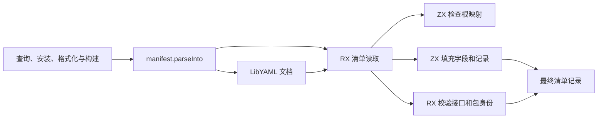
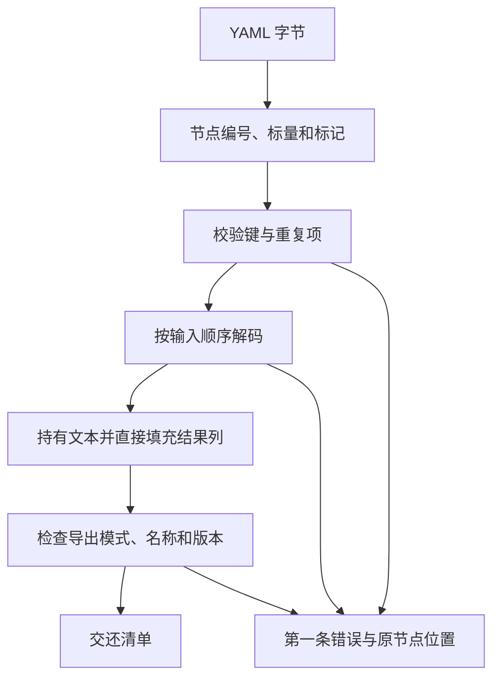

# 包清单记录装配自举

## Intent · 目标

把清单从 LibYAML 文档到类型化包记录的遍历、校验和填充迁入 RX/ZX。覆盖包查询、工作区发现、安装、格式化和库构建共用的读取入口，保留既有记录默认值和第一条诊断。

## Data · 实现证据

`manifest.parseInto` 先打开 LibYAML 文档并交给 Source。RX 依次验证根映射、装配字段、检查公开接口与包身份，再交还结果。ZX 按原始顺序装配普通字段、导出、依赖、工作区，以及原生模块、ABI 别名、原生接口和旧式外部接口。每个映射先验证全部键和重复项，再处理字段内容。原生 ABI 别名保留先检查值、再识别字段的诊断顺序。

ZX 借用 LibYAML 的节点编号数组与标量内容。字符串进入结果前建立一次自有存储，数组按确切长度分配。输出通过借用的列描述符直接填入最终记录。可空列表区分缺失与显式空数组。导出装配同时记录编译模块数，最终检查直接用计数判断是否混用了源文件和编译导出。

初轮原生 ABI 回归收到 `OutOfMemory`。同输入在 Debug Trace 版本通过，ReleaseSmall 探针显示发布步骤实际返回 `IndexOutOfBounds`，此时类型 ID 列表长度为 1，名称列表长度仍为 0。发布现在把调用层提供的模块槽位作为输出位置，接着安装命名空间并提交函数表长度。失败时释放新名称与 ID 列表，恢复两个槽位的空值。原生接口分析和写入仍由 Source 执行。

## Edges · 边界

LibYAML 继续负责 YAML 语法、文档装载、标记与资源释放。Zig 负责列视图绑定、通用键索引、标准库语义版本解析和最终类型描述符交接。包名称沿用 pkgs 的 Source 实现。原生节点返回值借用当前文档，用现有的类型形状参数明确 ABI。文档关闭后，交还的字段只引用结果分配器持有的存储。完整自举的依赖审计和冷构建验收属于后续工作。

## Answer · 验收

清单、工作区、格式化、安装和库读取的相关回归覆盖 2,199 项 CLI 用例。首轮失败的三组原生场景使用修复后的 CLI 单独补验，包括全部 15 项原生 ABI、安装包和库发布用例，均通过。修复后的清单资源测试覆盖 6 项 Zig 用例，其中包括分配失败和输入所有权。

另用修复后的 CLI 对照 126 份输入，包括 84 份有效清单和 42 份无效输入。输出、诊断与退出状态一致。初始 Zig seed 与 Source 引导器对同一 CLI 清单生成 306 份 Zig 文件，其中 250 份逐字节一致，其余差异仅为局部变量编号。清单结果直接引用最终存储，生成入口无需额外分配中间记录。

三版 CLI 均由 `7c9b225c3` Source 引导器生成，并运行 Source 分析与生成。环境为 macOS arm64、Zig 0.17.0、ReleaseSmall。固定基线 `dadb1f21a`、上一提交 `4503fbb1b` 和本阶段依次列出。每个场景交错运行三版 CLI，预热后取八次中位数。12 个场景的 331 份产物逐字节一致。

| 输入                            |               墙钟 ms |                CPU ms |           峰值 RSS MB |
| ------------------------------- | --------------------: | --------------------: | --------------------: |
| 发布源码库                      | 18.42 / 19.30 / 18.46 | 19.46 / 20.33 / 19.41 | 12.55 / 12.40 / 12.44 |
| 重新发布已编译库                | 17.43 / 16.29 / 15.64 | 18.76 / 17.72 / 17.08 | 11.27 / 10.99 / 11.06 |
| 发布含原生别名的源码库          | 18.60 / 19.56 / 18.10 | 20.03 / 20.89 / 19.50 | 14.43 / 13.81 / 13.84 |
| 重新发布含原生别名的已编译库    | 18.16 / 18.32 / 18.00 | 19.31 / 19.20 / 19.37 | 13.60 / 12.72 / 12.75 |
| 发布含依赖的源码库              | 76.04 / 75.64 / 75.32 | 77.04 / 76.74 / 76.46 | 16.21 / 15.82 / 15.88 |
| 重新发布含依赖的已编译库        | 76.37 / 75.00 / 75.33 | 77.27 / 76.09 / 76.36 | 15.79 / 14.52 / 14.53 |
| 装载 32 个原生模块并生成 Zig    |    2.97 / 2.81 / 2.74 |    2.81 / 2.58 / 2.53 |    7.47 / 7.43 / 7.59 |
| 装载 2,048 个原生模块并生成 Zig |   49.69 / 7.46 / 7.54 |   49.16 / 7.32 / 7.32 | 18.04 / 13.21 / 13.38 |
| 装载 98 包工作区根入口          |    8.88 / 6.60 / 6.50 |    9.04 / 6.77 / 6.58 |   11.26 / 9.22 / 9.39 |
| 装载 98 包工作区成员入口        |   10.93 / 6.11 / 6.27 |   10.90 / 5.99 / 6.09 |   11.26 / 8.80 / 8.98 |
| 含原生导入的源码生成            |    3.24 / 3.23 / 3.12 |    3.04 / 2.97 / 2.92 |    8.02 / 8.01 / 8.13 |
| `pkg inspect`，2,048 个原生模块 |    6.79 / 6.36 / 6.37 |    6.11 / 5.61 / 5.62 |    9.73 / 9.08 / 9.08 |

相对上一提交，场景中的最大墙钟增加为 0.33 ms，最大 CPU 增加为 0.27 ms，最大峰值 RSS 增加为 0.18 MB。直接读取大型清单的 RSS 与上一提交相同。装载同一份大型清单并生成 Zig 的墙钟为 7.54 ms，固定基线为 49.69 ms。含原生导入的生成从 3.23 ms 降到 3.12 ms。此对照覆盖清单所在路径，完整自举冷构建仍需独立验收。

原始结果收录于 `.zig-cache/verification-tmp/manifest-decode/` 的 `regression.log`、`fix-regression.log`、`logged-finalize.log`、`generation-parity.log`、`parity.json` 和 `comparison.json`。
