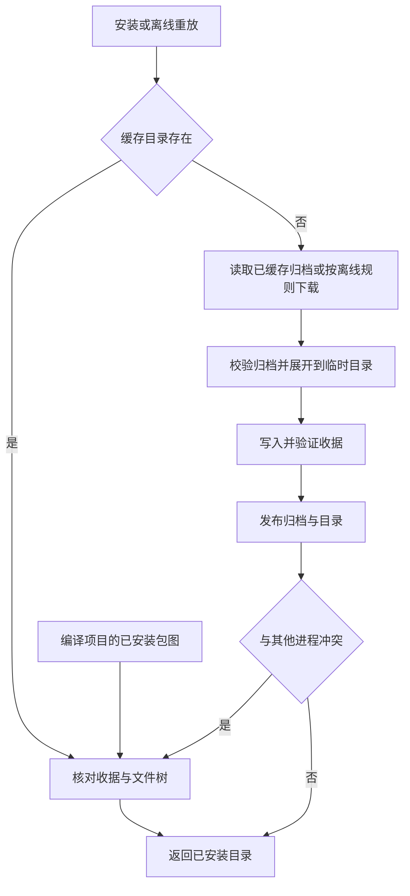

# 包缓存归档与收据自举

## Intent · 目标

把安装、离线重放和编译包图共用的缓存内容检查迁入 RX/ZX。覆盖缓存命中、新归档展开、收据生成与重新校验、原子发布及并发发布冲突。沿用已有的 gzip、tar 和路径规则。

## Data · 正式路径

`pkg install` 和离线重放都调用 `package_store.prepare`。项目依赖图用同一个收据验证入口。原先 Zig 负责选择已缓存目录、读取缓存归档或下载、逐条提取、走访目录及处理发布冲突。迁移后，RX 展示各阶段和失败分支，ZX 执行条目选择、限制检查和收据与目录的逐项比对。

## Edges · 生命周期和错误顺序

归档先完成 gzip、tar 结构和容量校验。提取阶段继续借用 Zig 标准库 tar 迭代器的当前条目。ZX 决定路径归一化、目录或文件处理及重复路径拒绝。普通文件依然边写入边计算 SHA-256。收据先校验版本、归档摘要、路径和重名，再检查目录内容、执行权限、总字节上限和每个文件的摘要。

Zig 保留文件、目录和迭代器句柄，提供压缩流、哈希、JSON 和原子文件系统操作。以斜杠为分隔符的平台直接借用遍历器当前路径进行查表。其他平台按原规则转换路径分隔符再查表。校验中止时，按迭代器的释放接口关闭仍在遍历栈内的目录，然后释放缓冲区。原生操作失败时透传原错误。现有独立归档、缓存及 HTTP 测试共用正式缓存模块。

## Answer · 验收

归档、缓存、HTTP、安装、安装监听、原生包和编译包七组回归通过。覆盖 97 个构建步骤、59 项 Zig 测试和 49 项命令与并发检查。初始 Zig seed 与 `7c9b225c3` Source 引导器生成相同的 60 份 Zig 文件，其中 57 份逐字节一致。其余仅局部变量编号不同。生成的阶段编排、归档遍历和收据遍历未增加堆分配。

三版工具逐次核对锁文件、安装映射、收据、归档摘要、每个提取文件的内容和执行权限。包图输出逐字节一致。离线重放先移除已提取目录，再由原缓存归档恢复相同产物。并发测试使用真实本地 HTTP 服务，四个进程同时下载并收敛到同一份已验证缓存，随后离线复用期间没有追加请求。

测量环境为 macOS arm64、Zig 0.17.0、ReleaseSmall。固定对照是 `dadb1f21a`，直接对照是 `2423fe096`。三套工具均由 `7c9b225c3` Source 引导器构建，运行时使用 Source 分析和生成。各场景在同一路径轮换运行，去掉首轮后取七轮中位数。小文件归档包含 1,024 份 128 B 数据文件及包清单，宽输入归档包含 16 份 256 KiB 文件及包清单。

| 场景                 | 墙钟 ms（固定 / 直接 / 候选） | CPU ms（固定 / 直接 / 候选） | 峰值 RSS MB（固定 / 直接 / 候选） |
| -------------------- | ----------------------------: | ---------------------------: | --------------------------------: |
| 小文件，首次安装     |      61.681 / 62.138 / 61.323 |     60.141 / 60.441 / 60.036 |             7.619 / 7.815 / 7.799 |
| 小文件，缓存目录命中 |      15.159 / 15.260 / 15.285 |     14.272 / 14.152 / 14.281 |             4.424 / 4.653 / 4.653 |
| 小文件，离线恢复归档 |      61.506 / 61.494 / 61.177 |     59.724 / 59.575 / 59.523 |             7.520 / 7.799 / 7.782 |
| 小文件，包图读取     |      14.619 / 14.338 / 14.511 |     13.799 / 13.635 / 13.664 |             4.375 / 4.506 / 4.489 |
| 宽输入，缓存目录命中 |         4.570 / 4.720 / 4.625 |        3.751 / 3.751 / 3.788 |             4.096 / 4.325 / 4.309 |

相比直接对照，墙钟最大增量为 0.173 ms，CPU 最大增量为 0.129 ms，峰值 RSS 持平或下降。小文件首次安装墙钟减少 0.815 ms。相对固定对照，最大墙钟、CPU 和峰值 RSS 增量分别为 0.126 ms、0.037 ms 和 0.262 MB。测量覆盖本地缓存操作，HTTP 的并发和失败行为由回归覆盖。完整自举冷构建仍待阶段验收。

宿主仍提供通用目录与 tar 迭代、字节流、哈希及文件句柄，标准库 HTTP 请求和下载尚在 Zig 路径。原始验收记录保存在 `.zig-cache/verification-tmp/package-cache-source/`。
