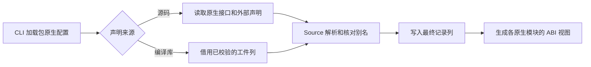
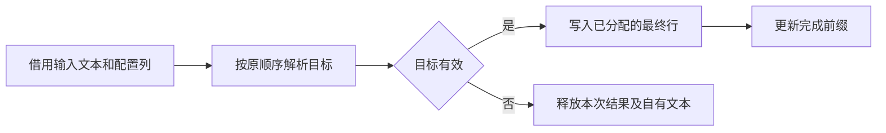

# 原生 ABI 别名批量发布自举

## Intent · 目标

让源码包和已编译库的原生 ABI 别名都由 RX/ZX 解析、校验并写入最终记录。保留包隔离、名称顺序、重复映射规则和失败回滚。

## Data · 正式路径

CLI 加载每个包的原生配置时，根据包是否携带已编译工件选择原生声明表。此前源码包在 Zig 里解析并去重，编译库在 Zig 中循环调用单条 Source 判定，再改写身份、扩容和追加记录。现在两种输入走同一个 RX 入口，以原有规则选择别名并共用写入。

## Edges · 所有权和兼容边界

源码配置的同名同目标映射合并，同名不同目标报冲突。显式配置仍优先取最后声明的身份。编译库默认暴露非标准声明名，仍拒绝默认重名，显式配置保留原顺序。显式空数组仍得到空别名集合。已有原生模块的 Zig 路径、头文件和依赖加载继续使用原宿主入口。

源码别名借用作用域的名称和目标。编译库结果继续拥有重定位后的目标，默认名称也独立持有。ZX 直接写最终记录，出现分配失败时，宿主按已写入前缀和当前待写目标释放内存。旧流程仅用于初始 seed。

## Answer · 验收

八组回归通过 115 个构建步骤和 46 项 Zig 测试。额外通过 10 项公开 ABI 别名检查和四项安装包检查，覆盖同名原生模块相互隔离、标量及对象 ABI、重发后独立安装、空配置、未知目标、冲突和失败后保留产物。专项清单以 `7c9b225c3` 的 Source 引导器生成并编译正式入口。

三套 CLI 均用同一 Source 引导器构建并执行 Source 分析、生成。macOS arm64、Zig 0.17.0、ReleaseSmall，关闭 zxc 生成缓存。交错执行，丢弃首轮后取八轮中位数。固定基线为 `dadb1f21a`，直接对照为 `cbc267cf6`。五组共 95 个发布文件逐字节一致。大量别名组使用两个原生接口，各配置 129 个名称。

| 发布场景         | 墙钟，固定 / 直接 / 候选（ms） | CPU，固定 / 直接 / 候选（ms） | 峰值 RSS，固定 / 直接 / 候选（MB） |
| ---------------- | -----------------------------: | ----------------------------: | ---------------------------------: |
| 源码包，默认配置 |          18.38 / 18.25 / 18.06 |         19.76 / 19.56 / 19.24 |              12.57 / 12.50 / 12.37 |
| 源码包，大量别名 |          20.58 / 19.22 / 18.93 |         21.88 / 20.59 / 20.34 |              14.44 / 14.31 / 14.20 |
| 编译库，显式配置 |          16.13 / 16.20 / 15.86 |         17.46 / 17.59 / 17.34 |              11.28 / 11.13 / 10.99 |
| 编译库，大量别名 |          18.14 / 18.77 / 18.57 |         19.37 / 20.27 / 20.07 |              13.59 / 13.46 / 13.30 |
| 编译库，默认配置 |          10.55 / 10.68 / 10.63 |         10.14 / 10.15 / 10.19 |                 8.52 / 8.36 / 8.22 |

大量别名重发较固定基线增加约 0.43 ms 墙钟和 0.70 ms CPU，较直接对照两项均下降。各样本的峰值 RSS 中位数都低于固定和直接对照。测量覆盖库发布和重发。整仓冷自举未纳入此批对照。原始记录在 `.zig-cache/verification-tmp/native-alias-publication/`。
